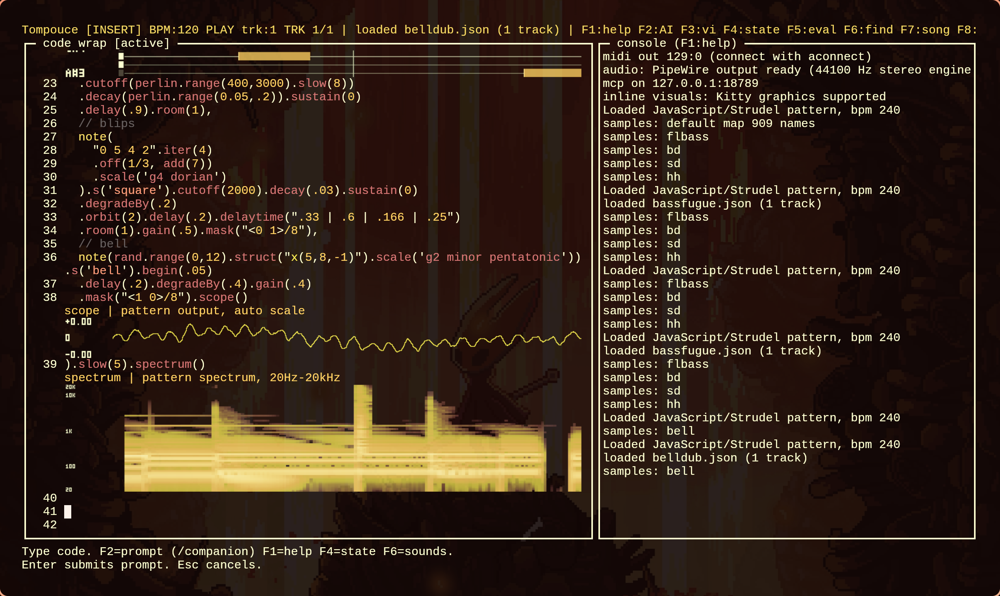

# Tompouce

Source: [ekollof/tompouce](https://github.com/ekollof/tompouce) (private repository).
Access requires a GitHub account with permission to this repository.

A terminal live-coding environment for music, inspired by Strudel, built in C.



## Install

Clone the complete project and install on Linux x86_64:

```sh
git clone git@github.com:ekollof/tompouce.git
cd tompouce
./install.sh
~/.local/bin/tompouce
```

Alternatively, use `gh repo clone ekollof/tompouce` with an authenticated GitHub
CLI. The checkout includes the bundled runtimes, vendored dependencies and
examples; the installer downloads the sound banks separately.

The installer supports Arch/Omarchy, Debian/Ubuntu and Fedora. Run it as your
normal user; it uses sudo only for distro packages. It installs build libraries,
Chromium when needed, a private pinned Csound 7, and a compatible private
tree-sitter when the distro library is too old. It builds in a temporary directory
and installs the binary, companion assets, licenses and examples under
`~/.local/lib/tompouce`, with a command in `~/.local/bin`. No Node/npm is
needed for installation: both JavaScript bundles are included in the project.

Default sound banks: Dirt-Samples, Salamander piano, tidal drum machines and
uzu-drumkit (roughly 450 MiB). They are installed beside the binary and work
offline. `./install.sh --all-banks` also installs the VCSL and mridangam catalog
samples (roughly 3 GiB total). Repository revisions are pinned in
`scripts/banks.lock.json`; downloaded files get SHA-256 receipts for safe resume,
and upstream README/license files are retained. Existing modified sound files
are not silently overwritten. Eight VCSL manifest paths omit a directory prefix;
the installer fetches the original files from their pinned actual locations while
preserving the manifest's local sample names and slot order.

Use `./install.sh --dry-run` to inspect the plan, `--prefix /absolute/path` for
another installation, `--skip-deps` for preinstalled system packages, or
`--no-browser` for terminal-only use. `--skip-banks` is available for build-only
setups. `--csound-prefix /path` reuses existing Csound 7 headers/libraries.
Installation needs HTTPS access and a UTF-8 terminal. Examples are in
`~/.local/lib/tompouce/examples`; press Ctrl+O to load one. Press F2 and enter
`/companion` to launch the Chromium companion. The installer leaves existing
editor settings, sessions and live processes alone. If `~/.local/bin` is absent
from PATH, use the absolute command shown above.

The installer verifies the JavaScript grammar and decodes installed piano,
TR909 and uzu samples with networking disabled before reporting readiness.
`python3 tests/test_install.py` tests plans, confinement, receipts and resume;
the fresh-install and repeat-install flows are also exercised on Arch/Omarchy.
Debian/Ubuntu and Fedora package plans have unit coverage; their package-manager
execution still needs testing on those distributions.

## Components

- `src/audio.c` — PortAudio real-time synth + drum voices
- `src/pattern.c` — mini-notation parser (`* ! @ / ?`, euclid, `{}`, `<>`, rests)
- `src/strudel.c` — statement lines (`note("c e").s("saw").lpf(800)`, `setcpm`)
- `src/slider.c` — `slider()` live values (source text stays put)
- `src/harmony.c` — Strudel chord symbols, scales, and scale degrees
- `src/scheduler.c` — cycle-based scheduler with event queue
- `src/track.c` — code-to-tracks compiler
- `src/ai.c` — LLM-assisted code generation (OpenAI-compatible)
- `src/tui.c` — S-Lang terminal interface (editor, console, AI prompt)
- `src/wavetable.c` — procedural bandlimited single-cycle tables (`inst wt:<name>`)
- `src/mcp.c` — MCP JSON-RPC server + UI orchestration
- `src/csound_host.c` — isolated native Csound orchestra renderer

## Docs

- [`docs/examples.md`](docs/examples.md) — copy-pasteable example gallery
- [`docs/architecture.md`](docs/architecture.md) — module map, data flow, threading, limits
- [`docs/acceptance.md`](docs/acceptance.md) — manual acceptance test checklist
- [`docs/javascript.md`](docs/javascript.md) — upstream JavaScript Strudel runtime,
  native C audio coverage, imports, live highlighting, and remaining limits
- [`docs/audio-comparison.md`](docs/audio-comparison.md) — repeatable browser/native captures

## Build

```sh
make
```

Requirements: `slang` (S-Lang), `portaudio-2.0`, `libcurl`, `libcjson`, `leveldb`,
ALSA and `tree-sitter` development libraries.
`xxd` embeds the committed JavaScript bundle during the build. QuickJS is
vendored; Node.js is only needed when rebuilding the JavaScript bundle.

For `.csound()`, `loadCsound()` and `loadOrc()`, install Csound headers/library.
The current upstream livecode orchestra requires Csound 7. On Linux x86_64,
`bash scripts/install-csound7.sh` installs a pinned engine under `~/.local/opt`
without replacing system libraries; then run `make clean && make`.

`make test` includes all 31 official Strudel examples with stored event
expectations, plus native Csound rendering checks. See
[`tests/fixtures/README.md`](tests/fixtures/README.md) for provenance and limits.

## Run

```sh
./tompouce
```

For a Chromium companion with voice activity, transport, tempo, console and
source editing, press F2, type `/companion`, and press Enter. Stop its helper
with `/companion stop`; it also exits with the engine. The companion is
loopback-only; audio stays native. Standalone launching via
`python3 scripts/companion.py --open` remains available.

The companion and F6 share a categorized sound catalog with sample counts,
search, and source snippet insertion. In F6, choose **import-sounds**, type or
paste a folder path, then press Enter; the companion offers a folder chooser.
WAV, MP3 and FLAC files are copied to the config directory’s
`tompouce/sounds/` storage and appear under **user** after import and on
future starts. Each folder becomes a sound name, with alphabetical file slots
(`s("my_drums:0")`). Importing the same filename replaces its slot; explicit
`samples()` maps take precedence. Limits: 8 MiB per file, 256 MiB / 2048 stored
files, 256 sound names. Local bank browsing remains available in F6.

The editor’s bottom mini scope and piano roll can be hidden with F2 →
`/scope off` (restored with `/scope on`). This preference persists across
restarts. F12 controls the separate large visualization pane.

Append `._scope()`, `._pianoroll()`, `._punchcard()`, `._spiral()`,
`._pitchwheel()`, `._spectrum()` or `._wordfall()` to a pattern for a visualization
inline beneath that source line, then evaluate. Scope shows that pattern’s
native voices before shared bus/master effects; spectrum analyzes that same
isolated signal. Note views follow downstream changes and show
recent/held/upcoming notes over four cycles on the actual playback timeline.
`tscope` is a scope alias. The spellings without `_` also render inline.
Widgets scroll with code and stay out of the
editable text. F2 → `/inline off` hides them; `/inline on` restores them.

Terminals supporting the Kitty graphics protocol automatically get pixel
waveforms, note views, pitch wheels, spirals and spectra, targeting 60 FPS while visible.
Quiet scopes scale to the signal;
the piano roll distinguishes sounding notes and shows pitch/time guides.
Graphics piano rolls use eight rows, separate overlapping notes of the same
pitch into lanes, and mark each onset so repeated notes remain distinct.
Their y-axis includes octave-labelled notes and a keyboard guide. Waveform
scopes label linear amplitude on the y-axis, using the current auto-scaled
range. Labels reserve their own gutter so they do not cover the plots.
Other terminals retain braille. F2 → `/graphics braille` selects braille;
`/graphics auto` restores automatic detection. This preference persists.
Graphics defaults follow the terminal palette, including guides and labels.
Tompouce checks for theme changes every five seconds; explicit pattern and
visual-option colors take precedence. Terminals that do not answer color
queries keep the built-in fallback palette, with a transparent background.
Direct tmux/screen sessions retain braille. The separate F12 pane also retains
its text display.

Keys:
- `Tab` — indent two spaces (selected lines as a block); `Shift+Tab` — unindent; `Ctrl+Space` — complete a legacy keyword.
- Type code in the editor (left pane).
- `F5` — evaluate code (`Ctrl+R` also evaluates outside vi normal mode)
- `Ctrl+P` — play / stop
- `F1` — toggle language cheatsheet over the console pane (`PgUp`/`PgDn` scroll)
- `F2` — AI prompt (supports `/bpm N`, `/play`, `/stop`, `/clear`, `/save`, `/load`, `/song`, `/rescan`)
- `F4` — toggle internals/state pane: editor mode, pending evaluation/unsaved
  changes, undo history, engine generations, graphics/inline status, audio/MIDI,
  sample-bank index, song/hold state, voices, queue and per-track timing.
- `F3` — toggle vi editor mode; motions, operators and search are listed below
- `Ctrl+Space` — context-aware completion (keywords, notes, drums, transforms, `wt:` tables)
- `F6` — browse samples, drum-machines, synths, wavetables and user sounds. Type to search; Left/Right changes category; Enter inserts a snippet at the source cursor. Backspace with an empty query returns to categories. The local-banks category preserves folder browsing (`Enter` descends, `Tab` uses a bank).
- `F7` — song mode: play track buffers in sequence from track 0 (`/song [on|off|hold]`)
- `F8` — hold current track (loop it inside song mode)
- `F9` — track list pane (shows buffers, active highlighted)
- `F10` / `F11` — narrow / widen the code pane
- `F12` — piano roll + braille scope pane (per-voice pitch bars, live output scope)
- `Ctrl+Left` / `Ctrl+Right` — nudge the `slider()` under the cursor (or the first slider). The source literal stays; F5 applies the new value. The code pane also draws a one-row roll of the cursor line and a one-row scope when it is tall enough.
- `Ctrl+T` — copy entire buffer to a new track (next in list)
- `Ctrl+N` / `Ctrl+B` — next / previous track (loads into editor)
- `Ctrl+D` — duplicate current line (vi `yy`+`p` does this too)
- `Ctrl+S` / `Ctrl+O` — save / load the whole song (all tracks) via a file picker (`/save [path]`, `/load <path>`)
- `Ctrl+Q` — quit (session auto-saved to `~/.config/tompouce/state.json`)
- Arrows / Enter / Backspace — edit

Editor selection and mouse:
- Shift+arrows / Shift+Home / Shift+End extend a selection; Ctrl+A selects all.
- Ctrl+C copies, Ctrl+X cuts, Ctrl+V pastes using the editor's internal clipboard.
- In vi normal mode, `v` selects text and `V` selects whole lines. Move with
  `hjkl`, arrows, `gg`, or `G`; `y` copies, `d` cuts, and `p`/`P` paste.
- Left-click positions the cursor; drag selects text. Click or drag a slider
  bar to set its live value. Click the right pane to focus it, or a song track
  row to load that buffer. Click the prompt row to enter a command.
- The wheel moves through code or scrolls the console/cheatsheet. Escape returns focus
  to the editor. Hold Shift for your terminal's native mouse selection.
- Terminal paste uses bracketed paste, so multiline text is inserted as text.

Optional startup settings live in `$XDG_CONFIG_HOME/tompouce/config.json`
(default `~/.config/tompouce/config.json`):

```json
{
  "vi_mode": true,
  "mouse": true,
  "kitty_graphics": true,
  "split_ratio": 0.6
}
```

Defaults are non-modal editing, mouse enabled, and a 60% code pane.
`split_ratio` accepts 0.3–0.85; invalid settings leave defaults intact.
F3 switches vi mode and saves the choice for future sessions. Vi mode starts
in normal mode after a restart. Escape leaves vi insert mode
when vi mode is enabled and clears selections in non-modal mode.

Vi normal mode supports:

- Counts such as `5w`, `3dd`, `2d3w` and `12G` (capped at 9,999).
- `h/j/k/l`, `w/b/e`, `W/B/E`, `0`, `^`, `$`, `gg`, `G`, `{` and `}`.
  `^` moves to the first nonblank character. `j/k` and `gj/gk` follow wrapped
  editor rows, skipping inline visualisations; operator `dj/dk` uses whole lines.
- `f/F/t/T` plus an ASCII character, `;` to repeat and `,` to reverse the find;
  `%` matches nested literal parentheses, brackets and braces.
- `d`, `c` and `y` with motions or text objects: `dw`, `ce`, `y$`, `diw`,
  `daw`, `ci"`, `da(`, `di[` and `ci{`. Word/WORD, quotes and bracket objects
  also work in visual selection. Quote objects stay within a logical line.
- `dd/cc/yy`, `D/C/Y`, `x/X`, `s`, `r`, and counted `p/P`.
  `c`-operator deletion and following typing form one undo step within the usual
  typing run; `u` undoes and `Ctrl+R` redoes.
- `/text` and `?text`, Enter to search, `n/N` to repeat, and `*/#` for a
  whole-word search. Search is literal, wraps the buffer, and Escape cancels.
- `i/a/I/A/o/O` and `v/V`; Escape returns to normal mode. Horizontal character
  motions and deletion respect UTF-8 code-point boundaries.

Application shortcuts (including playback, sliders, track switching, clipboard,
save/load and Ctrl+D duplication) retain their existing meanings. This is a
native vi subset: regex search, Ex commands, macros, named registers, marks,
block visual mode and dot-repeat are not implemented.

Editor regression checks: `make test` covers buffer edits and selection bounds;
`python3 tests/test_tui_pty.py` checks real terminal input, mouse reports,
startup configuration, paste, and terminal restoration on quit and signals.

Flags: `--bpm N`, `--block N` (audio frames 64–4096), `--code '...'`,
`--mcp-port N` (TCP instead of stdio), `--mcp [--ui]`, `--help`.

Mini-notation also has `tok!N` (replicate), `tok@N` (elongate), `tok/N` (slow across cycles; `| slow` still means every Nth cycle), `tok?` (degrade), `bd(3,8)`, `{a b, c d}`, and `a|b` choice inside a pattern. A line may be a call instead: `s("bd sd").gain(slider(0.5))`, `setcpm(45)` (BPM = cycles per minute × 4).

Language extras follow [Strudel](https://strudel.cc) names: comma chords (`c4,e4,g4`),
`n` / `chord` with ireal symbols (`Cm7`, `C^7`), `| scale C:minor` (degrees, root octave 3),
`| arp 0 1 2`, `| sound sawtooth`, `| adsr .01:.1:.6:.2`, `| lfo freq 4 1`, `| vib 4:.1`,
`| transpose N`, `| lpf Hz`. Also `s <bank-path>`, `fx drive|cutoff|delay|verb X`,
`euclid`, `every`, `| shuffle`, `| degrade`, `| mute`, `| solo`, `| midi CH`.
Pink and brown are aliases of white noise. `| lpf` is per voice; `fx cutoff` stays the master filter.
Session auto-restores on launch; `/rescan` picks up added banks.

Example code:

```
bpm 128
drum bd sd [bd bd] sd
drum hh hh hh hh | fast 2
bass c2 e2 g2 c3 | rev
lead c4 e4 g4 c5
```

AI uses `OPENAI_API_KEY` (and optional `OPENAI_BASE_URL`, `OPENAI_MODEL`). Without a key, offline templates are used.

### AI data egress
When `OPENAI_API_KEY` is set and the network library initializes, the AI prompt **and the current code buffer** are sent to the configured `OPENAI_BASE_URL` endpoint. Do not put secrets in the code buffer. Point `OPENAI_BASE_URL` at a local model if you need to keep data on-host. If curl initialization fails, AI silently falls back to offline templates.

## MCP (external agents)

Run as an MCP server over stdio:

```sh
./tompouce --mcp
```

Tools: `music_set_code`, `music_evaluate`, `music_play`, `music_stop`, `music_set_bpm`, `music_get_status`, `music_get_code`, `music_get_console`, `music_ai`, `music_song`, `music_track`, `music_session`, `music_health`, `music_debug`. Example Claude Code config:

```json
{
  "mcpServers": {
    "tompouce": {
      "command": "/home/ekollof/Work/music/code/tompouce",
      "args": ["--mcp"]
    }
  }
}
```

## Terminal UI

The interactive UI now uses S-Lang (`slang`) instead of ncurses. Works in any terminal, including kitty.

## Sample banks (`assets/banks`)

Now live: `| bank NAME` (drums + pitched), `s <bank-path>` one-shots, F6
search. Licenses verified against the downloaded trees — this section is
the required attribution for the CC-BY / CC-BY-SA banks.

| Directory | Content | License | Author / upstream |
|---|---|---|---|
| `akwf-free` | ~4000 single-cycle waveforms (WAV + C/JS) | CC0-1.0 (`LICENSE.md` in tree) | Adventure Kid, via <https://github.com/KristofferKarlAxelEkstrand/AKWF-FREE> |
| `dough-samples` | Strudel default manifests (mostly remote refs) + local `piano/` subset | mixed, per bank below | Felix Roos, <https://github.com/felixroos/dough-samples> |
| `dough-samples/piano` | Salamander piano subset | CC-BY 3.0 | Alexander Holm |
| `mrid` (+ `dough-samples/mrid` ref) | Mridangam samples | CC-BY-SA 4.0 — share adaptations alike | © Arthur Carabott 2022, performer Harishankar V Menon |
| `VCSL` | Community sample library | CC0 | Sam Gossner / Versilian Studios, <https://github.com/sgossner/VCSL> |
| `Dirt-Samples` | SuperDirt/TidalCycles sample set | per upstream repo | TidalCycles, <https://github.com/tidalcycles/Dirt-Samples> |
| `tidal-drum-machines` | Drum machine collection | per upstream repo | <https://github.com/ritchse/tidal-drum-machines> |
| `vsco2-ce` | Chamber orchestra (SFZ) | CC0 (`LICENSE` in tree) | Recorded by Sam Gossner & Simon Dalzell, <https://github.com/sgossner/VSCO-2-CE> |
| `salamander-grand` | Yamaha C5 grand (SFZ) | CC-BY 3.0 (`LICENSE` in tree) | Alexander Holm |
| `fluidr3` | General MIDI SoundFont (SF2 + SF3) | MIT (`original-files/COPYING` in tree) | © 2000-2002, 2008 Frank Wen |

Notes:
- CC0 / MIT / public-domain banks need no permission and are credited above anyway.
- CC-BY 3.0 banks (Salamander piano): keep this attribution when redistributing.
- CC-BY-SA 4.0 (`mrid`): adaptations must be shared under the same license.

### Adding banks

Drop directories of `.wav` / `.mp3` / `.flac` anywhere under `assets/banks/`
(or point `TOMPOUCE_BANKS` elsewhere). Layout tips: flat per-instrument
dirs for drums (`mydrums/bd/*.wav`), note-named files (`_C4_`) for pitched
use, keep playable files within 8 levels. Then `/rescan` (no restart
needed). Only libre-licensed material — keep the table above current.
The index caches in LevelDB (`~/.cache/tompouce/banks.ldb`).
