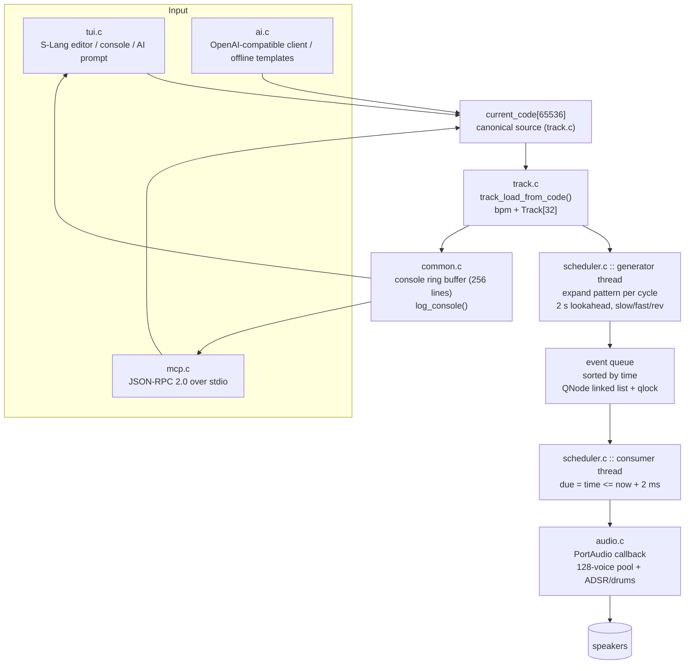

# Tompouce architecture

JavaScript buffers now have a second input path: `javascript.c` embeds
QuickJS and the upstream Strudel libraries, and `js_audio.c` converts queried
haps into native `AudioEvent`s. `dsp.c` implements the additional native
filters, modulation, synthesis helpers, and effects. JavaScript and sample
resolution run outside `tracks_lock`; only C DSP runs in the audio callback.
`csound_host.c` compiles and renders orchestras in a confined native child
process. A background thread transfers stereo blocks into a bounded atomic
ring; the audio callback only consumes PCM. Csound events still enter the
scheduler's note history for visualization. Failed orchestra compilation
keeps the last playable program, and replacing it releases the old renderer.
The original C parser path described below remains for the line dialect.
See [JavaScript and native audio](javascript.md) for the updated contracts,
source-location highlighting, limits, coverage, and dependency licenses.

## Overview



ASCII fallback (if mermaid is not rendered):

```
[tui.c UI] --\
              +--> current_code --> track.c --> scheduler generator
[mcp.c JSON] -/      ^                              |  (2 s lookahead)
[ai.c LLM] ----------+                              v
                                            event queue (sorted)
                                                    |
                                          scheduler consumer (2 ms due)
                                                    |
                                          audio.c PortAudio callback
                                                    v
                                                speakers
console ring buffer feeds both UI console pane and music_get_console.
```

## Modules

| File | Owns | Key entry points |
|---|---|---|
| `src/common.c` | timing, `trim`, `strdup_safe`, console ring buffer | `log_console`, `console_line`, `now_seconds` |
| `src/audio.c` | tempo (`bpm` 20–400), note→MIDI→freq, voice pool, PortAudio callback | `audio_set_bpm`, `audio_trigger_event`, `note_name_to_midi`, `midi_to_freq` |
| `src/pattern.c` | mini-notation parse + per-cycle expansion (`! @ / ?`, euclid, `{}`) | `parse_pattern_text`, `expand_node`, `node_free` |
| `src/strudel.c` | statement lines (`note().lpf()`, `setcpm`) | `strudel_parse` |
| `src/slider.c` | live `slider()` values; source text is not rewritten | `slider_bind`, `slider_nudge` |
| `src/harmony.c` | Strudel chord symbols, scales, degrees | `harmony_chord`, `harmony_scale`, `harmony_degree_midi` |
| `src/track.c` | source → `Track tracks[32]` + `current_code` | `track_load_from_code` |
| `src/scheduler.c` | generator + consumer threads, sorted event queue | `scheduler_init/shutdown/start`, `event_queue_push/clear` |
| `src/ai.c` | LLM request worker, offline fallback | `ai_request_async`, `ai_poll_result` |
| `src/tui.c` | S-Lang UI, editor state, vi mode, cursor, resize | `tui_init/run/shutdown`, `tui_frame` |
| `src/mcp.c` | MCP server, frame reader, UI orchestration | `mcp_run`, `handle_request`, `mcp_read_frame` |
| `src/main.c` | mode dispatch (`--mcp`, `--mcp --ui`) | `main` |

## Data flow

1. Source enters via editor, `music_set_code`, or `music_ai` → stored in
   `current_code` and compiled by `track_load_from_code()` (holds
   `tracks_lock`, clears the event queue).
2. Each `Track` holds a parsed `Node` tree (`SEQ`/`ALT`/`STACK`/`ATOM`), `fast_repeat`
   (1–64), `slow_stride` (1–64), `rev`, `gain` (0–2), `inst`, and the next
   cycle start + index.
3. The generator thread expands each due cycle: `expand_node()` →
   optional `rev` remap → `fast` subdivision → `AudioEvent`s with absolute
   `time`/`duration` (cycle = 4 beats) → `event_queue_push()` (sorted insert).
   `slow N` skips generation on non-multiple cycles.
4. The consumer thread pops events due within 2 ms and calls
   `audio_trigger_event()`, which steals the oldest voice if all 128 are busy.
5. The PortAudio callback renders synth (sine/saw/square/tri/noise + ADSR) or
   drum voices (kick/snare/hat/clap/tom) and advances `audio_time`.
6. Status and errors go to the console ring buffer, visible in the UI pane
   and via `music_get_console`.

## Threading and locking

- Audio callback: takes `voice_lock` only, never blocks on I/O.
- Scheduler generator/consumer: `tracks_lock` for track list, `qlock` for the
  queue (short critical sections).
- AI worker: detached thread, results exchanged via `ai_lock`-guarded pointer.
- UI: all `SLang`/`SLsmg` calls on the foreground thread; `SIGWINCH` sets a
  `sig_atomic_t` flag consumed in `tui_frame()`; window size re-read via
  `TIOCGWINSZ` each frame.
- MCP: headless mode loops on `select()` + `mcp_read_frame()` (1 MiB cap,
  non-blocking fd); `--mcp --ui` reattaches stdio to `/dev/tty`. A piped
  stdin stays the MCP socket. A terminal stdin opens `127.0.0.1:18789`
  and the UI loop accepts one client at a time.

## Limits (enforced)

| Resource | Limit | Where |
|---|---|---|
| Tracks | 32 | `MAX_TRACKS` (voices in one buffer) |
| Song tracks | 8192 | `SONG_TRACK_CEILING` (heap list, exact-size strings) |
| Editor source | grows until malloc fails; offsets stop near 2 GiB | `current_code`, `SOURCE_MAX` |
| Editor display | wrap on JS tokens by default; arrows follow visual rows; `/wrap off` sidescrolls | `editor_wrap`, tree-sitter-javascript, config `"wrap"` |
| Editor undo | full snapshots until malloc fails; typing runs coalesce | Ctrl+Z / Ctrl+Y, vi `u` |
| Console line | 512 B | `MAX_LINE` |
| Pattern nesting | 32 deep | `Ctx.depth` |
| `*N` / `fast` / `slow` | 1–64 | parser + track compiler |
| Gain | 0–2 | track compiler |
| BPM | 20–400, finite only | `audio_set_bpm` + MCP check |
| MCP frame | 1 MiB, oversized dropped | `mcp_read_frame` |
| Console | 256 lines | `MAX_CONSOLE` |
| Voices | 128 | `MAX_VOICES` |

## Modes

- `./tompouce` — interactive S-Lang UI only.
- `./tompouce --mcp` — headless MCP server (stdin/stdout = JSON-RPC).
- `./tompouce --mcp --ui` — UI on `/dev/tty`. JSON stays on stdio when
  stdin is a pipe. From a terminal, MCP listens on `127.0.0.1:18789`.
