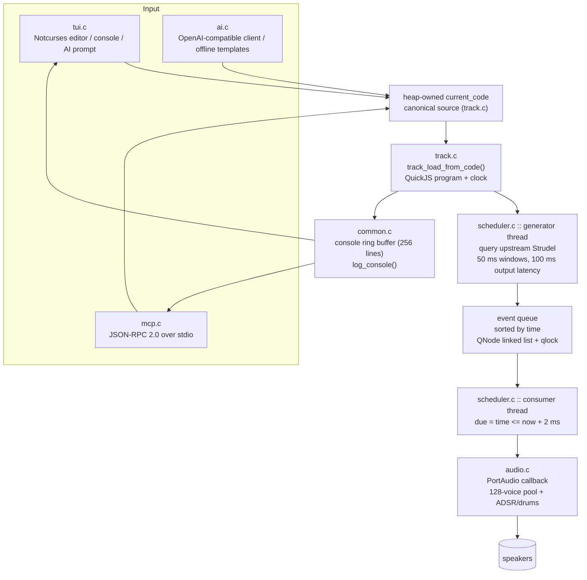

# Tompouce architecture

JavaScript Strudel is the only source language: `javascript.c` embeds
QuickJS and the upstream Strudel libraries, and `js_audio.c` converts queried
haps into native `AudioEvent`s. `dsp.c` implements the additional native
filters, modulation, synthesis helpers, and effects. JavaScript and sample
resolution run outside `tracks_lock`; only C DSP runs in the audio callback.
`csound_host.c` compiles and renders orchestras in a confined native child
process. A background thread transfers stereo blocks into a bounded atomic
ring; the audio callback only consumes PCM. Csound events still enter the
scheduler's note history for visualization. Failed orchestra compilation
keeps the last playable program, and replacing it releases the old renderer.
`audio_output.c` selects native PipeWire, native PulseAudio, PortAudio JACK,
then PortAudio ALSA at startup. Native connections have bounded setup waits;
failed attempts are closed before fallback. Every backend calls the same C
stereo DSP renderer at 44.1 kHz, with an optional preallocated libsamplerate
converter for other PortAudio device clocks. No JavaScript, sample loading or
file I/O was added to the DSP callback. F4 and MCP health report the backend.
Backend references: [PipeWire streams](https://docs.pipewire.org/group__pw__stream.html),
[PulseAudio threaded loop](https://www.freedesktop.org/software/pulseaudio/doxygen/thread-mainloop_8h.html),
[PortAudio host APIs](https://files.portaudio.com/docs/v19-doxydocs/portaudio_8h.html),
and [libsamplerate streaming conversion](https://libsndfile.github.io/libsamplerate/api_full.html).
See [JavaScript and native audio](javascript.md) for the updated contracts,
source-location highlighting, limits, coverage, and dependency licenses.

## Overview



ASCII fallback (if mermaid is not rendered):

```
[tui.c UI] --\
              +--> current_code --> track.c --> scheduler generator
[mcp.c JSON] -/      ^                              |  (bounded JS query windows)
[ai.c LLM] ----------+                              v
                                            event queue (sorted)
                                                    |
                                          scheduler consumer (2 ms due)
                                                    |
                                          audio.c PortAudio callback
                                                    v
                                                speakers
console ring buffer feeds both UI console pane and music_get_console.
```

## Modules

| File | Owns | Key entry points |
|---|---|---|
| `src/common.c` | timing, `trim`, `strdup_safe`, console ring buffer | `log_console`, `console_line`, `now_seconds` |
| `src/audio.c` | tempo (`bpm` 20–400), note→MIDI→freq, voice pool, PortAudio callback | `audio_set_bpm`, `audio_trigger_event`, `note_name_to_midi`, `midi_to_freq` |
| `src/slider.c` | live values and source-site bindings; UI synchronizes source | `slider_bind`, `slider_nudge` |
| `src/track.c` | source → QuickJS program and transport clock + `current_code` | `track_load_from_code` |
| `src/scheduler.c` | generator + consumer threads, sorted event queue | `scheduler_init/shutdown/start`, `event_queue_push/clear` |
| `src/prep_pool.c` | bounded general preparation workers plus the serial generated-room lane | `prep_pool_start/stop`, `prep_pool_submit`, `prep_pool_submit_serial` |
| `src/ai.c` | LLM request worker, offline fallback | `ai_request_async`, `ai_poll_result` |
| `src/tui.c`, `src/tui_terminal.h` | Notcurses UI, editor state, vi mode, cursor, resize | `tui_init/run/shutdown`, `tui_frame` |
| `src/mcp.c` | MCP server, frame reader, UI orchestration | `mcp_run`, `handle_request`, `mcp_read_frame` |
| `src/main.c` | mode dispatch (`--mcp`, `--mcp --ui`) | `main` |

## Data flow

1. Source enters via the editor, MCP or AI. `track_load_from_code()` compiles
   JavaScript and prepares sample-map/Csound state outside `tracks_lock`.
   Failed evaluations store the edited source while retaining the last playable
   program and controls. Successful replacements preserve accepted notes.
2. The active `Track` owns a QuickJS program, generation identity and transport
   phase anchors. Quoted mini-notation, tonal functions and transformations are
   implemented by the pinned upstream Strudel bundle.
3. The generator queries bounded 50 ms windows, prepares native events outside
   the track lock, and publishes them into the time-sorted event queue.
   Visual queries and source mappings use the same retained program.
4. The consumer thread pops events due within 2 ms and calls
   `audio_trigger_event()`, which replaces the earliest inserted voice if all
   128 are busy, independently of its target time or gain. A separate pool of
   up to 128 retiring graphs renders eviction fades until the incoming target
   plus 250 ms. Its overflow replaces the earliest-ending graph and reports a
   console diagnostic. Resource destruction stays outside the callback.
5. The PortAudio callback renders synth (sine/saw/square/tri/noise + ADSR) or
   drum voices (kick/snare/hat/clap/tom) and advances `audio_time`.
6. Status and errors go to the console ring buffer, visible in the UI pane
   and via `music_get_console`.

## Threading and locking

- Audio callback: takes `voice_lock` only, never blocks on I/O.
- Scheduler generator/consumer: `tracks_lock` for track list, `qlock` for the
  queue (short critical sections).
- Preparation pool: general workers run immutable sample, stretch and kernel
  jobs; one serial lane preserves generated-room order. The general count is
  bounded by process affinity and cgroup quota. Workers do not render audio or
  mutate the event queue; generated-room completion takes the short voice lock
  only to publish the kernel, under the generation guard. The generator
  publishes each completed hap in scheduling order through the queue
  transaction.
- AI worker: detached thread, results exchanged via `ai_lock`-guarded pointer.
- UI: Notcurses planes and rendering stay on the foreground thread; `SIGWINCH`
  sets a `sig_atomic_t` flag consumed in `tui_frame()`, with geometry read via
  `TIOCGWINSZ`. A blocking Notcurses input reader sends fixed-size events through
  a bounded, pollable pipe, preserving literal Ctrl+Space without timeout
  ambiguity. It never accesses editor or audio state. Output has a separate
  blocking terminal descriptor so nonblocking input cannot truncate graphics.
  Notcurses owns mouse enable/disable and the cell/pixel reporting protocol;
  the editor consumes decoded cell coordinates and preserves modifier bits.
- MCP: headless mode loops on `select()` + `mcp_read_frame()` (1 MiB cap,
  non-blocking fd); `--mcp --ui` reattaches stdio to `/dev/tty`. A piped
  stdin stays the MCP socket. A terminal stdin opens `127.0.0.1:18789`
  and the UI loop accepts one client at a time.

## Limits (enforced)

| Resource | Limit | Where |
|---|---|---|
| Song tracks | 8192 | `SONG_TRACK_CEILING` (heap list, exact-size strings) |
| Editor source | grows until malloc fails; offsets stop near 2 GiB | `current_code`, `SOURCE_MAX` |
| Editor display | wrap on JS tokens by default; arrows follow visual rows; `/wrap off` sidescrolls | `editor_wrap`, tree-sitter-javascript, config `"wrap"` |
| Editor undo | full snapshots until malloc fails; typing runs coalesce | Ctrl+Z / Ctrl+Y, vi `u` |
| Console line | 512 B | `MAX_LINE` |
| BPM | 20–400, finite only | `audio_set_bpm` + MCP check |
| MCP frame | 1 MiB, oversized dropped | `mcp_read_frame` |
| TCP MCP | per-request capability; first request within 2 s, idle timeout 10 s; nonblocking socket output | `mcp_dispatch_tcp`, `send_json` |
| Console | 256 lines | `MAX_CONSOLE` |
| Voices | 128 | `MAX_VOICES` |
| Retiring source graphs | 128 | separate bounded slots in `audio.c`; overflow is reported |

## Modes

- `./build/tompouce` — interactive Notcurses UI only.
- `./build/tompouce --mcp` — headless MCP server (stdin/stdout = JSON-RPC).
- `./build/tompouce --mcp --ui` — UI on `/dev/tty`. JSON stays on stdio when
  stdin is a pipe. From a terminal, MCP listens on `127.0.0.1:18789`.

TCP listeners require a top-level `auth` capability on every JSON frame and
close the connection on invalid framing, authentication or failed output.
Explicit headless TCP launches require `TOMPOUCE_MCP_TOKEN`; UI companion
listeners can generate a capability and deliver it through a private helper
stdin pipe. Remote asset fetches check the numeric sockaddr in libcurl's
socket-open callback for every connection and disable proxies. DNS validation
is therefore applied to the address used, not to an earlier lookup.
