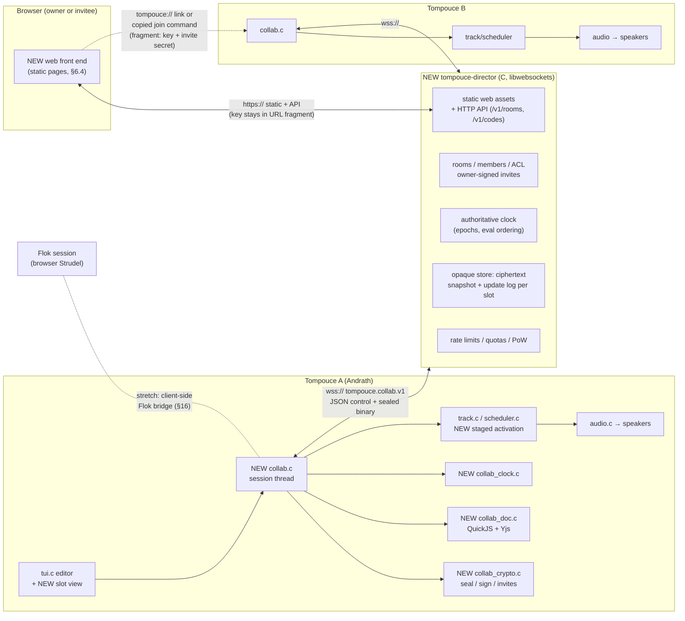
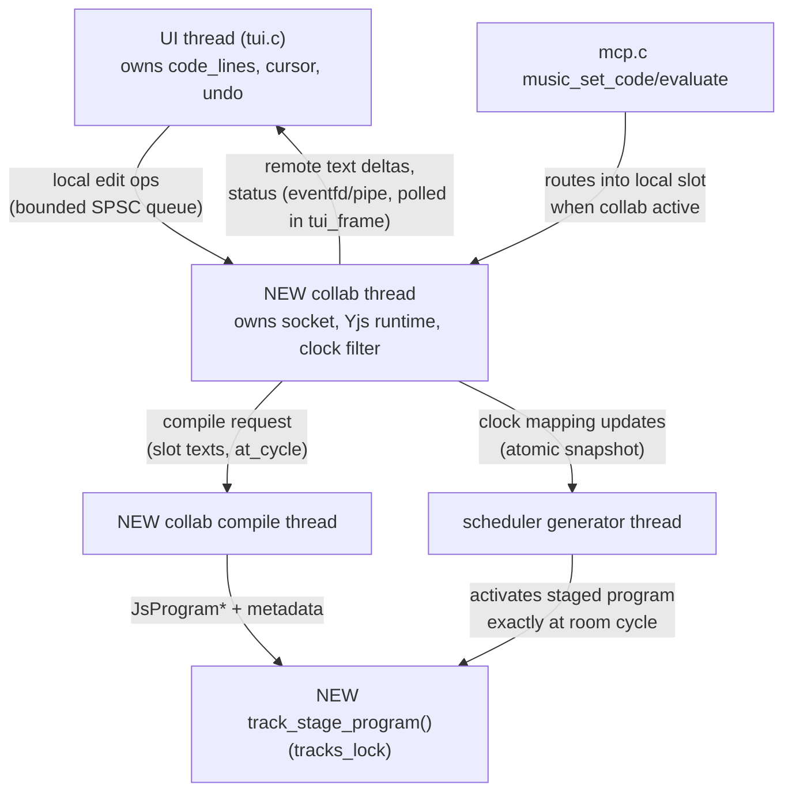
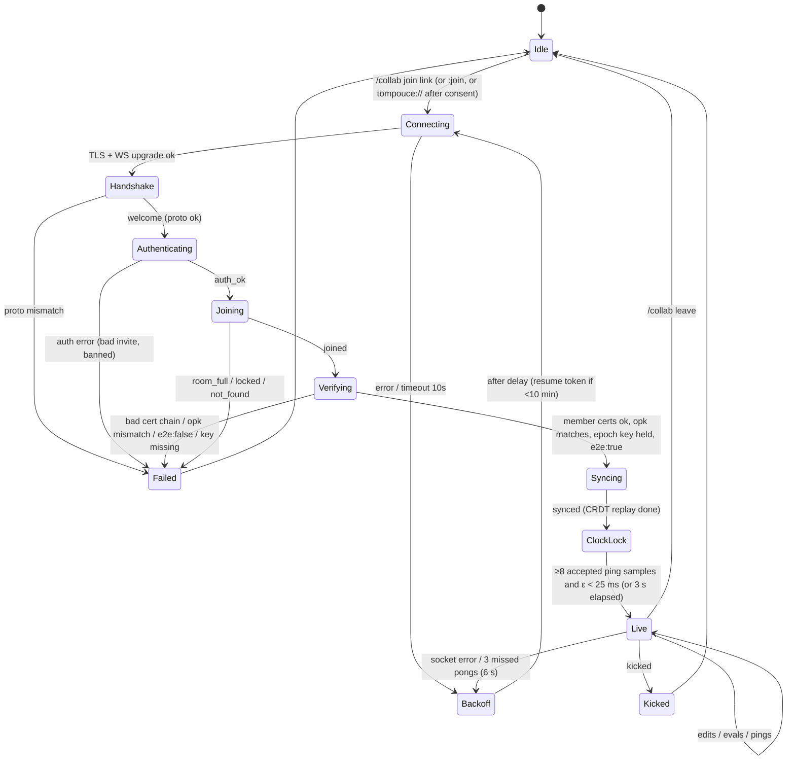
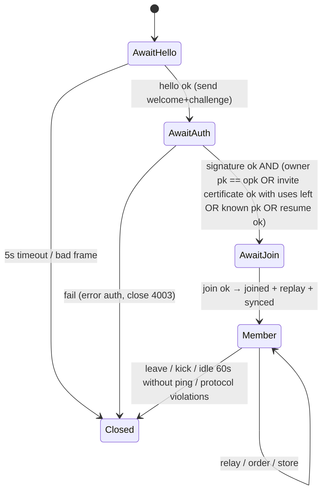

# Tompouce Collab: multi-user jamming design

Status: design brief for an implementing agent. Nothing here exists yet unless
it is cited as an existing file or function.
Target repo: `github.com/ekollof/tompouce`. This brief was written against
`master` at `090c3f3` ("Compressor structural latency…").
Author: Pierre (Grok Bot) for Andrath, 2026-11-26. **Revision 2, 2026-11-26**
(see the Decisions log below: public hosted server and web front end, E2E by
default, local-equivalent `live` eval, recent-software floors).

> **Revision note, 2026-11-27 (ekollof).** Factual grounding re-verified
> against `master` at `c4d3521`; corrected: schedule-ahead figure (150 ms,
> not 100 ms), typical local-eval latency (0.3–0.35 s), generator polling
> (5 ms poll, 100 ms re-query gate), `track_count == 1` qualified to the
> live path, LV2 scope narrowed to the test/demo namespace, lockfile copy
> confirmed missing (implementer must add it). Added one determinism
> checklist item (DSP path latency must be a pure function of the shared
> composite). No decision (D1–D7, §20 defaults) was changed.
>
> **Revision note, 2026-11-27 (ekollof), Q1 decided (D8).** ekollof hosts
> the public director at `bakery.andrath.nl`. §20 Q1 is resolved; Q2–Q15
> keep their defaults pending owner answers.
>
> **Revision note, 2026-11-27 (ekollof), OpenBSD host (D9).** The public
> director runs on OpenBSD 8.0 (`castor.hackerheaven.org`, SSH via bastion
> host only). §6.5, §18.1 and §18.4 now require portable server code and
> an `rc.d` script next to the systemd unit.
>
> **Revision note, 2026-11-27 (ekollof), LAN discovery (D10).** §6.6 and
> Phase 1.5: first-come-first-serve LAN director over built-in mDNS,
> join-code handshake, same E2E as the internet path.
>
> **Revision note, 2026-11-27 (ekollof), static web presence (D11).** No
> user accounts, no Flask/Django/FastCGI: the site is the front-door pages
> plus static setup guides; `relayd` terminates TLS straight to the
> director.

> **How to read this document**
> - `path/file.c :: function()` refers to code that **exists today**. It was
>   checked against the tree at `090c3f3`.
> - **NEW** marks an API, file, field, message or command this design
>   proposes. These names are suggestions. Keep them unless the codebase gives
>   you a concrete reason not to, and record any rename in the PR.
> - **VERIFY** marks a claim the implementer must confirm against upstream
>   source before relying on it, as `AGENTS.md` asks ("Resolve upstream
>   behavior against readable source"). Put the checkouts you use in
>   `.reference/`.
> - Follow `AGENTS.md` throughout. That means C11/C17, KNF, warnings as errors,
>   `switch` over long `if` chains, bounded string handling, overflow-checked
>   sizes, no shell or exec of untrusted strings, fail-closed validation, and
>   focused tests plus `test-security` and `test-security-sanitize` for every
>   new trust boundary. Put user documentation in `docs/` and outstanding work
>   in `TODO.md`.

---

## Decisions log

Revision 2, 2026-11-26. Andrath answered the first round of open questions.
Decisions below override anything in the first revision. The remaining open
questions are in §20.

| # | Date | Decision | Where it lands |
|---|---|---|---|
| D1 | 2026-11-26 | **There will be an official public hosted server**, with a **web front end** where the room owner creates a room and generates invitation links, and an invitee who opens a link gets the room key. The key travels in the URL fragment, which browsers never send to the server. A second, privately disclosable method (short join code plus a passphrase shared out of band) and QR codes are also offered. Self-hosting stays fully supported. | §6.3, §6.4, §14, §18.4 |
| D2 | 2026-11-26 | **End-to-end encryption is ON by default for every room.** Plaintext rooms exist only behind an explicit self-hosted/debug switch (`--allow-plaintext` on the director, `TOMPOUCE_COLLAB_PLAINTEXT=1` on the client). The public instance never enables it. Consequences are applied throughout: opaque server store, permissions from plaintext headers, sealed names and sample manifests, signed frames, no server-side content features. | §1, §7, §9.6, §11, §13, §14 |
| D3 | 2026-11-26 | **Room evals behave exactly like a local Alt+Enter / Ctrl+Enter.** Checked in the code: a local evaluate is **not** quantized to the next bar or cycle. It hot-swaps the program at the next scheduler window (audible typically 0.3–0.35 s after the key press), keeps the cycle phase, and lets already accepted notes finish. The room default is therefore **`live`** (no musical quantum). Quantized rooms (1/4 to 8 cycles) remain an owner opt-in. Details in §4.5 and §8.7. | §4.5, §8.7, §9.4, §12 |
| D4 | 2026-11-26 | **Require recent software.** libcurl ≥ 8.11.0 with `ws`/`wss` (WebSocket support became official and default-enabled in 8.11.0). The libwebsockets *client* fallback is dropped. Other floors in §6.5. | §6.1, §6.5 |
| D5 | 2026-11-26 | Derived from D1 and D2: **account-less, capability-based access.** The room owner holds a room-scoped owner key that is the root of trust. Invites are owner-signed certificates, so a malicious server cannot invent members. The old `public` room flag is removed (a public listener link is just a multi-use listener invite). | §13.5, §14 |
| D6 | 2026-11-26 | Derived from D2: the **shared user-sound blob store is off on the public instance** (the operator cannot scan E2E blobs) and opt-in on self-hosted directors. | §11.2, §18.4 |
| D7 | 2026-11-26 | Derived from D5: **automatic owner succession is removed.** The owner key is the trust root, so ownership moves only by handing over the owner key (owner link). Delegated moderators are an open question. | §13.5, §20 |
| D8 | 2026-11-27 | **Public instance operator and domain.** ekollof hosts the official public director at `bakery.andrath.nl`. Examples, invite links and defaults use that hostname through the `public_url` setting. ToS, privacy text and abuse contact are still owed before public launch. | §18.4, §20 |
| D9 | 2026-11-27 | **The public director runs on OpenBSD 8.0** (`castor.hackerheaven.org`; the public name is expected to resolve there). The director and its service files must therefore be portable: POSIX C11 only, no Linux-only APIs, LibreSSL-compatible TLS use, dual-stack sockets, and OpenBSD `rc.d` supervision next to the systemd unit. | §6.5, §18.1, §18.4 |
| D10 | 2026-11-27 | **LAN discovery with first-come-first-serve director.** Two tompouces on one network find each other over built-in mDNS (no Avahi dependency); whoever starts hosting first spawns the local director and advertises it, others join by on-screen join code. Same E2E handshake as the internet path; `ws://` is acceptable on LAN because everything sensitive is already sealed. | §6.6, §12, §14.4, §19 |
| D11 | 2026-11-27 | **The public web presence is static only.** The site is the §6.4 front-door pages plus explanatory setup guides (rooms, join methods, E2E-or-otherwise options, LAN mode). No user accounts (D5 stands), no dynamic backend — no Flask, Django or FastCGI; `relayd` TLS-terminates straight to the director, which serves the static assets itself. | §6.4, §18.4 |

Resolved from the first revision's questions: Q1 (public hosting: yes), Q2
(E2E default: yes), Q3 (quantum: `live`), Q8 (user-sound sharing: off on
public), Q9 (libcurl floor: require 8.11+, no fallback), Q12 (succession:
no auto-transfer).

---

## 1. Summary

Several Tompouce instances, each on a different machine, join a **room** on
a small **director** server. The Tompouce project runs an official public
director with a **web front end**; anyone can also self-host one. Each
participant edits their own **slot** of Strudel code, and optionally a shared
slot. When someone evaluates, every instance compiles the same room program
and switches to it **at the same room-clock instant**, which is how a local
Alt+Enter behaves (§4.5). Each instance renders audio locally with its own
native engine.

Only these kinds of data cross the network:

1. **CRDT updates** for the slot texts, using Yjs.
2. **Eval events**: the exact evaluated text plus the room cycle it activates
   on.
3. **Clock data**: the room's cycle origin and tempo, plus ping and pong
   samples for offset estimation.

**Everything that carries code, names, chat, cursors or sample lists is
end-to-end encrypted by default.** The room key never reaches the director.
It is handed to invitees in the URL fragment of an invite link (which
browsers do not send to servers), or through a join code plus a passphrase
that the owner shares by another channel. The director sees only ciphertext,
routing headers, public keys and timing. It orders messages, keeps the clock,
enforces slot permissions from plaintext headers, and rate-limits. It never
runs or reads user code.

Audio never crosses the network. Strudel queries are pure functions of cycle
time. If every client has the same code, the same sample content, the same
cycle origin and the same tempo, they produce the same events.

## 2. Goals and non-goals

### Goals

- G1. Two to sixteen Tompouce clients in one room, each with at least one
  slot. Every member hears the same composed program, phase-aligned.
- G2. Live co-editing with remote cursors, using conflict-free merge (a CRDT).
- G3. **Local-equivalent evaluation.** A room eval takes effect on every
  client at the same room-clock instant, with the same semantics as a local
  Alt+Enter: phase-continuous hot swap, accepted notes survive (§4.5). Owners
  may opt into musical quantization.
- G4. Cycle alignment across clients: within 5 ms p95 on a LAN and within
  15 ms p95 over the internet at RTT ≤ 150 ms. This assumes the declared
  output latency is correct.
- G5. Remote code is untrusted. A room member must not be able to read local
  files, reach the local network, drive local MIDI or OSC devices, open the
  browser, or exhaust memory or CPU beyond bounded budgets, unless the local
  user consents per capability.
- G6. Low bandwidth: on the order of 1 to 10 kbit/s per member while editing.
- G7. Rooms with owner-signed invites, per-room member keys, owner moderation
  (kick with key rotation, ban, lock, revoke) and rate limits. Transport is
  TLS.
- G8. **End-to-end encryption by default** for all room content. A server
  operator, including the public instance's operator, cannot read code.
- G9. **An official public instance with a web front end**: the owner creates
  a room and invite links in the browser, and an invitee opens a link to get
  the key and hand it to the Tompouce client. The server never learns the
  room key. A second method without any key in a URL (join code plus
  out-of-band passphrase) is available. Self-hosting is supported.
- G10. Stretch: interoperate with Flok sessions so Tompouce can jam with
  browser Strudel users. Section 16 states what that interop can and cannot
  promise.

### Non-goals

- Streaming audio or MIDI between clients. Each client renders locally.
- Peer-to-peer transport, NAT traversal or WebRTC.
- Ableton Link as the sync mechanism. Link uses UDP multicast discovery and is
  LAN-only, so it cannot sync over the internet. A later local bridge may
  publish the room tempo and phase to Link peers on the same LAN; see the open
  questions.
- Sharing local hardware state between members, such as MIDI input
  controllers or LV2 plugins only one member has.
- Collaborative song mode (the `F7` track list). Song mode is disabled in a
  room (§10.5, §12.2).
- **User accounts, passwords, e-mail, or any personal data held by the
  operator.** Access is by capability (owner key, invites).
- **Server-side features that need plaintext**: content moderation, syntax
  checking, search, history browsing, previews, a Flok gateway. They conflict
  with D2 and are out of scope (§14.8).
- Sandboxing the V8 query worker for remote code. Section 13.3 forces QuickJS
  instead.
- Hiding traffic metadata (who joins which room, when, message sizes) from the
  operator. §13.7 lists it as a residual risk.

## 3. Glossary

| Term | Meaning |
|---|---|
| **Director** | The NEW server binary `tompouce-director`. It handles rooms, admission, the clock, relaying, the opaque store, and serves the web front end. |
| **Web front end** | The NEW static pages the director serves (§6.4): create room, owner console, invite landing page. |
| **Room** | A session on a director, with members, slots, a clock, a room key and settings. Its server-visible name is an opaque random **room id**. |
| **Member** | An authenticated connection with a per-room public key, a role and a color index. |
| **Per-room key (`pk`)** | An Ed25519 keypair a user derives for each room from a local master seed, so rooms cannot be linked by key. |
| **Owner key (`opk`/`osk`)** | A room-scoped Ed25519 keypair created at room creation. `opk` is the **trust root**: it is in every invite link, and every client verifies membership against it. |
| **Role** | `owner`, `editor` or `listener`. Section 13.5 defines the permissions. |
| **Slot** | One named code buffer in the room. It has one CRDT document (`Y.Doc`), an owner and an ACL. Slot 0 is the optional **shared** slot. |
| **Composite program** | The single Strudel program each client compiles from every slot's *last evaluated* text (§9.4). |
| **Eval event** | The order "slot S now evaluates text X, activating at room cycle C", relayed by the director. |
| **Room cycle** | Cycle position on the room clock: `c(T) = c_e + (T − T_e) · cps`. |
| **Epoch (clock)** | `(c_e, T_e, cps)`: a clock segment. A tempo change creates a new clock epoch. |
| **Quantum `q`** | Optional musical activation granularity in cycles (1/4, 1/2, 1, 2, 4, 8). The default is `live`, meaning none (§8.7). |
| **Lead** | The minimum time between when an eval is ordered and when it activates. It covers network delay and compile time. |
| **Offset θ** | Server monotonic time minus local monotonic time, as estimated by the clock filter. |
| **L_out** | Local output latency: the time from scheduling an event at audio time *t* to hearing it. |
| **Remote profile** | The NEW restricted evaluation mode used whenever the composite contains text not authored locally. |
| **Room key `K_e`** | 32 random bytes that seal all room content. `e` is the **key epoch**. The director never sees it. |
| **Key epoch** | A counter (u16) that increases each time the room key is rotated (§14.6). |
| **Invite** | An owner-signed capability that admits one or more new members with a role and an expiry (§14.2). |
| **Invite link** | An `https://` or `tompouce://` URL with the invite secret and room key in its fragment (§14.3). |
| **Join code** | A short code (for example `K7QF-92XM-PD4T`) that looks up a passphrase-wrapped invite on the director (§14.4). |
| **Passphrase** | A generated secret, shared out of band, that unwraps a join code's invite and room key. |
| **Membership certificate** | The chain `opk → invite → member pk` that lets any client check that a member was admitted by the owner. |
| **E2E** | End-to-end encryption with a room key that the server never sees. On by default. |
| **Plaintext debug mode** | The explicit opt-out of E2E, available only on self-hosted/debug directors. |

## 4. How the codebase works today (grounding)

The implementer must understand these facts first. Everything later builds on
them.

### 4.1 Source, evaluation and programs

- The canonical editor source is the heap string `current_code`. It is set
  only through `src/track.c :: current_code_set()`.
- Evaluation is `src/track.c :: track_load_from_code(const char *code_buf)`.
  It works as follows:
  1. It compiles through `src/javascript.c :: javascript_compile_from(code,
     bpm, previous, &metadata, …)` outside `tracks_lock`.
  2. It prepares Csound with `javascript_prepare_csound_from()`.
  3. It loads sample maps with `websamp_load_arguments()`, which receives the
     metadata's `samples` list.
  4. It then replaces `tracks[0]` under `tracks_lock`. On the live path
     `track_count == 1` (song mode keeps separate multi-track state).
  5. On failure it keeps the last playable program and only stores the edited
     text.
- Each `JsProgram` owns a **fresh QuickJS runtime**, created in
  `javascript.c :: initialize()`:
  - `JS_SetMemoryLimit(p->runtime, JS_MEMORY_LIMIT)`, where `JS_MEMORY_LIMIT`
    is 128 MiB.
  - `JS_SetMaxStackSize(1 MiB)`.
  - `JS_SetInterruptHandler(interrupted)`, which compares `now_seconds()` with
    `p->deadline`.
  - The compile deadline is 2.0 s (`compile_program`). Query deadlines are
    0.2 s and 0.05 s (`javascript.c` around lines 1142, 1356 and 1427).
- Host functions installed in the runtime are `__hostLog`, `__hostSlider*`,
  `__hostMidiOpen`, `__hostMidiRead`, `__hostMidiKeys`, `__hostPrebake`,
  `__hostCsound`, `__hostSignal`, the fraction, triangle, pure and commonKeys
  helpers, and `__hostMidiManifest`. The module loader
  `javascript.c :: module_loader()` resolves `local:` modules from the user's
  config while `p->loading_allowed` is set.
- `js/runtime.mjs :: globalThis.__compile(code, bpm, prebake)` is the JS entry
  point:
  - It runs the confined startup prebake.
  - It transpiles through `prepare()`, then runs the result as a `"use
    strict"` async `Function`.
  - It stacks the `$:` and labelled branches collected in `collecting`, with
    `S`-prefixed solo, `each` and `all`.
  - It returns JSON metadata: `{bpm, samples, locations, visuals,
    visualSites, voices, csound, sliders}`.
  - `setcps` and `setcpm` set the module-level `tempo`.
  - `samples(...)` only records its arguments (`sampleCalls`, at most 64). The
    C side (`websamp.c`) fetches them, applying the public-address and
    redirect policy in `websamp_url_allowed()` and `addr_is_public()`.
- A query worker exists: `src/js_worker.c`, with native V8 in
  `src/v8_worker.cc` or a Node diagnostic worker. It is preferred whenever its
  binary is present (`javascript.c :: worker_backend_enabled()`).
  `TOMPOUCE_QUERY_BACKEND=quickjs` is the opt-out. `include/js_worker.h`
  states that **"Node/V8 is not a sandbox; the parent owns confinement"**.
  `docs/v8-assessment.md` lists open hardening gates.

### 4.2 Scheduler, transport and clock

- `src/scheduler.c :: schedule_live_javascript(double now)` drives queries.
  Its behavior follows Strudel's Cyclist:
  - It queries 50 ms windows, with a 5 ms generator poll gated to 100 ms
    re-query ticks (`js_tick`) and a 200 ms look-ahead (`phase < now + .2`).
  - Events are scheduled about 150 ms ahead (`phase + .15` deadline).
- `Track` (in `include/track.h`) holds the transport state: `js_origin`,
  `js_seconds` (seconds per cycle), `js_cursor` (cycle position),
  `js_anchor_cycle`, `js_anchor_time`, `js_phase`, `js_tick`,
  `compile_generation` and `transport_revision`.
- The clock is `src/audio.c :: audio_time_now()`. It returns `audio_time`, a
  sample-counted clock advanced by the output callback. If no backend starts,
  it falls back to a "silent clock", `now_seconds() − silent_clock_origin`.
  `now_seconds()` in `common.c` reads `CLOCK_MONOTONIC`.
- Tempo is `audio_set_bpm()` and `audio_get_bpm()`, and
  `audio_sec_per_cycle() = 240/bpm`. A cycle is four beats.
- `scheduler_transport_set(on)` restarts at cycle 0 and bumps
  `transport_revision`.
- `track_load_from_code()` keeps phase continuous when it replaces a playing
  program (full trace in §4.5):
  - The new program starts at `boundary = js_phase + .1`.
  - It calls `event_queue_new_program(HUGE_VAL)`.
  - `event_queue_new_program(double boundary)` **drops** queued events with
    `time >= boundary`. Passing `HUGE_VAL` drops nothing, which is why a
    local hot-swap never withdraws accepted notes. A collab activation must
    do the same (§8.7).
- Output latency is not exposed numerically. `audio_output.h` only has
  `audio_output_latency_label()` and `audio_output_queue_label()`, which
  return strings.

### 4.3 Editor (TUI)

- Text is stored as `char **code_lines` (`code_line_count`) in `src/tui.c`.
  - The central mutation is `editor_replace_grouped(int a, int b, const char
    *text, int group)`, which uses byte offsets. It builds the whole new
    buffer before swapping it in.
  - It records undo with `undo_begin()` and `undo_commit()`. Undo stores
    full-text snapshots: `struct undo_snap`, `editor_undo()` and
    `editor_redo()`.
  - It moves the cursor to the end of the edit and fixes up auto-pairs with
    `editor_pairs_map()`.
  - Lower-level line helpers (`line_insert()` and others near
    `tui.c:262–350`) also mutate the buffer.
- `editor_flatten()` returns the whole buffer.
- Commands:
  - The vi `:` commands are in `src/tui_commands.h :: command_words[]`.
  - The F2 slash commands are in `native_command_words[]`: `bpm`, `play`,
    `stop`, `companion`, `clear`, `rescan`, `save`, `load`, `song`, `inline`,
    `graphics`, `theme`, `scope`, `wrap`, `tutor` and `volume`.
- Keys: F1–F12 are all assigned (see the README key list). Ctrl+letters are
  decoded as 1–26 in `src/tui_terminal.h`. Ctrl+N and Ctrl+B move to the next
  and previous track, and F9 is the track list pane. Ctrl+G and Ctrl+K appear
  unused (VERIFY in `tui.c` and `tui_vi.h`).
- Play highlighting already carries per-span colors:
  `scheduler_editor_play_styles(now, editor, off, len, color, flags, max)`.
- `config.json` is read into a **4 KiB buffer** in `load_editor_config()`.
  Collab settings therefore go in their own file (§18.3).
- The session is autosaved to `~/.config/tompouce/state.json` on quit. This
  matters for security (§13.4).

### 4.4 Side-effecting capabilities reachable from pattern code

| Capability | Where today | Risk if remote-authored |
|---|---|---|
| OSC UDP send to any IPv4/IPv6 literal | `src/osc_output.c :: osc_output_prepare()` (`oschost`/`oscport`, default 127.0.0.1:57120) | Packets to LAN hosts, or local services such as SuperCollider. |
| MIDI out (notes, CC, SysEx, transport) | `src/midi.c`, used from `js_audio.c` | Drives local synths; SysEx can rewrite device memory. |
| MIDI in / CC reads | `__hostMidiOpen` → `midi_open_input()` | Opens devices; reads differ per machine (non-deterministic). |
| Remote sample URLs | `samples()` → `websamp.c` (public addresses only, no proxy, cache in `~/.cache/tompouce/web`) | Leaks the client IP to an attacker host; uses bandwidth and disk. |
| Local modules `local:` | `javascript.c :: module_loader()` → `local_module_source()` | Reads the user's local JS. |
| Named prebakes and MIDI manifests | `__hostPrebake`, `__hostMidiManifest` | Reads the user's config store. |
| Csound orchestras | `__hostCsound` → `csound_host.c` (seccomp-confined child) | CPU use; already confined. |
| LV2 and Carla plugin instantiation | `s("lv2:<uri>")` (test/demo namespace only), `.out('carla')`, `lv2_host.c`, `carla_host.c` | Loads native plugin code installed locally. Full LV2/Carla goes through `carlaProject`/`carlaTarget`, not the `s("lv2:…")` sample namespace. |
| Named PipeWire outputs | `.out(name)` → `audio_output_target()` | Routes audio to other sinks. |
| Hydra page | `web/hydra.html` runs **`new Function(...)` on `music_get_code` output** in Chromium | **Remote code runs in a browser** that has camera, screen and network access. |
| Query backend | V8 worker (`js_worker.c`), not a sandbox | A JIT engine without audited confinement. |

### 4.5 What a local Alt+Enter / Ctrl+Enter really does (verified, decision D3)

Question from the owner: does local evaluation wait for the next bar? **No.**
It is not quantized to a bar or a cycle. It is an immediate, phase-continuous
hot swap at the next scheduler window. The trace:

1. **Key.** `src/tui_terminal.h :: terminal_event()` returns
   `KEY_STRUDEL_EVALUATE` for both Ctrl+Enter and Alt+Enter. The key handler
   in `src/tui.c` (L4986: `if (ch == KEY_STRUDEL_EVALUATE) { do_perform(); continue; }`)
   calls `do_perform()`. F5 (`src/tui.c` L5094–5096, `case (int)NCKEY_F00+5`) reaches the same `do_perform()`.
2. **`src/tui.c :: do_perform()`** calls `do_evaluate()`, then
   `scheduler_transport_set(1); scheduler_start();`.
3. **`src/tui.c :: do_evaluate()`** calls `track_load_from_code()` and then
   `scheduler_track_update()`. (`src/mcp.c :: music_evaluate` does the same
   `track_load_from_code`, then optionally the transport calls.)
4. **`src/scheduler.c :: scheduler_transport_set(on)`** resets to cycle 0
   **only if the transport was not already playing**. While playing, the call
   is a no-op for position, so the cycle position carries on.
5. **`src/track.c :: track_load_from_code()`**, continuous branch
   (`replace_javascript && audio_is_playing() && js_seconds > 0`, that is, a
   JavaScript program is already playing):
   - `music_cursor = js_cursor`: the cycle position is kept.
   - `boundary = js_phase + .1`, where `js_phase` is the scheduler's query
     cursor. If `boundary < now + .05`, it is bumped to `now + .1` and the
     cursor is advanced by the elapsed time so the phase stays true.
   - A tempo set in the program (`bpm` metadata) is applied with
     `audio_set_bpm()` at the same swap, and `js_origin = boundary −
     music_cursor · js_seconds` keeps the cycle position continuous across
     the tempo change.
   - The new program is compiled and swapped in with
     `event_queue_new_program(HUGE_VAL)`.
   - Stopped branch (nothing playing): `boundary = round((now+.01)*10000)/10000 + .1`
     and the cursor starts at 0.
6. **`src/scheduler.c :: event_queue_new_program(double boundary)`**
   (about L413) drops queued events with `time >= boundary` and bumps
   `qgeneration`. With `HUGE_VAL` it **drops nothing**, so notes already
   accepted by the audio queue keep playing.
7. **`src/scheduler.c :: schedule_live_javascript()`** then queries 50 ms
   windows, ticked every 100 ms, with a 200 ms look-ahead and a
   `phase + .15` schedule deadline. The first window of the new program
   starts at `boundary`.

**Result.** The new program's time anchor is `boundary = js_phase + 0.1 s`.
`js_phase` is the query cursor, which after a fill sits in
`[now + .2, now + .25)`, since the generator polls every 5 ms but only
re-queries on 100 ms ticks and fills 50 ms windows until `phase ≥ now +
.2`. So the swap is audible typically **0.3–0.35 s** after the key press
(the 0.2 s lower bound only holds if the cursor had lagged), never
sooner than 0.1 s (the `now + .1` bump), and lands at whatever cycle position
the transport has reached. Nothing in `track.c`, `scheduler.c` or `tui.c`
waits for a bar, a cycle or a beat. (The timing figures are derived from the
constants above; Phase 0 should confirm them with the trace hook.) The first
revision of this document claimed that
`event_queue_new_program(audio_time_of(pending_cycle))` would "keep accepted
notes". That was wrong (a boundary argument *drops* queued events at or after
it) and is fixed in §6.2 and §8.7.

**Design consequence.** The room default is `live`: one shared instant
`at_cycle = ceil64(c(S_now + lead))`, phase-continuous, queued notes kept
(§8.7). Quantized activation exists only as an owner opt-in.

## 5. Architecture

### 5.1 Topology



The dotted arrow from the browser to the client carries the invite link
(fragment included) on the user's own machine. The director never receives it.

### 5.2 Client internals and threads



Thread rules, from `docs/architecture.md` and `AGENTS.md`:

- The UI thread alone touches Notcurses and editor state.
- The collab thread never touches editor state and never holds `tracks_lock`
  across I/O.
- The audio callback is unchanged. Collab adds no JS execution, I/O,
  allocation or locking to it.
- Every queue is bounded. A slow or malicious peer must not block playback.
- All collab status and errors go to the console ring through
  `log_console()`. `AGENTS.md` says "do not add hidden control channels".

## 6. Components

### 6.1 Client: new modules

All new modules are C11 in `src/`, with headers in `include/`, and are linked
into `tompouce_core`. Collab is behind a CMake option, `WITH_COLLAB` (NEW,
default `ON` when the dependencies are found), following the
`WITH_CSOUND`/`WITH_V8` pattern in `CMakeLists.txt`. The only new client
dependency is **libsodium** (≥ 1.0.20). The transport reuses **libcurl**,
which is already in `REQUIRED_DEPS`, but collab now **requires libcurl ≥ 8.11.0
with WebSocket support** (decision D4; §6.5). There is no libwebsockets client
fallback.

| File (NEW) | Owns | Key entry points (NEW) |
|---|---|---|
| `include/collab.h`, `src/collab.c` | Session lifecycle, state machine (§10), collab thread, routing between the UI, MCP, compile and scheduler | `collab_connect(const CollabConfig *)`, `collab_disconnect()`, `collab_state()`, `collab_submit_edit(slot, a, b, text)`, `collab_request_eval(slot)`, `collab_poll_ui(CollabUiEvent *out, int max)`, `collab_status_copy(CollabStatus *)` |
| `src/collab_transport.c` | WebSocket client over **libcurl's WebSocket API**: `CURLOPT_CONNECT_ONLY=2`, `curl_ws_send()`, `curl_ws_recv()`, `CURLINFO_ACTIVESOCKET` for `poll()`. At build time require `LIBCURL_VERSION_NUM >= 0x080B00`. At runtime check that `curl_version_info()->version_num >= 0x080B00` and that `->protocols` contains `wss`; if not, report "collab needs libcurl 8.11 or newer with WebSocket support" and stay offline. Also used for the plain HTTPS calls to `/v1/pow`, `/v1/rooms` and `/v1/codes`. | `ctr_open(url, subprotocol)`, `ctr_send_text()`, `ctr_send_binary()`, `ctr_recv()`, `ctr_fd()`, `ctr_close()` |
| `src/collab_proto.c`, `include/collab_proto.h` | Frame codec and schema validation for every message. **Shared with the director.** Pure, no I/O, fuzzable. Uses cJSON with explicit depth and size checks. | `cp_parse_control(const char *, size_t, CpMsg *)`, `cp_encode_*()`, `cp_parse_binary(const uint8_t *, size_t, CpBin *)` |
| `src/collab_clock.c`, `include/collab_clock.h` | Offset and drift estimation, audio↔monotonic mapping, room-cycle↔audio-time mapping, correction policy (§8). Pure and deterministic, so it is unit-testable. | `cc_add_sample()`, `cc_server_time()`, `cc_audio_time_for_cycle()`, `cc_correction()` |
| `src/collab_doc.c`, `include/collab_doc.h` | A dedicated long-lived QuickJS runtime hosting Yjs and y-protocols awareness (§9). Byte↔UTF-16 offset conversion. | `cd_open()`, `cd_slot_create(id)`, `cd_apply_local(slot, a, b, text, out_update)`, `cd_apply_remote(slot, update, out_deltas)`, `cd_snapshot(slot)`, `cd_text(slot)`, `cd_awareness_*()`, `cd_undo(slot)`, `cd_redo(slot)` |
| `js/collab.mjs` → `js/dist/collab.js` | The Yjs wrapper, bundled by `js/build.mjs` (esbuild) as a second entry point, committed like `js/dist/runtime.js`, and embedded with `tompouce_embed(js/dist/collab.js collab.inc collab_js_bundle)` next to the existing `tompouce_embed(js/dist/runtime.js runtime.inc strudel_js_bundle)` in `CMakeLists.txt`. Pin exact `yjs`, `y-protocols` and `lib0` versions in `js/package.json` and `package-lock.json`. Flok uses `yjs ^13.6.21` and `y-protocols ^1.0.5`. Add their MIT notices to `js/dist/licenses.txt`. | `globalThis.__collab = {open, create, applyLocal, applyRemote, snapshot, text, stateVector, diff, awareness…}` |
| `src/collab_samples.c` | Sample manifest (sealed before sending), SHA-256 content hashing (libsodium `crypto_hash_sha256`), prefetch scheduling (§11) | `cs_manifest_build()`, `cs_manifest_diff()`, `cs_prefetch()` |
| `src/collab_crypto.c` | libsodium wrappers: master seed and per-room key derivation, signatures, the E2E AEAD, `crypto_box_seal` for rekey envelopes, certificate chain verification, Argon2id, constant-time compare (§13, §14). Shared with the director (certificate checks). | `ccr_identity_load_or_create()`, `ccr_room_keypair()`, `ccr_sign()`, `ccr_verify()`, `ccr_seal()`, `ccr_open()`, `ccr_cert_verify()`, `ccr_rekey_open()` |
| `src/collab_link.c`, `include/collab_link.h` | Parse and validate invite links (`https://` and `tompouce://`), owner links and join codes; build links; wrap and unwrap invites with a passphrase (§14.3, §14.4). Pure, no I/O, fuzzable. Also a small QR renderer for the terminal (a vendored, MIT-licensed encoder, VERIFY the license and pin it). | `cl_parse_link()`, `cl_build_link()`, `cl_wrap_invite()`, `cl_unwrap_invite()`, `cl_qr_ascii()` |

### 6.2 Client: changes to existing modules

| File | Change |
|---|---|
| `js/runtime.mjs` | Add **`globalThis.__compileSlots(slotsJson, bpm, prebake)`** (NEW). Each slot is transpiled through `prepare()` and run in its **own** async `Function` scope inside the one runtime, so `const melody` in two slots does not collide. Each slot gets its own `collecting` map, `hush()` and `each`/`all` scope. Branch ids are namespaced `"<slot>/<label>"`, so a slot's solo (`S$:`) stays inside it (open question 4). One slot's runtime exception is caught and reported per slot. The returned metadata adds `slots: [{id, ok, error, voices, locationsBase}]`, plus a `tempoBySlot` map. Keep `__compile` unchanged for non-collab use, sharing helpers rather than copying them. In the remote profile, `Math.random` is reseeded deterministically (§9.4). |
| `src/javascript.c` | Add **`JsProfile`** (NEW) to `compile_program()`, with a matching entry point `javascript_compile_slots(const CollabSlotText *slots, int n, double bpm, JsProgram *previous, const JsProfile *profile, cJSON **metadata, char *err, int errlen)` (NEW). The profile has these flags: `allow_local_modules`, `allow_named_prebakes`, `allow_midi_manifest`, `allow_midi_in`, `allow_csound`, `run_startup_prebake`, `force_quickjs`. When a flag is off, the host function throws a catchable `Error("<capability> is disabled for room code (see /collab allow)")`. Do not remove the function from the realm, so error messages stay clear. With `force_quickjs`, the program never binds the query worker; this is the per-program equivalent of `worker_backend_enabled()` returning 0. |
| `src/track.c` | Add **`track_stage_program(JsProgram *, cJSON *metadata, double activate_cycle, unsigned eval_seq)`** (NEW). It stores a pending program in a new `Track.pending_*` group. It does not swap it in. Extract today's swap block into a static `track_activate_locked()` so the immediate path and the staged path share one code path. |
| `include/track.h` | Add fields: `JsProgram *pending; double pending_cycle; unsigned pending_seq; cJSON *pending_metadata; int collab_clock;` (NEW). |
| `src/scheduler.c` | In `schedule_live_javascript()`: when `pending` is set and a query window `[begin, end)` contains `pending_cycle`, **split the window**. Query `[begin, pending_cycle)` on the old program and `[pending_cycle, end)` on the new one. Call **`event_queue_new_program(HUGE_VAL)`**, exactly as local `track_load_from_code()` does, so already-accepted notes survive (§4.5; passing the activation time instead would *drop* queued notes at or after it, and the first revision of this document had that wrong). If `pending_cycle` is already behind the query cursor `js_phase`, activate at `js_phase` (late path, §8.7). Add the NEW `scheduler_collab_align(const CollabClockSnapshot *)`, which sets the anchors (`js_anchor_cycle`, `js_anchor_time`, `js_seconds`) from the room clock and applies the bounded slew from §8.6 without bumping `transport_revision`. |
| `src/audio_output.c`, `include/audio_output.h` | Add **`double audio_output_latency_seconds(void)`** (NEW). Use the backend-reported output latency: PipeWire `pw_stream_get_time_n()` delay, PulseAudio `pa_stream_get_latency()`, PortAudio `Pa_GetStreamInfo()->outputLatency`, OpenAL buffers × frames / rate. Return `NAN` when it is unknown. VERIFY each backend's API. |
| `include/event.h`, `src/js_audio.c`, `src/osc_output.c`, `src/midi.c` | Add a per-event **origin tag**: `AudioEvent` gains `uint16_t slot` (NEW). Derive it from the namespaced branch id in the hap's `id` control. Gate OSC and MIDI emission through `collab_capability_allowed(slot, CAP_OSC/CAP_MIDI_OUT, target)` (NEW) **on the generator, before preparation**. `osc_output.h` already says "Prepare on the generator. Send on the consumer, never in audio", so the check goes in `osc_output_prepare()`'s caller. |
| `src/websamp.c`, `include/websamp.h` | Add `websamp_prefetch(const char *token)` (NEW): a non-blocking enqueue of the download path that `websamp_acquire()` uses lazily today. Add a per-host consent hook for remote-authored `samples()` calls. |
| `src/tui.c`, `src/tui_commands.h`, `src/tui_terminal.h` | Slot view, `/collab` and `:collab` commands (including `:join <link>`, `/join <link>`, the join consent prompt and `/collab invite --qr`), remote cursors, status segment, F9 slot list in collab mode, edit capture (§9.3) and the remote-delta apply path that bypasses snapshot undo (§9.3). |
| `src/mcp.c` | When collab is active, `music_set_code` writes into the local user's focused slot and `music_evaluate` becomes a room eval request. Add the NEW read-only tool `music_collab_status`, which `test_mcp_security` must bound. |
| `web/hydra.html` / companion | If the composite contains remote-authored text, `music_get_code` returns only local-authored slots to the hydra page. Alternatively the page refuses to `new Function` until the user consents (`CAP_HYDRA`). |
| `src/main.c` | Add `--collab URL` (NEW), `--collab-name NAME` (NEW) and **`--join LINK`** (NEW, the target of the `tompouce://` handler: parse, show the consent prompt, then connect). These sit next to the existing `--mcp`, `--mcp-port` and `--bpm` flags. |
| `scripts/install.py`, `scripts/build-appimage.sh`, `packaging/aur/` | Register the `x-scheme-handler/tompouce` MIME handler (`Exec=tompouce --join %u`, `Terminal=true`), detect a libcurl older than 8.11.0 and build with `WITH_COLLAB=OFF` plus a message, and bundle a current libcurl in the AppImage (§6.5). The AppImage `.desktop` file is written near `scripts/build-appimage.sh:169`. |
| `CMakeLists.txt` | `WITH_COLLAB`, `WITH_DIRECTOR`, `WITH_WEB_COLLAB` options, the libcurl and libsodium version checks, `tompouce_embed()` for `collab.js` and the web assets (§6.4). |
| `cmake/Tests.cmake` | Register the new tests (§17), add them to the sanitize lists and add `test_collab_proto` to the `test-security` target. |
| `docs/` | Add `docs/collab.md` (user guide and protocol reference) and update the modules table in `docs/architecture.md` with the new rows. Add a wiki page `docs/wiki/Collaborative-Jamming.md`, and remember that the wiki sync rules in `AGENTS.md` apply. Update the README key list for the collab-mode bindings. |

### 6.3 New server: `tompouce-director`

**Recommendation: C11 with libwebsockets, cJSON and libsodium, living in the
same repository under `director/`. CMake option `WITH_DIRECTOR` (NEW,
default OFF).**

Reasons:

- **Same language, same conventions.** The `AGENTS.md` rules (KNF, bounded
  strings, overflow checks, sanitizer builds, `ctest-safe.sh`) apply as they
  are. One reviewer can audit both sides. The parser `collab_proto.c` is
  **compiled into both binaries**, so client and server cannot disagree about
  validation, and one fuzz target covers both.
- **The workload is small.** The director routes messages, keeps per-room
  state, runs a clock and enforces limits. It never runs CRDT logic (§9.6) or
  user code. One event loop handles thousands of members on a small VPS.
- **libwebsockets** (MIT, **≥ 4.5.8**, §6.5) is mature and packaged on Arch,
  Debian and Fedora. It serves the WebSocket endpoint, the small HTTP API and
  the embedded static pages, with **HTTP/2 disabled** (the TLS proxy speaks
  HTTP/1.1 to it) to keep the exposed parser surface small.
  It provides an event loop, RFC 6455 framing, ping/pong, TLS through
  OpenSSL, per-connection buffers and backpressure. Writing WebSocket and TLS
  framing by hand would be the riskiest code in the project. Disable
  `permessage-deflate`, because compressing data next to secrets invites
  CRIME/BREACH-style length leaks, and the payloads are tiny anyway.
- **libsodium** handles token hashing (BLAKE2b), Ed25519 challenge
  verification, constant-time compare and randomness. It is the same library
  the client uses.
- **cJSON** is already a project dependency (`libcjson` in
  `REQUIRED_DEPS`).

Alternatives considered:

- **Go** (gorilla/coder websocket) would be quick to write, but adds a second
  toolchain and language.
- **Rust** (tokio-tungstenite, plus yrs for free) would bring a cargo
  toolchain into the build.
- **Node** (reusing the y-websocket server, as Flok does) is the heaviest
  runtime. It would also split security review across two ecosystems.

None of these beats "one C codebase with one shared parser" for this
project.

Director layout (all NEW):

```
director/
  CMakeLists.txt          # add_executable(tompouce-director ...) linking ../src/collab_proto.c
  main.c                  # args, config, lws context, signals, sd_notify (libsystemd optional, as CMakeLists.txt already probes)
  room.c / room.h         # rooms, members, slots, ACLs, bans
  clock.c / clock.h       # server monotonic µs, epochs, eval ordering, lead computation
  auth.c / auth.h         # challenge/response, owner-key check, invite certificates (verify osig + msig, uses, expiry, epoch)
  invite.c                # invites, join codes (wrapped blobs, decoys), revocation
  http.c / web.c          # HTTP API (/v1/pow, /v1/rooms, /v1/codes, /v1/invites), embedded static assets, security headers
  pow.c                   # proof-of-work challenge and adaptive difficulty
  rekey.c                 # epoch bookkeeping, rekey envelope storage and delivery
  store.c / store.h       # opaque per-slot sealed snapshot + update log, optional on-disk persistence
  ratelimit.c             # token buckets per member/IP
  director.conf.example
systemd/tompouce-director.service.in   # follows the tompouce-daemon.service.in @BIN_DIR@ pattern
packaging/container/Containerfile
```

TLS deployment:

- **Native TLS:** `--cert` and `--key` with OpenSSL through libwebsockets.
- **Behind a reverse proxy (recommended for the internet):** run Caddy or
  nginx with automatic ACME certificates, and point it at the director on
  `127.0.0.1:7420` or a Unix socket.
- Public deployment, ACME, quotas and ops are in §18.4. A TLS-terminating
  third party (CDN) in front of the public instance is discouraged.
- The director **refuses** to bind a non-loopback address without TLS unless
  `--insecure-lan` is given. That flag exists for Phase 1 only and logs a
  warning every minute.

The port 7420 is a proposal.

License note: the project is AGPL-3.0-or-later and the director is a network
service. To satisfy AGPL §13 for modified deployments, the `welcome` message
includes a `source` URL, configurable and defaulting to the GitHub repo.

### 6.4 Web front end (decision D1)

**Purpose.** Let an owner create a room and invite links without installing
anything, and let an invitee open a link, see what they are joining, and hand
the key to their Tompouce client. **The page never sends the room key, the
invite secret or a passphrase to the server.** Those live in the URL
fragment (`#…`), which browsers do not include in requests.

**Stack (recommendation: a static, build-time-bundled vanilla ES module
site, served by the director itself).**

| Choice | Decision | Why |
|---|---|---|
| Framework | **None.** Plain HTML, one CSS file and small ES modules (`create.mjs`, `owner.mjs`, `join.mjs`). | Smallest attack surface, nothing to hydrate, auditable in an afternoon. The pages are forms and a list. A React/Vue/Svelte runtime adds supply chain and bytes for no gain. |
| Crypto in the browser | **`libsodium-wrappers-sumo`**, pinned, loaded only by `create` and `owner` pages. | The C client uses libsodium, so primitives match exactly (Ed25519, XChaCha20-Poly1305, `crypto_box_seal`, Argon2id, BLAKE2b). Test vectors are shared (§17.1). WebCrypto lacks XChaCha20, Ed25519 support is uneven across browsers, and it has no Argon2. |
| Join landing page | **No crypto library, no network call except an optional invite status GET.** It parses the fragment, shows fingerprints, and builds links. | The page every invitee opens, and the one most worth keeping tiny and verifiable. |
| QR codes | A vendored, MIT-licensed QR encoder (for example a single-file generator, pinned and hash-checked). The QR is drawn client-side to `<canvas>`/SVG. | No network call and no third-party service ever sees the link. |
| Build | New directory `web-collab/` with its own `package.json`, built with esbuild like `web/build.mjs` (ES2022 target, `minify`, `legalComments: 'inline'`, committed `dist/`, `dist/licenses.txt` generated from the lockfile). | Matches the existing `web/` pattern. |
| Serving | Assets are **embedded in the director binary** with the existing `tompouce_embed` pattern (so a self-hosted director is a single file), or served from `--web-root DIR` for development. Hashed filenames, `Cache-Control: immutable`. | No separate web server, no CDN, no third-party origin. |
| Browser support | Evergreen browsers (ES2022 modules, WebAssembly, `crypto.getRandomValues`, Clipboard API). | Matches D4: prefer recent software. No legacy fallbacks. |

**Security headers (the director sends them on every page).**

```
Content-Security-Policy: default-src 'none'; script-src 'self' 'wasm-unsafe-eval';
  style-src 'self'; img-src 'self' data:; connect-src 'self';
  base-uri 'none'; form-action 'none'; frame-ancestors 'none'
Referrer-Policy: no-referrer
Cross-Origin-Opener-Policy: same-origin
X-Content-Type-Options: nosniff
Strict-Transport-Security: max-age=63072000; includeSubDomains
Permissions-Policy: camera=(), microphone=(), geolocation=()
Cache-Control: no-store      (HTML only; assets are immutable)
```

No inline scripts, no inline styles, no `eval`, no third-party origins. Every
`<script>` tag carries a Subresource Integrity hash generated at build time.
`Referrer-Policy: no-referrer` and the fragment mean no URL secret can leak
through `Referer`. Pages call `history.replaceState` to drop the fragment from
the address bar after reading it when the user chooses "hide link".

**Pages.**

| Path | Page | What it does |
|---|---|---|
| `/` | **Create room** | Solves the proof-of-work, generates the owner key and room key **in the browser**, calls `POST /v1/rooms` with only the **public** owner key, and redirects to the owner console. Shows a loud warning that the **owner link is the room's master key** and must be saved. Also offers the command to create a room from the client (`/collab host`). |
| `/o/<room>#v=1&s=<owner-seed>&k=<K>&e=<epoch>` | **Owner console** | Opens a WebSocket as the owner (only the signature of the challenge leaves the browser). Lists members (names decrypted locally), lists invites, creates invites (role, expiry, single-use or multi-use, join-code method), revokes invites, locks or unlocks the room, deletes the room. Kick with key rotation is **client-only in v1** (§14.6) to keep the page small; the console tells the owner to use `/collab kick`. |
| `/j/<room>#v=1&o=<opk>&n=<invite-id>&i=<invite-seed>&k=<K>&e=<epoch>` | **Invite landing** | Shows the room's short id, the owner fingerprint, the role and expiry (from `GET /v1/invites/<id>`, which needs only the public id), and four actions: **Open in Tompouce** (the `tompouce://` link with the same fragment), **Copy join command** (`/collab join <https link>`), **Show QR**, **Install instructions**. No secret is ever sent. |
| `/j/<room>` with no fragment | **Join with code** | Asks for the join code (read from the path or typed) and the passphrase, fetches the wrapped invite with `GET /v1/codes/<code>`, **unwraps it locally** (Argon2id in WebAssembly), then behaves like the landing page. |
| `/about`, `/privacy` | Static text | States what the server sees and what it does not (§14.9). |
| `/guide`, `/guide/*` | Static setup guides | Plain pages explaining how to set up rooms and connect people to your Tompouce: public rooms, E2E invite links, join codes, and LAN discovery (decision D11). No accounts, no forms that submit secrets, no JavaScript beyond the shared header. |

**What the page does not do.** It does not play audio, evaluate code, host a
code editor, or act as a full client. It is a front door. Co-editing and
playback stay in the Tompouce client. (A browser client is out of scope; see
the open questions.)

**Trust caveat, stated plainly.** A web page served by the operator could be
changed to read the fragment. E2E protects against a server that stores and
relays data. It does not protect a user from a **malicious operator who
serves malicious JavaScript** to that user. Mitigations (document all of
them in `docs/collab.md` and on `/about`):

1. The landing page is tiny, has no third-party code and holds no crypto
   library, so changes are easy to spot. Release builds publish the SHA-256
   of every asset in the GitHub release, and `/about` lists the running
   hashes so users and auditors can compare them.
2. **Links work without the page.** An owner can create the room from the
   Tompouce client (`/collab host`) and share the link by any channel. An
   invitee can paste the link straight into the client (`:join <link>`),
   never loading the page.
3. The owner console only exists for convenience; the room key never needs
   to leave the owner's own machine.
4. Self-hosting is supported, so a group that does not trust the public
   operator runs its own director.
5. CSP, SRI, `no-referrer` and no third-party origins limit what a
   compromised dependency could do.
6. A CDN or proxy in front of the public instance (for example Cloudflare)
   would terminate TLS and could therefore serve altered pages. The public
   instance should **not** sit behind a TLS-terminating third party (§18.4).

**Client handoff (the three ways, in order of preference).**

1. **`tompouce://` handler.** `tompouce://join/<host>/<room>#v=1&o=…&n=…&i=…&k=…&e=…`.
   The client registers a `x-scheme-handler/tompouce` entry
   (`Exec=tompouce --join %u`, `Terminal=true`) through `scripts/install.py`,
   the AUR package and the AppImage `.desktop` file
   (`scripts/build-appimage.sh`). **A custom URL handler is a remote-controlled
   entry point**, so `--join` never connects silently: it parses and validates
   the URL (length, charset, `host` against an optional allowlist) and shows
   a confirmation prompt with the host, room id, owner fingerprint and role
   before doing anything (§12.1). It never passes the URL to a shell.
2. **Copy a command.** The page copies the `https://` link itself, and the
   user pastes it into `:join <link>` or `/collab join <link>`. This works in
   any terminal, on any OS, and is the fallback when no handler is
   registered.
3. **QR.** For phones or a second machine: the landing page and the owner
   console draw the link (or the join code) as a QR code. The client can also
   print a QR in the terminal (`/collab invite --qr`, using block characters),
   so a room can be joined in person without any web server.

### 6.5 Minimum versions (decision D4)

Prefer recent software, and require it where it removes code. The build checks
these and fails with a clear message, or turns collab off, instead of limping.

| Component | Minimum | Notes |
|---|---|---|
| **libcurl (client)** | **8.11.0**, built with `ws` and `wss` | WebSocket support left experimental and is enabled by default from 8.11.0 (2024-11-06). Check at **build time** (`LIBCURL_VERSION_NUM >= 0x080B00`) and at **run time** (`curl_version_info()`: `version_num` and `protocols` containing `wss`). The libwebsockets *client* fallback is **dropped** (no `COLLAB_TRANSPORT=lws`). Prefer the newest 8.x. |
| **libsodium** (client, director) | **1.0.20** | Needed for current Argon2id, `crypto_kdf`, `crypto_sign` and `crypto_box_seal` behavior; track the latest 1.0.x. VERIFY the 1.0.20 requirement against the symbols used. |
| **libwebsockets** (director only) | **4.5.8** (latest 4.5.x at the time of writing; track patch releases) | The director is the only component linking it. It is internet-facing, so use the newest patch release. Build **without HTTP/2** (HTTP/1.1 behind the TLS proxy) to keep the exposed parser surface small. VERIFY the version and the build flags. |
| **OpenSSL** | **3.0** (3.x LTS preferred) | Used by libcurl and by libwebsockets native TLS. |
| **TLS** | 1.3 preferred, 1.2 minimum | Set at the proxy or with lws vhost options. |
| **cJSON** | the current distro package (≥ 1.7.17) | VERIFY. |
| **Yjs / y-protocols / lib0** | Latest 13.6.x / 1.0.x / 0.2.x at implementation time, **pinned** in `js/package-lock.json` | Update deliberately, not automatically. Both ends must be able to read each other's updates, so a bundled version bump is a protocol note. |
| **esbuild, Node** (build time only) | esbuild 0.25.12 (the version `web/` and `js/` already pin) or newer; Node ≥ 22 LTS | Node never runs at runtime. |
| **Browsers** (web front end) | Evergreen: ES2022 modules, WebAssembly, Clipboard API | No polyfills. |
| **Caddy** (public instance reverse proxy) | ≥ 2.8 | Automatic ACME. |
| **OpenBSD** (public director host, decision D9) | **8.0**, `castor.hackerheaven.org` | Portable code only: POSIX C11, no Linux-only APIs (`epoll`, `timerfd`/`eventfd`/`signalfd`, `prctl`, `malloc_trim`, `getrandom(2)` — use `poll(2)`-family I/O through libwebsockets and `arc4random`/`getentropy` via libsodium `randombytes`), no direct OpenSSL-3-only calls (the host ships LibreSSL; talk TLS through libcurl/libwebsockets), dual-stack sockets (the host resolves to IPv6), and small-machine caps (§13.6 sized for ~1 GiB RAM). Ship an OpenBSD `rc.d` script next to the systemd unit (§18.1); keep `sd_notify` optional as today. Prefer `pledge`/`unveil` confinement on OpenBSD, following the repo's seccomp posture for helper processes. |
| **systemd** | ≥ 252 | For the hardening directives in §18.1 (VERIFY each directive). |
| Existing: C11 compiler, CMake ≥ 3.20, Notcurses ≥ 3.0.9, QuickJS (vendored) | unchanged | Whatever `CMakeLists.txt` already requires. |

**Distro implications (keep this short in the user docs).**

- **Arch / rolling distros:** fine; libcurl is far past 8.11.
- **Debian 12 (bookworm):** ships libcurl 7.88, where WebSocket is
  experimental and not compiled in, so it **needs a newer curl** from
  backports or a source build. Newer Debian releases and recent Fedora and
  Ubuntu releases ship a recent enough libcurl (VERIFY the exact versions at
  release time). Ubuntu 24.04 LTS ships 8.5.0, which is too old.
- **The installer and AppImage soften this.** `scripts/install.py` should
  detect a too-old libcurl and build with `WITH_COLLAB=OFF` plus a clear
  message, rather than fail the whole install. The AppImage (`scripts/build-appimage.sh`)
  and the AUR package can bundle a current libcurl.
- The director container base moves to the current Debian stable (trixie) or
  newer, so its runtime libraries are recent without backports (§18.2).

### 6.6 LAN discovery and first-come-first-serve director

No public server, no DNS, no manual addresses: two tompouces on the same
network find each other, and whoever starts hosting first becomes the
director for the room.

- **Hosting.** `/collab host` (or `tompouce --collab-host`) starts the
  installed `tompouce-director` as a managed child process bound to the LAN
  interface (loopback stays up too), then advertises it. If the binary is
  not installed, the command fails with the install pointer instead of a
  socket error. Quitting collab mode stops the child. There is deliberately
  no election protocol: the first binder wins, and a second host just shows
  up as a second advertisement for the joiner to pick between.
- **Discovery.** A minimal built-in mDNS announcer and browser over UDP
  5353 (multicast `224.0.0.251`, plus IPv6 link-local), written in portable
  POSIX C in the client — no Avahi/Bonjour dependency, which would be a new
  toolchain-weight dependency with poor OpenBSD story, against the grain of
  §6.1. Service type `_tompouce-collab._tcp.local`. TXT records carry only
  `v` (protocol version), `fp` (director/room public-key fingerprint, which
  is public key material the joiner needs for trust-on-first-use) and
  `join=code`. They never carry room names, member lists, sample manifests
  or anything else: multicast is plaintext, and the E2E posture (D2)
  extends to the LAN.
- **Joining.** `/collab join` lists discovered directors with their
  fingerprints. The host's screen shows an 8-digit join code (the §14.4
  method, no URL fragments needed on a LAN); the joiner types it in, and
  from there the handshake is the standard E2E one — capability
  certificates, sealed frames, same as the internet path. Trust is TOFU:
  both screens show the fingerprint for out-of-band comparison (read aloud
  across the room).
- **Transport on LAN.** Plain `ws://` is acceptable here: everything sensitive
  is already sealed end to end, and skipping TLS/proxy setup is the point of
  LAN mode. D2's `--allow-plaintext` debug switch is **not** auto-enabled on
  LAN; debug plaintext stays an explicit flag.
- **Clock.** The §8 filter runs unchanged and is at its best on a LAN
  (sub-ms typical); nothing LAN-specific is needed.
- **Firewall.** The host must allow inbound UDP 5353 to the mDNS multicast
  group and inbound TCP to the director port on the LAN interface only
  (e.g. `pf`, `firewalld` `--add-port`, `ufw allow in on <lan-if>` — exact
  rules depend on the installer's firewall, so document the two openings,
  not copy-paste rules).
- **Security notes.** Discovery leaks presence (someone on this LAN is
  hosting) plus a fingerprint; that is inherent and documented in the UI.
  Join codes are single-use, short-lived and rate-limited by the director's
  existing buckets (§13.6). A VPN looks like a LAN to this machinery,
  which is fine. LAN is not trusted: the remote profile (§13.2) applies
  exactly as on the internet.

NEW modules: `src/collab_mdns.c` + `include/collab_mdns.h` (announce,
browse, TXT encode/decode; pure socket code, no I/O beyond its own
sockets, unit-testable against loopback multicast), wired into `collab.c`
lifecycle. `/collab host` gains the LAN bind-and-advertise behavior;
`/collab join` with no argument lists discovered LAN directors instead of
taking a link. NEW test: `tests/test_collab_mdns.py` loopback
announce/browse round-trip (part of the §17.2 integration family).

## 7. Wire protocol (`tompouce.collab.v1`)

### 7.1 Transport

- WebSocket (RFC 6455) over TLS (`wss://`), with the subprotocol header
  `Sec-WebSocket-Protocol: tompouce.collab.v1`. The URL path is `/v1`. The
  room is chosen in `join`, not in the path, so room ids never appear in
  WebSocket access logs. (The web pages' HTTP paths do carry the room id, so
  the public instance's proxy logs omit request URIs, §18.4.)
- **Text frames** carry control messages: UTF-8 JSON, one object per frame.
- **Binary frames** carry sealed CRDT and awareness payloads with a fixed
  20-byte header (§7.4).
- Limits are enforced by both sides and advertised in `welcome.limits`:

| Limit | Default |
|---|---|
| Control frame | 16 KiB, except `eval`, `eval_req` and `joined`, which have their own caps |
| Eval body (UTF-8 code) | 256 KiB per slot, plus about 130 bytes of seal overhead; the composite is capped at 1 MiB |
| `joined` frame | 2 MiB (it carries `last_eval` bodies) |
| Binary update payload | 64 KiB |
| Snapshot payload | 1 MiB per slot |
| JSON nesting depth | 8 |
| String fields | room id = 26 characters `[a-z2-7]` (opaque); names are sealed (≤ 32 bytes inside the seal); reason ≤ 200 bytes |
| Members per room | 16 |
| Slots per room | 16 (ids 0–15; 0 = shared) |
| Rooms per director | 256 self-hosted default, 20000 on the public instance (§18.4) |

A frame over its limit closes the connection with WebSocket close code
**1009**. Malformed JSON, an unknown required field or a schema violation
returns `error` and, after three such frames in 10 s, close code **1008**.
Validate the whole frame before dispatching anything; this mirrors the MCP
rule "validate complete protocol frames before dispatch" in `AGENTS.md`.

### 7.2 Versioning

- `hello.proto` lists the protocol majors the client speaks, for example
  `[1]`. The director picks the highest common major and echoes it in
  `welcome.proto`. If there is none, it sends `error{code:"proto"}` and closes
  with 1002.
- Within a major version, new **optional** fields may be added. Receivers
  ignore unknown optional fields but reject unknown message types
  (`error{code:"type"}`). New message types require capability negotiation:
  `hello.caps` lists them and `welcome.caps` returns the agreed set.
- Binary header byte 0 is the binary format version (`1`). An unknown version
  is dropped with an `error`.

### 7.3 Control messages

Every control frame is shaped like this:

```json
{"t":"<type>","id":17, ...fields}
```

- `t` is required and is a string from the tables below.
- `id` is optional: a client-chosen uint32 echoed in `ack` or `error.ref`.

Binary values (keys, signatures, sealed blobs) are **base64url without
padding**. Times are **integers in microseconds**: `*_us` fields are server
monotonic µs and never wall-clock time (the only wall-clock values are the
`expires` fields of invites, in Unix seconds, enforced by the director).
Cycles are **rational-safe decimals sent as a pair**, `[numerator,
denominator]` with `denominator ∈ {1,2,4,8,16,32,64}`, so activation points
are exact. Example: `"at_cycle":[513,2]` is cycle 256.5. The numerator is an
integer in `[0, 2^53)`. A quantum of `[0,1]` means **`live`** (§8.7).

**E2E consequences for this table.** In an E2E room (the default, D2) every
field that would reveal what members are playing or who they are is carried
inside a sealed blob `enc` (§14.5): member names, slot names, eval bodies,
chat, sample manifests, slider values. The director sees and enforces only
the plaintext routing fields: `slot`, `q`, `at_cycle`, roles, ACL member ids,
sizes and rates. A control frame that carries a field that must be sealed in
plaintext (for example `body`) is rejected with `error{code:"e2e_required"}`
when the room is E2E.

#### Client → director (WebSocket)

| `t` | Fields | Notes |
|---|---|---|
| `hello` | `proto:[1]`, `client:{name:"tompouce", version:"…"}`, `caps:["e2e","sliders"]` | First frame, sent within 5 s of connecting or the connection is closed. A client always lists `e2e`. |
| `auth` | `pk` (per-room Ed25519 public key, 32 B), `sig` (signature over `"tompouce-collab-v1" ‖ challenge ‖ room ‖ pk`), `room` (opaque room id), and exactly one of `owner:true`, `invite:{id, ipk, msig}` or `resume` (32 B) | Proves possession of `pk`. `owner:true` is accepted only when `pk` equals the room's registered `opk`. `invite.msig` is the invite key's signature over `"tpc-member-v1" ‖ room ‖ pk` (§14.2). The director verifies the invite and consumes one use atomically. Known members reconnect with `pk` alone, or `resume`. |
| `join` | `room`, `profile` (sealed `{name, color?}`, §14.5) | Sent after `auth_ok`. |
| `ping` | `t0` (client monotonic µs, opaque to the server) | Clock sampling (§8.2). |
| `eval_req` | `slot`, `q?` (`[n,d]`, defaults to the room quantum, which defaults to `live`), `enc` (sealed, signed eval record, §14.5) | The director assigns `at_cycle` and `eval_seq`, then fans out `eval`. The sealed record carries the body and the author's per-slot monotonic `seq`. |
| `tempo_req` | `cps` (finite, 0 < cps ≤ 4), `q?` | Needs the `tempo` permission. Uses the same activation rule as an eval (§8.7). |
| `transport_req` | `action:"start"|"stop"` | Owner only. `start` creates a clock epoch with `c_e = 0` at the activation instant. |
| `slot_create` | `slot_name` (sealed, `enc`), `owner?` (defaults to self), `acl?` | Editor or owner. |
| `slot_update` | `slot`, `slot_name?` (`enc`), `acl?`, `muted?` | Slot owner or room owner. `muted` here is room-wide, for moderation. |
| `slot_delete` | `slot` | Slot owner or room owner. Clients drop it from the composite at the next activation. |
| `ack` | `ref`, `late?` (cycles) | Client acknowledgement of `eval` activation (§9.4). |
| `slider` | `slot`, `enc` | Phase 2, cap `sliders` (§9.4). The sealed record holds `site`, `value`, `at_cycle?`. |
| `invite_create` | `invite:{id, ipk, role, epoch, expires, max_uses}`, `osig`, `code?:{code, w, kdf}` | Owner only. `osig` is the owner's signature over the invite certificate (§14.2). `code` registers a passphrase-wrapped copy for the join-code method (§14.4). |
| `invite_revoke` | `id` | Owner only. Takes effect immediately for new joins; existing members stay (use kick + rotate). |
| `invite_list` | — | Owner only. The reply lists id, role, expires, uses, max_uses, revoked. No secrets are stored on the director to return. |
| `member_kick` / `member_ban` | `member`, `kcert` (owner-signed kick certificate, §14.6), `reason?` | Owner only. A ban is keyed by `pk` and optionally by IP prefix. Always followed by `rekey`. |
| `rekey` | `epoch`, `entries:[{member, sealed}]`, `osig` | Owner only. One sealed copy of `K_epoch` per remaining member (§14.6). |
| `rekey_ack` | `epoch` | A member confirms it holds the new key. |
| `room_update` | `locked?`, `quantum?`, `max_members?` | Owner only. |
| `room_delete` | — | Owner only. Wipes the store, invites and codes. |
| `sealed_msg` | `enc`, `to?` (member id) | Ephemeral relay of chat, manifests and similar sealed records. Not stored. Late joiners get manifests because members re-announce on `member_joined`. |
| `leave` | — | Clean exit. |

Snapshots, doc updates and awareness travel as binary frames (§7.4), not as
control messages.

#### HTTP endpoints on the director (§6.3, §14)

These are plain HTTPS requests. They are used by the web front end and by the
client (through libcurl) before a WebSocket exists.

| Request | Purpose |
|---|---|
| `GET /v1/pow` | Returns a proof-of-work challenge `{salt, bits, expires_s}` for room creation. |
| `POST /v1/rooms` `{opk, pow:{salt, nonce}, quantum?}` | Creates a room owned by `opk`. Returns `{room}` (the opaque room id). E2E is on. The body never contains `K`. |
| `GET /v1/codes/<code>` | Returns the passphrase-wrapped invite `{w, kdf, room}` for a join code (§14.4). Unknown codes return an indistinguishable decoy. |
| `GET /v1/invites/<id>` | Returns `{state:"ok"|"expired"|"revoked"|"exhausted"|"unknown", role, expires}` so the landing page can say whether a link is still good. |
| `GET /`, `/j/<room>`, `/o/<room>`, `/assets/*` | The static web front end (§6.4). |
| `GET /healthz`, `/metrics` | Ops (§18.4). `/metrics` binds to loopback only. |

#### Director → client

| `t` | Fields | Notes |
|---|---|---|
| `welcome` | `proto:1`, `caps:[…]`, `challenge` (32 B), `server:{name, version, source}`, `limits:{…}`, `now_us` | `source` is the AGPL source URL. |
| `auth_ok` | `member_pk`, `resume` (32 B, valid 10 min, for reconnect) | |
| `joined` | `room:{quantum, locked, e2e:true, epoch, opk}`, `you:{member, role, color_idx}`, `members:[{member, pk, role, color_idx, profile, cert?}]`, `slots:[{slot, slot_name, owner, acl, muted, last_eval?}]`, `clock:{…}`, `pending_rekey?:{epoch, sealed}` | `cert` is `{id, ipk, role, epoch, expires, max_uses, osig, msig}`: the chain a client verifies against `opk` (§14.2). The owner has no `cert`. `last_eval` is the latest `eval` per slot (sealed), so a late joiner can build the composite at once (§10.3). If this member missed a rotation, `pending_rekey` carries its sealed key envelope. After `joined`, the director streams stored snapshots and logs as binary frames, then sends `synced`. |
| `synced` | `slots:[ids]` | Marks the end of the initial store replay. |
| `pong` | `t0` (echo), `t1` (server receive µs), `t2` (server send µs) | |
| `clock` | `epoch:{c:[n,d], t_us, cps}`, `next?:{c:[n,d], t_us, cps}`, `running:bool`, `seq` | Broadcast on every epoch change. `next` announces a scheduled tempo change ahead of its activation. |
| `eval` | `slot`, `author` (member id), `eval_seq` (room-global, monotonic), `at_cycle:[n,d]`, `q`, `enc` | The authoritative activation order. |
| `snapshot_req` | `slot`, `upto:{member:seq,…}` | Sent to the slot owner, or the longest-connected editor for slot 0, when the log for that slot passes its threshold (§9.6). |
| `member_joined` / `member_left` / `member_updated` | member object (with `cert`) | |
| `member_kicked` | `member`, `pk`, `kcert`, `epoch_next` | Relayed so every client drops the member from its trusted set before it seals anything else under the old key. |
| `rekey` | `epoch`, `sealed` (this member's envelope), `osig` | See §14.6. |
| `slot_created` / `slot_updated` / `slot_deleted` | slot object | |
| `sealed_msg` | `from` (member id), `enc` | Relayed. |
| `slider` | as the client message, plus `author` | |
| `invites` | `invites:[{id, role, expires, uses, max_uses, revoked}]` | Reply to `invite_list`. |
| `ack` | `ref`, `late_by?` | For requests without a richer reply. Also relays a member's late-activation notice to the author. |
| `error` | `code`, `msg`, `ref?` | Codes: `proto`, `type`, `schema`, `auth`, `perm`, `rate`, `size`, `room_full`, `locked`, `banned`, `not_found`, `e2e_required`, `invite_invalid`, `epoch`, `quota`, `internal`. |
| `kicked` | `reason?`, `ban:bool` | The director closes the connection with 4001 or 4003 afterwards. |

### 7.4 Binary frames

```
 0       1       2               4                       8                      12        14      15      16               20
 +-------+-------+---------------+-----------------------+-----------------------+---------+-------+-------+----------------+
 | ver=1 | kind  | slot (u16 BE) | member (u32 BE)       | seq (u32 BE)          | epoch   | flags | rsvd  | len (u32 BE)   |
 |       |       |               |                       |                       | (u16 BE)| (u8)  | (u8=0)|                |
 +-------+-------+---------------+-----------------------+-----------------------+---------+-------+-------+----------------+
 | payload (len bytes). E2E (flags bit0 = 0): 24-byte XChaCha20 nonce ‖ ciphertext ‖ 16-byte tag ‖ 64-byte Ed25519 author   |
 | signature (§14.5). Plaintext debug mode (flags bit0 = 1): the raw payload, no signature.                                  |
 +--------------------------------------------------------------------------------------------------------------------------+
```

| kind | Name | Plaintext inside the seal |
|---|---|---|
| 1 | `doc_update` | Yjs update v1 for that slot's `Y.Doc` |
| 2 | `awareness` | y-protocols awareness update (cursor or selection as Yjs relative positions, plus name and color). `slot` = 0xFFFF (room-wide). Not stored. |
| 3 | `snapshot` | `Y.encodeStateAsUpdate(doc)`, the compacted full state |
| 4 | `sv_diff` | A reconnect diff: the local update that the director's stored state lacks (§10.4) |

How the header fields are filled:

- **`member`:** the client sends 0. The director overwrites it with the
  sender's member id before relaying. The signature is bound to the author's
  `pk`, so clients map `member → pk` through the verified `joined`/`member_*`
  data and do not rely on the director's value alone.
- **`seq`:** a per-sender monotonic counter. Receivers drop duplicates and
  out-of-order frames below their high-water mark. The counter restarts at 1
  for each new `resume` session, and the director tracks it per
  `(member, session)`.
- **`epoch`:** the key epoch the payload is sealed under. The director
  rejects a frame whose epoch is older than the current epoch after the
  rotation grace window (§14.6) with `error{code:"epoch"}`. It never
  decrypts anything.
- **`flags`:** bit0 = plaintext debug payload. A director in normal mode drops
  and counts any frame with bit0 set and closes the connection with 1008 after
  three. Other bits must be 0.
- **`len`:** must equal `frame_length − 20`.
- **Permission checks:** the director checks `slot` against the sender's
  ACL from the plaintext header **before** storing or relaying. Clients check
  the sealed author signature and the ACL again before applying, so a
  malicious director cannot forge writes.

### 7.5 Example session

Values are shortened. The room id is opaque.

```text
C→S  {"t":"hello","proto":[1],"client":{"name":"tompouce","version":"0.2.0"},"caps":["e2e"]}
S→C  {"t":"welcome","proto":1,"caps":["e2e"],"challenge":"q8Zk…","server":{"name":"bakery.andrath.nl","version":"0.2.0","source":"https://github.com/ekollof/tompouce"},"limits":{"ctrl":16384,"update":65536,"eval_body":262144},"now_us":91233441021}
C→S  {"t":"auth","pk":"Hk3…","sig":"9fA…","room":"mfrggzdfmztwq2lknnwg23tpoa","invite":{"id":"Zx9…","ipk":"Lm2…","msig":"Ab7…"}}
S→C  {"t":"auth_ok","member_pk":"Hk3…","resume":"Pq…"}
C→S  {"t":"join","room":"mfrggzdfmztwq2lknnwg23tpoa","profile":"<sealed {name:andrath}>"}
S→C  {"t":"joined","room":{"quantum":[0,1],"locked":false,"e2e":true,"epoch":0,"opk":"Qw1…"},
      "you":{"member":3,"role":"editor","color_idx":4},
      "members":[{"member":1,"pk":"Qw1…","role":"owner","color_idx":0,"profile":"<sealed>"}],
      "slots":[{"slot":1,"slot_name":"<sealed>","owner":1,"acl":{"write":[1]},"muted":false,
                "last_eval":{"eval_seq":41,"at_cycle":[8192,64],"author":1,"enc":"<sealed eval>"}}],
      "clock":{"epoch":{"c":[0,1],"t_us":90011000000,"cps":0.5},"running":true,"seq":7}}
S→C  <binary ver=1 kind=3 slot=1 member=1 epoch=0 …>          (stored snapshot, sealed)
S→C  <binary ver=1 kind=1 slot=1 member=1 epoch=0 …> ×N       (log tail, sealed)
S→C  {"t":"synced","slots":[1]}
C→S  {"t":"slot_create","slot_name":"<sealed andrath-bass>","id":5}
S→C  {"t":"slot_created","slot":2,"slot_name":"<sealed>","owner":3,"acl":{"write":[3]}}
C→S  <binary ver=1 kind=1 slot=2 member=0 seq=1 epoch=0 …>    (typing, sealed)
C→S  {"t":"ping","t0":5512330021}
S→C  {"t":"pong","t0":5512330021,"t1":91234512000,"t2":91234512040}
C→S  {"t":"eval_req","slot":2,"enc":"<sealed+signed {body:\"$: note(\\\"c2 [~ c2] eb2 g1\\\")…\",seq:1}>"}
S→C  {"t":"eval","slot":2,"author":3,"eval_seq":42,"at_cycle":[8400,64],"q":[0,1],"enc":"<same blob>"}
```

Binary example, hex, for a 5-byte Yjs update on slot 2 from member 3 in
**plaintext debug mode** (payload bytes illustrative; as relayed):

```
01 01 0002 00000003 0000002a 0000 01 00 00000005  | 01 01 c8 a1 00
```

In a normal E2E room the payload is 24 + n + 16 + 64 bytes, where n is the
plaintext length, so a 5-byte update is 109 bytes.

## 8. Clock synchronisation

### 8.1 Timebases

| Symbol | Clock | Source |
|---|---|---|
| `S` | Director monotonic µs | `CLOCK_MONOTONIC` on the director. It is slewed by NTP but never stepped, and its absolute value is meaningless. |
| `m` | Client monotonic seconds | `common.c :: now_seconds()` |
| `a` | Client audio time, seconds | `audio.c :: audio_time_now()`: callback-advanced samples, or the silent clock |
| `c` | Room cycle | The epoch formula |

### 8.2 Offset sampling (NTP-style)

The client sends `ping{t0 = m_send}`. The director stamps `t1` on receipt and
`t2` on send, and the client stamps `t3 = m_recv`. Converting to common units
(µs):

```
θ_i = ((t1 − t0) + (t2 − t3)) / 2        # offset estimate: S ≈ m + θ
δ_i = (t3 − t0) − (t2 − t1)              # round-trip network delay
```

The error of `θ_i` is at most `δ_i / 2`. Asymmetric routes add bias that no
one-way method can remove.

Schedule:

- A burst of 16 pings, one every 100 ms, on join and on reconnect.
- Then one ping every 2 s.
- After a detected step (§8.6), one every 500 ms for 10 s.

Pings travel on the same WebSocket. Head-of-line blocking behind a large
snapshot inflates `δ`, and the min-delay filter rejects those samples. The
director should timestamp `t1` when the frame is read from the socket, not
after queueing, and `t2` immediately before writing.

### 8.3 Filter and drift fit

1. Keep a ring of the last 64 samples `(m_i, θ_i, δ_i)`.
2. **Min-delay gate:** let `δ_min` be the minimum `δ` over the last 32
   samples. Accept a sample only if `δ_i ≤ 1.5·δ_min + 2 ms`.
3. **Drift fit:** run weighted least squares on the accepted samples within
   the last 120 s, with weight `w_i = 1/(δ_i + 1 ms)²`:

   ```
   θ(m) = α + β · (m − m_ref)      # β = relative drift, typically |β| < 1e-4 (100 ppm)
   ```

   With fewer than 8 accepted samples, use `β = 0` and take `α` from the
   minimum-delay sample.
4. **Uncertainty:** `ε = δ_min/2 + sqrt(Σ w_i r_i² / Σ w_i)`, where `r_i` are
   the fit residuals. The UI shows `ε` (§12.3).
5. Then `S(m) = m + α + β (m − m_ref)` and its inverse
   `m(S) = (S − α + β m_ref) / (1 + β)`.

Closed-form WLS, applied to the accepted samples, with `x_i = m_i − m_ref`
and `y_i = θ_i`:

```
W  = Σ w_i         X = Σ w_i x_i      Y = Σ w_i y_i
XX = Σ w_i x_i²    XY = Σ w_i x_i y_i
β  = (W·XY − X·Y) / (W·XX − X²)        # if denominator < 1e-9: β = 0
α  = (Y − β·X) / W
```

Clamp `|β| ≤ 500 ppm`. A larger value means bad samples or a clock step:
reset and burst.

### 8.4 Audio-clock mapping

`audio_time` advances with the sound card's crystal, not with
`CLOCK_MONOTONIC`. The generator thread samples pairs `(m_k, a_k)` once per
iteration and the collab clock fits:

```
a(m) = γ + ρ · (m − m_ref)        # ρ ≈ 1 ± 1e-4
```

The fit uses least squares over 30 s and rejects outliers beyond 3σ. The
callback updates `audio_time` once per block, so every sample has up to one
block of quantization. Averaging over many samples removes that. On the
silent clock, `ρ = 1` exactly and `γ` is the known origin.

### 8.5 Room cycle → local schedule time

For the current epoch `(c_e, T_e, cps)`:

```
S(c)      = T_e + (c − c_e) / cps · 1e6               # µs
m(c)      = m(S(c))                                    # §8.3 inverse
a(c)      = γ + ρ (m(c) − m_ref)                       # §8.4
a_sch(c)  = a(c) − L_out − L_user                      # output-latency compensation
```

- `L_out` comes from `audio_output_latency_seconds()` (NEW). If that returns
  `NAN`, fall back to a per-backend default:
  - PipeWire: quantum / rate
  - OpenAL: frames × buffers / rate, from the existing
    `audio_output_queue_label()` inputs
  - otherwise 20 ms
- `L_user` is the manual trim in ms, set with `/collab latency ±N`. It is
  persisted per output backend in `collab.json`. It also absorbs DAC and
  Bluetooth latency that no API reports.
- The scheduler's own 100 ms look-ahead is **not** latency: it is how far
  ahead of `a_sch` events are queued. It does not need compensation.

Scheduler integration (NEW `scheduler_collab_align()`): in collab mode the
generator stops deriving `js_origin` from `boundary = now + .1` and derives
the anchors from the room clock:

```
js_seconds      = 1 / cps
js_anchor_cycle = c_now_floor                  # an integer cycle near now
js_anchor_time  = a_sch(js_anchor_cycle)
js_origin       = js_anchor_time − js_anchor_cycle · js_seconds
```

The existing window loop then advances `js_cursor` and `js_phase` exactly as
it does today. The collab thread publishes `CollabClockSnapshot {α, β, m_ref,
γ, ρ, m_ref_a, epoch, next_epoch, L_total, seq}` through a seqlock or an
atomic pointer swap. The generator reads it without blocking.

### 8.6 Correction policy

On every generator iteration, compute the misalignment
`e = a_planned(c_cursor) − a_sch(c_cursor)`. Here `a_planned` is the audio
time the scheduler would use for the next window's starting cycle.

| \|e\| | Action |
|---|---|
| ≤ 1 ms | Nothing (dead band). |
| 1–50 ms | **Slew**: shift the next window's start time by `−sign(e)·min(|e|, 0.5 ms)`. That is at most 1% time compression over 50 ms windows, which is inaudible for patterns. Events move; no audio is resampled. |
| > 50 ms, or the epoch changed | **Re-anchor** at the next integer cycle. The old program keeps playing until that cycle, then anchors jump. Log `collab: re-anchored by ±N ms`, which also shows in F4. Accepted notes are never withdrawn, matching the existing "accepted notes survive" invariant. |

A tempo epoch change takes effect at the activation point `c_b` the
director picks (§8.7, same `live` rule as an eval, with the cycle position
continuous). Up to `c_b` the old `cps` applies, and the new one applies after
it.
This uses the same window split as program activation. Call `audio_set_bpm(cps
· 240)` at the split so `audio_get_bpm()`, the effect tempo and F4 agree.

### 8.7 Eval activation (default `live`, same as a local Alt+Enter)

**Decision D3.** A local Alt+Enter is not quantized (§4.5). The room default
therefore is **`live`**: no musical quantum. It reproduces the local
behavior as closely as a network allows:

- The new program takes over **at one room-clock instant** that is identical on
  every client, and the **cycle phase continues** (no restart, no wait for the
  next bar).
- Notes the scheduler already accepted from the old program are **not**
  withdrawn. They finish, exactly as a local hot-swap lets in-flight events
  play (§4.5).
- A room eval on a stopped room starts the transport at cycle 0, as local
  `do_perform()` does with `scheduler_transport_set(1)`.

**How the director picks the instant.**

```text
lead     = max(250 ms, max_over_connected_members(delay_j) + 350 ms)
T_act    = S_now + lead                   # server monotonic µs
at_cycle = ceil64(c(T_act))               # round UP to a 1/64-cycle grid
```

- `c(·)` is the current clock epoch's mapping (§8.1). `ceil64` rounds up to a
  multiple of 1/64 cycle (31 ms at 0.5 cps, about 4 ms at 4 cps). The grid
  only makes the number exact and identical on all clients. It does not
  quantize musically.
- `delay_j` is member *j*'s measured one-way delay δ/2 from the clock filter
  (§8.2). The 350 ms term is the compile-and-stage allowance (the first compile
  can take longer; the compile time for typical programs is not measured
  yet, so Phase 0 must benchmark it and tune this constant). The floor is 250 ms, which
  matches the scheduler's 200 ms look-ahead plus one 50 ms window
  (`scheduler.c :: schedule_live_javascript`).
- A member that is slower than `lead` activates **late**, at the next scheduler
  window after its compile finishes, which is exactly what a slow local compile
  does. It sends `ack{late}` and the UI shows `late by 180 ms` (§12.3). It does
  not stall the room.

**Tempo changes** use the same rule. The `tempo_req` creates a new clock epoch
with `c_e = c(T_act)` (the *cycle position is continuous*, only `cps` changes).
This matches `schedule_live_javascript`, where a changed `seconds` re-bases the
origin so the cycle position stays continuous.

**Owner opt-in quantized modes.** `room_update{quantum:[n,d]}` with `n/d ∈
{1/4, 1/2, 1, 2, 4, 8}`: `at_cycle = ceil_q(c(T_act))`, the first multiple of
`q` at or after `T_act`. `[1,1]` is "next cycle boundary". `[0,1]` is `live`
(default). The per-eval `q` field in `eval_req` may only be **equal to or
coarser than** the room quantum, so no member can force a quantum finer than
the owner chose.

**Latency cost of being in a room.** An author's own Alt+Enter takes effect
after `lead` (about 350 ms on a LAN, about 425 ms at 150 ms RTT, because the
350 ms compile allowance dominates) instead of the local ~200–350 ms (§4.5), so a room eval is only about 0.1 s later than a solo one. All members activate together, including the author, because
that is what keeps the room deterministic. The status bar shows the countdown
(`next in 0.4 s`).

**Activation on the client** (details in §9.4):

1. `eval` arrives: verify the author signature and decrypt (§14.5), then
   compile the composite off-thread.
2. `track_stage_program(program, metadata, at_cycle, eval_seq)`.
3. The generator splits the query window exactly at the audio time of
   `at_cycle` (§6.2). Old program for `[begin, at)`, new program for
   `[at, end)`. If the activation time is already behind the scheduler's
   query cursor `js_phase` (the client is late), activate at `js_phase`
   instead. Never re-query a window that already produced queued events, or
   old and new notes would double.
4. **The scheduler must not drop already queued events at activation.** Use
   `event_queue_new_program(HUGE_VAL)`, the same call local
   `track_load_from_code` makes (§4.5). Passing the activation time as the
   boundary would delete queued notes at or after it, which a local Alt+Enter
   does not do. (This corrects the first revision of this document.)
5. `ack` after the first window of the new program is queried.

**Ordering of evals.** `eval_seq` is a room-global counter. If two evals for
**different** slots land on the same `at_cycle`, both apply there, in
`eval_seq` order. If two evals for the **same** slot land on the same
`at_cycle`, the higher `eval_seq` wins.

**Worked example.** Room at 120 BPM (`cps = 0.5`), LAN, so `lead` is about
350 ms (0.175 cycle). An eval arrives at `S_now` = cycle 40.000. `c(T_act)` =
40.175, so `at_cycle = ceil64(40.175) = 2572/64 = 40.1875`. Every client
switches there, in phase, with no wait for cycle 41. A room on
`quantum = [1,1]` would instead activate at cycle 41.

### 8.8 Expected accuracy and why not Ableton Link

- On a LAN, `δ_min` is around 0.3–1 ms, so `θ` error is about 0.5 ms. With
  correct `L_out`, onsets align within 1–3 ms.
- Over the internet, `δ_min` is around 20–150 ms. The error comes mostly from
  route asymmetry, typically under 5 ms and in bad cases 10–20 ms. This
  design cannot remove that bias. It is shown as `±ε` in the UI.
- Ableton Link solves a similar problem with a different design. It discovers
  peers by UDP multicast and agrees on a shared timeline peer-to-peer, so it
  cannot cross routers or the internet. A Link bridge, publishing room
  tempo and phase on the local LAN, can come later as an optional client
  feature. It is not a substitute for §8.2–8.6.

## 9. Shared document and CRDT integration

### 9.1 Decision: Yjs inside a dedicated embedded QuickJS runtime

| Criterion | Yjs in QuickJS (recommended) | yffi (y-crdt C bindings, Rust) |
|---|---|---|
| Build | No new toolchain. Bundled by the existing esbuild step (`js/build.mjs`), committed like `js/dist/runtime.js`, and embedded with `tompouce_embed()`. Node stays a build-time-only tool, as today. | Needs **cargo/rustc** at build time. Every distro package (AUR `PKGBUILD`, the Debian and Fedora installer plans) gains a Rust build dependency. Alternatively, vendoring a prebuilt `libyrs` per architecture. |
| Fault containment against hostile updates | A malformed or adversarial update becomes a JS exception, or hits the runtime's memory limit or interrupt deadline. The engine survives. | Rust is memory-safe, but **a panic across `extern "C"` aborts the process** (Rust ≥ 1.81). A crafted update that triggers any panic kills the whole engine and its audio. VERIFY whether yffi wraps entry points in `catch_unwind`. |
| Wire compatibility | **Reference implementation.** Byte-identical with browser Yjs, which Flok uses, so a Flok bridge (§16) needs nothing extra. y-protocols awareness and sync come from the same bundle. | yrs is designed to be binary-compatible with Yjs v1 and v2 updates, but it is a second implementation. |
| Offsets | Y.Text indexes are **UTF-16 code units**, so editor byte offsets need conversion (§9.5). There is precedent: `javascript.c :: utf8_offset()` already converts UTF-16 positions to bytes for highlights. | `YOptions.encoding = Y_OFFSET_BYTES` gives byte offsets natively (`libyrs.h`: `Y_OFFSET_BYTES 0`, `Y_OFFSET_UTF16 1`, yffi 0.28.2). That would be simpler here. |
| Performance | QuickJS is an interpreter. Slot docs are small (under 64 KiB) and edits are single keystrokes, so applying an update takes well under 1 ms. A full snapshot of a 64 KiB doc takes a few ms, on the collab thread only. | Native speed, which is unnecessary at this scale. |
| License | MIT (yjs, y-protocols, lib0) | MIT |
| Runtime needs | `crypto.getRandomValues` (lib0 uses it for client ids) and `TextEncoder`/`TextDecoder`. Provide `getRandomValues` as a host function backed by `getrandom()`, as `mcp.c :: mcp_auth_init()` does. Reuse `js/text-encoding.mjs`, which already exists for the QuickJS realm. VERIFY lib0's exact globals. | None |

**Recommendation: Yjs in QuickJS**, behind the `collab_doc.h` interface. The
deciding factors are fault containment against hostile peers, which matches
the `AGENTS.md` rule that "malformed or disconnected peers must not …
terminate the engine", and no Rust in the build. If profiling ever shows a
problem, `collab_doc.c` can be reimplemented over yffi with
`Y_OFFSET_BYTES` without touching callers. Record that decision in the PR.

Collab runtime setup (NEW, in `collab_doc.c`):

- Use its own `JSRuntime`, separate from every `JsProgram` runtime, with
  `JS_SetMemoryLimit` set to 64 MiB and `JS_SetMaxStackSize` to 512 KiB.
- Install an interrupt handler with a **per-call deadline of 50 ms**. A call
  that times out marks the offending slot doc as corrupt (§15).
- Install no host functions except `__hostRandom` (for `getRandomValues`)
  and `__hostLog`. Install no module loader.
- Only the collab thread uses it.
- Pass binary data in and out as `ArrayBuffer`
  (`JS_NewArrayBufferCopy` and `JS_GetArrayBuffer`), never as strings.

### 9.2 Document model

- **One `Y.Doc` per slot.** The binary header's `slot` field then tells the
  director which ACL applies without parsing CRDT content. This matters
  because the director cannot parse sealed CRDT content at all. Each doc contains
  `Y.Text("code")` and nothing else, so the attack surface stays small.
- Room metadata is **director state**, not CRDT state. It changes rarely and
  needs authority. The director-readable part is `slot` ids, owners, ACLs,
  `muted` and the quantum (what it needs for enforcement). **Slot names are
  sealed** (E2E, §14.8), so the director never sees them.
- Awareness, using the y-protocols format, is per room, on its own
  awareness-only `Y.Doc`. Each member's local state is `{name, color, slot,
  anchor, head}`. `anchor` and `head` are encoded `Y.RelativePosition`s in
  the focused slot's text, so cursors stay correct while text shifts.
  Awareness updates are sent at most 10 times per second, with an idle
  heartbeat every 15 s.

### 9.3 Editor integration (UI thread)

**Capturing local edits: diff, don't hook.** The editor has one central
mutator, `editor_replace_grouped()`, plus several line-level helpers
(`line_insert()` and others). Hooking every site is fragile. Instead:

1. Keep `collab_shadow`, the text last synced with the CRDT for the focused
   slot.
2. After each input event batch in `tui_frame()`, when the focused slot is
   writable and the buffer changed, take `editor_flatten()`. Compute the
   minimal single replacement `(a, b, text)` from the common prefix and
   suffix, snapped to UTF-8 code-point boundaries. Push it onto the bounded
   SPSC queue with `collab_submit_edit(slot, a, b, text)`, then set
   `collab_shadow` to the new text.
3. Paste floods (see the Notcurses issues `AGENTS.md` mentions) coalesce
   naturally, because one diff covers a whole frame.

**Applying remote edits** (NEW static `editor_apply_remote(int a, int b,
const char *text)`):

- The collab thread translates each Yjs text event delta into byte-offset
  `(a, b, text)` operations and posts them to the UI.
- The UI applies them with a variant of `editor_replace_grouped()` that:
  - does **not** call `undo_begin()` or `undo_commit()`;
  - does **not** move `cur_line` or `cur_col` to the edit end, and instead
    remaps the local cursor, the selection anchor and `editor_pairs_map()`
    marks through `(a, b, len(text))`;
  - updates `collab_shadow` in the same step, so the next diff does not echo
    the remote edit back.
- Factor the shared buffer-rebuild code out of `editor_replace_grouped()`;
  do not copy it.
- Before applying a remote batch, the UI first flushes any pending local
  diff. That keeps `collab_shadow` consistent: local edits are always
  submitted before remote deltas are applied on top.

**Undo in collab slots:**

- Snapshot undo (`struct undo_snap`) would revert other people's edits. While
  the focused buffer is a collab slot, `Ctrl+Z`, `Ctrl+Y` and vi `u`/`Ctrl+R`
  call `cd_undo(slot)` and `cd_redo(slot)` instead. Those use a
  `Y.UndoManager` scoped to `Y.Text("code")` and tracking only the local
  origin.
- The local snapshot stack is cleared when entering collab mode and restored
  when leaving it (§10.5).

**Viewing:** the editor shows **one slot at a time**, the focused slot, so the
single-buffer editor and its tree-sitter, wrap, completion and vi code stay
unchanged. Section 12 covers switching. Read-only slots (not writable by me)
open with insert disabled and a `[ro]` tag. Edits to them are refused before
the diff step.

### 9.4 Composite program and evaluation

**What compiles.** On every applied `eval`, the client builds the composite
from **each slot's last *evaluated* body**, not its live CRDT text. The order
is ascending slot id. The new body replaces its slot. Every client therefore
compiles the identical input. The decrypted `eval` record's `body` is the exact text the author
evaluated, so nobody waits for CRDT convergence before compiling. This is the
same choice Flok makes (`EvalMessage.body`, §16).

**How it compiles.** The composite goes through NEW
`javascript_compile_slots()` → `__compileSlots()`:

- Each slot runs in its own function scope.
- A per-slot runtime exception does not discard the others. The slot reports
  `ok:false`, and the **client substitutes that slot's previous good body**
  and compiles once more. Every client does the same, because the failure
  comes from the same input.
- A syntax error is caught by a per-slot `javascript_check()` pre-pass, which
  already exists with a 30 ms budget and a 16 MiB limit. Without that,
  syntax errors would cost a second full compile.
- Result: one member's typo never silences the room. The author sees the
  error in their console and slot status, and everyone else sees `⚠` on that
  slot.

**Tempo.**

- In collab mode, `setcps` and `setcpm` inside slot code do **not** change
  local tempo directly. After compiling, if `metadata.tempoBySlot` is set for
  the evaluated slot and its author is the local user with the `tempo`
  permission, the client sends `tempo_req`.
- Remote slots' tempo calls are ignored, with a one-time console note per
  slot (`javascript_warn_once()` exists).
- The room clock is the only source of `cps`. This avoids two slots fighting
  over tempo.

**Determinism checklist.** The implementer must check each of these:

- Strudel's `rand`, `perlin` and similar functions are seeded from cycle time
  and are deterministic (VERIFY against `@strudel/core` 1.2.6 signal.mjs).
- `Math.random()` at eval time is replaced, in the remote profile only, with a
  seeded xorshift keyed by `sha256(room ‖ eval_seq)`. Do this in the
  `__compileSlots` prologue and restore it afterwards.
- `Date.now()` and `performance.now()` (the prelude in `initialize()` maps
  them to `Date.now()`) are non-deterministic. Leave them, and log a one-time
  warning when the source uses them in a remote-profile compile.
- **Startup prebakes** (`prebake.strudel` and the F6 prebake list) differ per
  machine. In collab mode `run_startup_prebake = false` by default. A room can
  carry shared setup in slot 0 instead. `collab.json` has
  `"local_prebake": true` to override, with a warning that output may
  diverge.
- **Live sliders.** `slider()` nudges change query-time values without
  re-evaluating (`docs/javascript.md`), which would diverge across clients.
  In collab:
  - Phase 2: a nudge in a slot I own also rewrites the literal (that already
    happens) and is broadcast as a `slider` message with `at_cycle`
    quantized to 1/8 cycle, under cap `sliders`.
  - Phase 1: sliders are local-only, and the console warns about it.
- **MIDI input, CC, `midin` and keys** are per machine and therefore diverge.
  This is documented as a known divergence. MIDI-in-driven room patterns
  are not supported.
- **Sample resolution** must match: §11.
- **Query backend:** QuickJS only in collab (`force_quickjs`). Byte-identical
  event parity between V8 and QuickJS is claimed only for the Bakery corpus,
  and confinement is the bigger reason (§13.3).
- **DSP path latency must be a pure function of the shared composite.**
  Algorithmic latencies (phase-vocoder lookahead, compressor node-existence
  structural delay, convolution tail length) are identical on every client
  only if they depend on nothing but the compiled program and its metadata.
  Anything keyed on local UI, voice-pool or device state (e.g. whether a node
  exists yet) diverges the room. Pin with a cross-client render-equality
  test: the same composite evaluated at the same room-clock instant on two
  builds must produce byte-identical PCM.

**Activation.**

1. The compile worker produces a `JsProgram*`.
2. `track_stage_program(program, metadata, at_cycle, eval_seq)` stores it.
3. The generator activates it by splitting windows at `at_cycle` (§6.2).
4. If compiling has not finished by the time `a_sch(at_cycle) − 200 ms`
   passes (the generator's look-ahead):
   - the client activates at the **next scheduler window** after the compile
     completes (what a slow local compile does, §4.5);
   - it logs `collab: eval #42 applied late by 180 ms`;
   - it tells the director, through `ack` with field `late`, so the author's
     status shows it.

   Other members are unaffected. The only divergence is that one member hears
   the old slot a little longer.

The `metadata.samples` handling (`websamp_load_arguments()`) and Csound
preparation (`javascript_prepare_csound_from()`) run in the compile worker,
as they do in `track_load_from_code()` today. They must finish before
staging.

### 9.5 Offset conversion

`cd_apply_local()` receives byte offsets and converts them inside JS with a
single pass over the string, counting UTF-16 units per UTF-8 sequence. Use
the logic in `js/text-encoding.mjs`. Deltas going out to the UI are converted
from UTF-16 back to bytes the same way.

Test coverage: multi-byte text (`"ç"`, emoji, CJK) in random edit sequences
across three replicas (§17.1).

### 9.6 Late join, snapshots and the director's opaque store

The director never interprets CRDT bytes. Per slot it stores:

- `snapshot`: the last `kind=3` blob, ≤ 1 MiB;
- `log`: the `kind=1` and `kind=4` updates received after that snapshot, as
  a ring capped at 1 MiB or 4096 entries.

When the log passes half its cap, the director sends `snapshot_req` to the
slot owner, or to the longest-connected editor for slot 0. The responder
sends `Y.encodeStateAsUpdate(doc)`, which contains everything it has seen.
The director **replaces the snapshot and truncates the log only up to the
`seq` high-water marks the responder had acknowledged** at request time. To
make that possible, `snapshot_req` carries `upto:{member:seq}` and the
snapshot includes those updates. Yjs applies updates idempotently and in any
order, so overlap is harmless.

Abuse note: every snapshot is signed, and clients check the signer against
the slot's ACL and certificate roles before applying, so a bad snapshot can
only come from someone allowed to write that slot. On an owned slot only the
owner can write, so a bad snapshot can only corrupt the owner's own slot. On slot 0, any editor could already wreck
the text by editing, so snapshots add no new power there.

Persistence is optional: `--state-dir` writes these blobs per room to files
with mode 0600, using write-to-temp then `rename()`. **They are always
ciphertext** (sealed, signed frames, §14.5). The director cannot compact or
merge them, so it only replaces a snapshot with a newer sealed one. After a
key rotation the old-epoch blobs are deleted once a snapshot under the new
epoch arrives (§14.6).

## 10. State machines

### 10.1 Client connection



- **Backoff** delays are 0.5, 1, 2, 4, 8, 16 and then 30 s, with ±20% jitter.
  Playback **continues** throughout Backoff: the last composite keeps playing
  on the last clock estimate, which drifts at most around 100 ppm, or 3 ms
  per 30 s. Local edits queue in Yjs and are sent on resync (§10.4).
- In ClockLock, audio is already playing the replayed composite on a
  provisional clock. The client re-anchors once when it reaches Live.

### 10.2 Director member



### 10.3 Eval lifecycle

```mermaid
sequenceDiagram
  participant A as Author client
  participant D as Director
  participant B as Other client
  A->>A: Alt+Enter / F5 on own slot → seal + sign {body, seq}
  A->>D: eval_req{slot, enc}
  D->>D: perm check, size, rate; at_cycle = ceil64(c(S_now+lead)) (live); eval_seq++
  D-->>A: eval{…, at_cycle, eval_seq}
  D-->>B: eval{…, at_cycle, eval_seq}
  par each client
    A->>A: verify signature, decrypt, check seq; build composite; compile (remote profile if needed)
    B->>B: same
  end
  A->>A: track_stage_program(at_cycle)
  B->>B: track_stage_program(at_cycle)
  Note over A,B: generator splits window at a_sch(at_cycle) → same musical cycle everywhere
```

The author also waits for the director's `eval`; it does **not** apply its
own request optimistically. Everyone then uses the same `eval_seq` order, and
the author hears exactly what the room hears.

### 10.4 Resync after reconnect

1. Reconnect, sending `auth` with `resume`. The director re-sends `joined`
   (with `pending_rekey` if a rotation was missed: open it **before**
   decrypting any replay), then the snapshot and log for every slot, then
   `synced`.
2. For each slot, the client merges the replay into its local doc. Then it
   computes
   `diff = Y.encodeStateAsUpdate(localDoc, Y.encodeStateVectorFromUpdate(mergedReplay))`
   and sends it as `kind=4` if it is non-empty. This carries edits made
   offline. The director treats `kind=4` exactly like `kind=1` for ACL
   checks, storage and relay. VERIFY that `Y.mergeUpdates` and
   `Y.encodeStateVectorFromUpdate` exist in the pinned Yjs version. They are
   part of Yjs 13.5+.
3. The client compares `last_eval` per slot with the composite it has been
   playing. Any newer `eval_seq` is compiled and activated at the next
   scheduler window after compiling (late-join rule).
4. The client resets the clock filter's drift fit only if the director's
   `welcome.now_us` jumped backwards (a director restart). It then re-runs
   the burst.

### 10.5 Entering and leaving collab mode (local state)

- **Enter:**
  - Stash the local session: `current_code`, the song list (via
    `scheduler_track_dup()`), the undo stacks and transport state.
  - Disable song mode (`scheduler_song_set(0)`).
  - Mark the session as collab, so `state_save()` does **not** write room
    code into `state.json`.
- **Leave:**
  - Keep the room composite playing until the user chooses: `/collab leave`
    stops at the next cycle and restores the stash, while
    `/collab leave keep` copies **only slots the local user authored** into
    the editor.
  - Saving remote slots requires an explicit `/collab save PATH`. That writes
    a song JSON file marked `"collab_origin": true`, and loading it later
    shows a one-time warning (§13.4).

## 11. Samples

### 11.1 The problem

Sample names resolve locally from installed banks (`banks.c`, under
`TOMPOUCE_BANKS`), the default catalogs (`websamp.c :: load_defaults()`),
user imports (`sound_store.c`) and `samples(...)` maps. If two machines
resolve `bd:3` to different files, they play different audio from identical
code.

### 11.2 Manifest

- **Bank-set digest.** Each client computes the SHA-256 of the canonicalized
  `scripts/banks.lock.json` that its installation used. That file pins
  repository commits for dough, dirt, uzu and machines. Plus the WebAudioFont
  lock (`scripts/gm-webaudiofont.lock.json`). The client sends it in `hello`
  as a **sealed** `sealed_msg` (type 5) to the room, never in plaintext
  (an operator could otherwise fingerprint installs). When digests differ, the UI warns (`samples: your bank set
  differs from mira's; default sounds may not match`). There is no automatic
  transfer of whole banks. The installer does not copy the lock files today
  (`RUNTIME_FILES` has no entry), so Phase 0 must add that copy.
- **Explicit maps.** After compiling, each client lists the
  `(name, idx) → url` entries reachable from the composite's `samples()`
  calls. Those are in `metadata.samples`, which
  `track_load_from_code()` already passes to `websamp_load_arguments()`. The
  **slot author** computes the SHA-256 of each file it actually loaded, read
  from `~/.cache/tompouce/web` (`websamp_is_cache_file()`), and publishes
  a **sealed** manifest record `{entries:[{name, idx, sha256, size, url}]}`
  (`sealed_msg`, type 5; members re-announce on `member_joined`). The director
  never sees sample names or URLs.
- **User-imported sounds** (`user_sounds_*`) live only on the author's
  machine. Phase 4 adds an opt-in `share` that uploads them to the director's
  content store as **ciphertext** (subkey 3), capped at 16 MiB per room and
  2 MiB per file, under random blob ids. The sealed manifest maps `sha256` to
  the blob id. Peers fetch them over HTTPS from `GET /v1/blob/<id>?room=…`
  with their resume token as a bearer credential. The blob store is **off on
  the public instance** (D6, §18.4), because the operator cannot scan E2E
  blobs, and opt-in (`blob_store = on`) on self-hosted directors. Until then, a missing user
  sound falls back exactly as it does today, and the slot shows `⚠ missing
  sounds: …`.

### 11.3 Prefetch before activation

When an `eval` arrives:

1. After compiling, but **before** staging, intersect the composite's sample
   tokens with the local cache and banks. The tokens come from
   `metadata.samples` plus the room manifest.
2. For each missing entry whose host the user has allowed (§13.2), call
   `websamp_prefetch(token)` (NEW). That runs the existing public-URL policy
   and download path on a worker, never in the callback.
3. Verify the hash: if `sha256(file) ≠ manifest.sha256`, keep the file but
   mark the entry **mismatch**. Do not substitute anything. Log it and show
   `⚠`. Divergence is visible, never silent.
4. Stage the program. Today's lazy-load path still covers anything not yet
   downloaded. That plays silence or the fallback for those notes, as it does
   now, until the file arrives.

The director **never fetches URLs**. That keeps it out of SSRF territory, and
with E2E it cannot see the URLs anyway (it is sealed).

## 12. TUI and UX

### 12.1 Commands

These are added to `native_command_words[]` (F2 `/…`) and also accepted as vi
`:collab …` (add `"collab"` to `command_words[]`). Tab completion follows the
existing completion code.

| Command | Action |
|---|---|
| `/collab join <link>` | Join a room from an invite link (§14.3): `https://host/j/<room>#…` or `tompouce://join/host/<room>#…`. The fragment never goes to the server. **Always shows a consent prompt first**: host, room id, owner fingerprint, role. `:join <link>` and `/join <link>` are short aliases (NEW command words). Plaintext debug rooms need `--plaintext` (§14.10). |
| `/collab join <server> <code>` | Join with a join code (§14.4). The passphrase is asked for in a hidden prompt. |
| `/collab host [name]` | Create a room on the default director (proof-of-work, then `POST /v1/rooms`). You become owner. The owner secrets are stored under `~/.config/tompouce/collab/rooms/` (0600). The owner link is shown once, with a warning. |
| `/collab leave [keep]` | Leave (§10.5). |
| `/collab invite [--role editor\|listener] [--ttl 24h] [--uses N] [--code] [--qr]` | Mint an invite (owner only). Default: single-use editor, 24 h. `--uses N` makes it multi-use (default role listener). `--code` creates a join code plus a generated passphrase (§14.4). `--qr` draws the link or code as a terminal QR. The link or code is copied to the clipboard and printed once. |
| `/collab invites` / `/collab revoke <id>` | List invites (id, role, expiry, uses) or revoke one (owner only, §14.3). |
| `/collab rotate` | Rotate the room key now (owner only, §14.6). |
| `/collab slot new <name>` | Create a slot you own and focus it. |
| `/collab slot <n\|name>` | Focus a slot (also Ctrl+N and Ctrl+B, §12.2). |
| `/collab slot rename\|delete\|share <name>` | Slot admin. `share` grants write to named members. |
| `/collab mute <slot>` / `/collab solo <slot>` | **Local** listening only. This does not change the room or break sync; it filters by `AudioEvent.slot`. |
| `/collab tempo <bpm>` | `tempo_req` with `cps = bpm/240`. Plain `/bpm N` maps to this in collab mode, and so does `setcpm` in your own slot. |
| `/collab quantum <live\|1/4\|1/2\|1\|2\|4\|8>` | Room quantum (owner only). Default `live`, like a local Alt+Enter (§8.7). |
| `/collab latency [±ms\|auto]` | Show or trim `L_user`. `auto` resets to the backend-reported latency. |
| `/collab allow <osc\|midi\|samples\|csound\|lv2\|outputs\|hydra> [target]` / `/collab deny …` | Consent gates (§13.2). |
| `/collab kick\|ban <name>` / `/collab lock [on\|off]` | Owner moderation. `kick` and `ban` **always rotate the room key** (§14.6). |
| `/collab start` / `/collab stop` | Room transport (owner only). |
| `/collab status` | Prints room, members, RTT, `θ`, `ε` and drift to the console. |
| `/collab save <path>` | Export the room as song JSON (§10.5). |

### 12.2 Keybindings

These keep to existing conventions. **No F-keys are reassigned.**

- **F5, Ctrl+Enter, Alt+Enter** in a collab slot send a room eval for the
  focused slot. By default it activates `live`, at one shared instant about
  0.35–0.45 s later (§8.7), not at the next bar. The status line counts down
  to activation: `⏱ c40.1 (0.3s)`.
- **Ctrl+N / Ctrl+B** (next and previous track today) become **next and
  previous slot** in collab mode, the same "move through buffers" idea.
- **F9** (track list today) shows the **slot list** in collab mode. Each row
  shows color, slot name, owner, state and the last eval cycle. The states
  are `editing`, `queued c131`, `live`, `⚠ error`, `muted (local)` and
  `missing sounds`. Enter focuses a slot.
- **F7, F8 and Ctrl+T** (song mode, hold, copy to track) are disabled in
  collab mode. They print `song mode is unavailable in a room`.
- **Ctrl+G** (NEW, if VERIFY confirms it is free) jumps to the slot of the
  member who evaluated most recently: "go to the action". In vi normal mode
  this is `gs` (NEW, VERIFY that it is unused in `tui_vi.h`).
- **Ctrl+.** and **Alt+.** (stop) stop **local** listening only. They mute
  output locally and keep following the room clock, so un-muting comes back
  in phase. The room transport stops only through `/collab stop`, which is
  owner only. This avoids one member stopping everyone by reflex. **Ctrl+P**
  (play/stop) toggles local listening the same way.
- **F1** gets a collab section in the cheat sheet.

### 12.3 Indicators

The status line gets a collab segment (NEW) next to `status_msg`:

```
⇄ mfrg…q2lk 3♪ c128.4 ±2ms live 🔒   (UTF-8)
<> mfrg..q2lk 3p c128.4 +-2ms live E2E (ASCII fallback, "ascii_status": true or when the terminal lacks the glyphs)
```

| Part | Meaning |
|---|---|
| `⇄` | Live. `…` while syncing, `⚠` when ε > 25 ms or drift is high, `✕` offline (playing on the last estimate). |
| `3♪` | Number of members. |
| `c128.4` | Room cycle. |
| `±2ms` | Clock uncertainty `ε`. |
| `live` | Room quantum: `live` (default) or `q1`, `q4`, … |
| `🔒` | The room is E2E (always, on the public instance). In a plaintext debug room (§14.10) this becomes a red **`🔓 PLAINTEXT`**. `⚠ rotation pending` appears if a key rotation has not finished (§14.6). |

The **F4** internals pane gets a "collab" block:

- server, room, role
- RTT (min, avg), θ, drift in ppm, ε
- `L_out` (backend) and `L_user`
- last re-anchor
- pending evals and their at_cycle
- the CRDT doc size per slot
- rate-limit drops
- consent state per capability

### 12.4 Per-player colors and cursors

- The director assigns a `color_idx` from an 8-entry palette in join order. Use the
  same palette as Flok's `userColors` (`#30bced`, `#6eeb83`, `#ffbc42`,
  `#ecd444`, `#ee6352`, `#9ac2c9`, `#8acb88`, `#1be7ff`), so mixed sessions
  look consistent. A member can't choose a color already in use.
- **Remote cursors** in the focused slot are drawn as a one-cell
  background-colored block. Remote selections are tinted, and each cursor
  line gets a name tag at its right edge. Truncate the tag to fit and skip it
  when the line is too narrow. Draw these in the editor render pass, after
  syntax colors and before the play highlight, so active-hap highlights stay
  visible.
- **Play highlights.** `scheduler_editor_play_styles()` already returns a
  `color` per span. In collab, haps carry a `slot` id (namespaced branch ids
  from `__compileSlots`), and each slot's highlight uses its author's color.
  The focused slot shows its own highlights. `locationsBase` maps composite
  offsets back to slot-local offsets.
- If Theme mode (`/theme omarchy|pywal`) recolors the UI, player colors stay
  fixed so identity doesn't change mid-jam. Their contrast against the theme
  background is checked; if it fails, the player color is used as foreground
  instead of background.
- The slot list (F9) and the editor title show `slot-name — owner` in the
  owner's color.

## 13. Security

### 13.1 Principles

Remote code is untrusted. Fail closed. Consent is per capability and per
target, and it is stored locally. The director is untrusted
with content in every room (E2E is the default, D2), and only *trusted to
relay, order and rate-limit*. Every network
input is bounded before it is parsed. Credentials never reach logs, argv or
URLs sent to the server: invite and key travel in the URL fragment, and
tokens go only in frames. Room keys, invite secrets and passphrases
never reach the director at all.

### 13.2 Remote profile and consent gates

The composite compiles in the **remote profile** whenever any slot body was
authored by someone other than the local identity, including the shared slot
0. With the remote profile on:

| Capability | Default for remote code | Enforcement point |
|---|---|---|
| `local:` modules | **Denied** | `module_loader()` checks `profile->allow_local_modules` |
| Named prebakes and `loadPrebake` | **Denied** | `host_prebake()` |
| MIDI manifests | **Denied** | `host_midi_manifest()` |
| MIDI input open | **Denied** (divergent anyway) | `host_midi_open()` |
| MIDI output | **Denied** until `/collab allow midi [port]` | Generator gate by `AudioEvent.slot` before MIDI preparation in `js_audio.c` |
| OSC output | **Denied** until `/collab allow osc host:port` (exact address and port; `127.0.0.1:57120` is a common choice) | `osc_output_prepare()`, which already parses `oschost`/`oscport`; add the allowlist check |
| `samples()` URLs | **Ask per host** (prompt in the console; `/collab allow samples <host>`) | `websamp.c` before fetching. The existing public-address and redirect policy still applies on top. |
| Csound | **Denied** until `/collab allow csound`. It is seccomp-confined already, but costs CPU. | `host_csound()` |
| LV2 and Carla | **Denied** until `/collab allow lv2` | Where `lv2:` sources or `.out('carla')` resolve |
| Named outputs `.out(name)` | **Denied** (falls back to target 0) | `audio_output_target()` call site |
| Hydra page | **Denied** | `music_get_code` filtering or a page-side consent check |
| Query backend | **Forced QuickJS** | `force_quickjs` (§6.2) |
| Memory, CPU | Existing limits: 128 MiB, 2 s compile, 0.2 s and 0.05 s query deadlines | Existing `initialize()` and `interrupted()` |
| Query timeouts | **Strike rule (NEW):** three query deadline hits in 10 s from haps whose `slot` is remote mutes that slot locally. Show `⚠ slot muted: too slow`. | `js_audio.c` or the generator |

Consent is stored in `collab.json` under `allow`. It is per capability and
target, and it can be scoped to a room. The default can never be "allow all".
A denied capability is a **catchable** `Error` in JS (compile time) or a
dropped event with a one-time warning (query time). It never aborts the
composite.

Local slots in a mixed composite follow the same profile. The gates are per
**event slot**, where the event's origin is known (OSC, MIDI, outputs), and
per **composite**, where it isn't (module loading at compile time).
Consequence: while you are in a room with others, your own `local:` imports
don't work either. Document this.

### 13.3 Why QuickJS only for remote code

`include/js_worker.h` says it plainly: "Node/V8 is not a sandbox; the parent
owns confinement". `docs/v8-assessment.md` lists the open gates: confinement
across all V8 threads, JIT executable mappings, and an in-process V8 sandbox
that is disabled in the packaged build. QuickJS has no JIT. Each program has
its own runtime with memory and interrupt limits, and the realm only contains
the host functions listed in §4.1. Remote-profile compiles therefore always
use QuickJS. When the V8 confinement work lands, revisit this with a
dedicated security review.

### 13.4 Persistence hazards

- Room code must never be **autoloaded** outside the remote profile. The
  `state.json` autosave skips collab sessions (§10.5).
- `/collab save` files are marked `"collab_origin": true`, and loading one
  shows a warning: `this song contains code from other people; OSC, MIDI and
  local modules stay disabled until you evaluate it with /trust`. Adding
  `/trust` is **optional**. The minimum is the warning.
- The **master seed** lives at `~/.config/tompouce/collab/identity.key`, mode
  0600, in a directory with mode 0700. Owner and room keys for rooms the user
  created live in `~/.config/tompouce/collab/rooms/<room>.json` with the same
  protections. Create it with `O_CREAT|O_EXCL`, write
  to a temp file then `rename()`, and refuse symlinks (`O_NOFOLLOW`). This
  follows the confinement rules in `AGENTS.md`.
- `collab.json` stores no secrets. Keys of rooms the user joined are kept only
  in memory for the session, unless the user runs `/collab remember`, which
  writes them to a separate file with mode 0600.

### 13.5 Identity, auth, roles (accounts-free, owner-rooted)

- **No accounts.** The public instance stores no user records, no passwords
  and no e-mail addresses. Access is by **capability**: the owner key and
  owner-signed invites (decision D5; §14).
- **Identity:** a local 32-byte master seed in
  `~/.config/tompouce/collab/identity.key`. For each room the client derives a
  **per-room Ed25519 keypair** (`crypto_kdf_derive_from_key`, context
  `"tpcroom1"`, subkey id from the room id), so rooms and servers cannot be
  linked by public key. The display name is cosmetic and sealed. The `pk` is
  shown as a short fingerprint (first 10 bytes of SHA-256, base32) in
  `/collab status` and member lists.
- **Owner key:** at room creation the owner makes a random room-scoped
  Ed25519 keypair `(osk, opk)`. `opk` is registered with the director and is
  the room's **trust root**, pinned in every invite link and checked by every
  client. The owner's member `pk` **is** `opk`.
- **Auth:** the client signs `"tompouce-collab-v1" ‖ challenge ‖ room ‖ pk`.
  The director verifies the signature, then checks admission:
  - `owner:true` and `pk == opk`; or
  - a valid invite (§14.2): the director checks the owner's signature on the
    invite certificate, the invite's signature over `(room, pk)`, expiry
    (director's wall clock), revocation, key epoch, and `uses < max_uses`, and
    **consumes a use atomically**; or
  - a `pk` already admitted to the room and not banned; or
  - a valid `resume` token.

  There is **no public-room admission path**. An open audience is a
  multi-use `listener` invite (§14.3).
- **Roles** (carried in the signed invite certificate, so peers can check
  them without trusting the director):

  | Permission | owner | editor | listener |
  |---|---|---|---|
  | Hear and see the room | ✓ | ✓ | ✓ |
  | Create and own slots | ✓ | ✓ | – |
  | Write a slot | own, and any (override) | own, and slots shared with them | – |
  | Eval a slot | any writable | own writable | – |
  | Tempo, quantum, transport | ✓ | if granted `tempo` | – |
  | Create/revoke invites, kick, ban, lock, rotate key | ✓ | – | – |

- **Ownership does not auto-transfer** (decision D7). The owner key is the root
  of trust, so ownership changes only by handing over the owner link or key
  file (for example to the owner's second machine). If the owner is absent the
  room keeps running: nobody can mint invites, kick or rotate until the owner
  returns. Delegated moderators (owner-signed delegation certificates) are an
  open question (§20).

### 13.6 Rate limits

The director keeps token buckets per member, and per IP for connects.

| Kind | Rate | Burst |
|---|---|---|
| Connections per IP | 10 per minute | 20 |
| `doc_update` + `awareness` | 60/s | 300 |
| Bytes in | 64 KiB/s | 512 KiB |
| `eval_req` | 2/s | 6 |
| `tempo_req` and slot admin | 1/s | 3 |
| `ping` | 4/s | 16 |
| `chat` and other `sealed_msg` | 1/s | 5 |
| `POST /v1/rooms` | Public instance: 5/day and 20 active per /24 (IPv4) or /56 (IPv6), plus proof-of-work | 5 |
| `GET /v1/codes/<code>` | 5/min per IP | 5 |
| `GET /v1/invites/<id>` | 30/min per IP | 30 |
| `GET /v1/pow` | 30/min per IP | 30 |
| `invite_create` / `invite_revoke` | 2/s | 6 |

When a member goes over a limit, the director drops the frame and sends
`error{code:"rate"}`, at most once per second. After sustained abuse (more
than 30 s over the limit) it kicks the member. The client also limits itself
to the same rates, so honest clients never trip these.

### 13.7 Threat model

Scope: a public hosted director with a web front end, E2E on by default (D2),
plus self-hosted directors. Attackers: a malicious room member, a network
attacker, a curious or malicious **operator**, an Internet stranger, and a link
thief.

| # | Threat | Actor | Impact | Mitigation | Residual risk |
|---|---|---|---|---|---|
| T1 | Remote code reads local files or modules | Malicious member | Data theft | Remote profile denies `local:`, prebakes and manifests. There is no fs or net in the QuickJS realm. | Bugs in host functions; covered by tests and fuzzing. |
| T2 | Remote code sends OSC or MIDI to local devices or LAN | Member | Device control, LAN probing | Default deny, exact-target allowlist, gate on the generator by slot. | The user allows a broad target. |
| T3 | Remote code triggers sample fetches that leak IP or SSRF | Member | Privacy, internal probing | Ask per host. The existing public-address and redirect check (`addr_is_public()`) stays. No proxy. | IP disclosure to approved hosts. |
| T4 | CPU or memory exhaustion through code | Member | Audio dropouts, local DoS | Existing memory and interrupt limits, the strike rule, a per-slot `javascript_check` pre-pass. | Short dropouts before the strike rule fires. |
| T5 | Remote code runs in Chromium through `/hydra` | Member | Browser-level compromise surface | Hydra receives only local-authored code unless `CAP_HYDRA` is granted. | — |
| T6 | Remote code autoloaded later without the profile | Member, then time | Bypasses consent | `state.json` skip, the `collab_origin` flag and its warning. | The user copies code by hand. |
| T7 | Malformed frames crash client or director | Anyone connected | DoS, possible RCE | One shared `collab_proto.c` parser, size caps before parsing, fuzzing (§17.4), ASan/UBSan in CI. The director runs HTTP/1.1 only behind the TLS proxy (smaller parser surface, §6.5). | Parser bugs. |
| T8 | Malicious Yjs updates crash or hang the CRDT | Member | DoS | Yjs runs in QuickJS with a memory cap and a 50 ms call deadline. A slot that times out is quarantined (§15). | The slot is lost until a snapshot comes from its owner. |
| T9 | Forged edits to another member's slot | Member, or operator | Sabotage | Every sealed frame is **signed** by the author and checked against the cert role and slot ACL (§14.5). The director also enforces the ACL from plaintext headers. | Shared slot 0 is shared by design. A malicious operator can widen the **per-slot ACL** among existing editors (it cannot add outsiders, and listeners stay read-only through certificates). Signed slot-ACL records are a later hardening. |
| T10 | Eavesdropping or tampering in transit | Network | Code and IP leak | TLS required off loopback, certificate verification on (`CURLOPT_SSL_VERIFYPEER` and `VERIFYHOST` stay at their defaults), no proxy unless configured. Content is also E2E sealed. | A compromised CA exposes metadata, not content. |
| T11 | Curious or malicious operator | Server operator | Would read code, inject evals, forge membership | **E2E by default (D2).** Bodies, updates, names, slot names, chat and manifests are sealed with a key the server never sees. Membership is authenticated by owner-signed certificates, so the operator cannot add ghost members. Evals carry the author's signature. | Metadata (T32), timing manipulation (T13), denial of service, and the web-page caveat (T20). |
| T12 | Invite or link leak | Anyone | Unwanted joiners, or key exposure | See T21 and T22. Expiry, single-use, revocation, rotation. | See T21. |
| T13 | Clock manipulation by the director | Server | Desync, odd tempo | The client clamps `cps` to (0, 4], rejects backward epochs, and limits slew. | Bad timing; it cannot reach code. |
| T14 | Credential and key leakage through logs | Bug | Account or room takeover | Never log tokens, keys, fragments, seeds or passphrases. Redact URLs to `host/room`. Tests grep the console ring and director logs for secrets. The director's access log omits request paths (room ids) or hashes them (§18.4). | — |
| T15 | Spam or flooding | Member | Annoyance, DoS | Rate limits (§13.6), message caps, kick and ban. | — |
| T16 | Resource exhaustion on the director | Anyone | Service down | Per-IP limits, room, member and store caps, proof-of-work room creation, idle expiry, systemd `MemoryMax` (§13.6, §18.4). | Distributed DoS; mitigate with the operator's own network tooling. |
| T17 | Replay of old frames | Network or server | Stale edits, re-activation of an old eval | TLS prevents network replay. Per-sender `seq` and the signed AD prevent server-side frame replay. Each eval record carries the author's monotonic `seq` per slot, so a replayed old eval is rejected. | A director can give a late joiner a stale `last_eval` (it fixes itself at the next eval). |
| T18 | Malicious director serves a crafted `joined` with huge or deep JSON | Server | Client DoS | The same parser limits apply to director→client frames. | — |
| T19 | **Ghost member** injected by the operator | Operator | Silent eavesdropper or writer | Every member must present `opk → invite → pk` signatures that verify against the pinned `opk` (§14.2). The operator has neither `osk` nor any `isk` (invite secrets live only in links), so it cannot mint a certificate. The member list is visible. | A *real* invite holder who is also the operator (a link given to the operator). |
| T20 | **Malicious JavaScript from the web front end** | Operator (or a compromised host) | Reads the URL fragment and with it the room key | Tiny landing page with no crypto library, strict CSP and SRI, no third-party code, published asset hashes. Links also work without the page (`:join <link>`) and rooms can be created from the client. Self-hosting. No TLS-terminating third party in front of the public instance (§6.4, §18.4). | **Real and unfixable for users who open the page from an operator they do not trust.** Documented plainly. |
| T21 | **Link interception or leakage** (chat history, e-mail, shoulder surfing, clipboard, screen share, browser history) | Third party | Joins the room, or reads it with the key | The fragment is never sent to a server and `Referrer-Policy: no-referrer` stops `Referer` leaks. Default invite TTL is 24 h (max 7 d), **single-use by default**, revocable, and bound to a key epoch, so a rotation kills stale links. The join-code method (§14.4) splits the secret across two channels. | Anyone holding a valid unused link before it is consumed. A link that reached the operator's logs by user error (pasted into a query) is a key leak: rotate. |
| T22 | **Forwarded multi-use link** | Invitee | Uncontrolled audience | Multi-use invites are capped (64) and default to `listener`. The owner sees every admitted member and uses `/collab kick` (which rotates the key). | Social. |
| T23 | **Passphrase brute force** | Operator, or anyone who holds the wrapped invite | Learns the invite secret and the room key | Passphrases are **generated** (80 bits). Argon2id with 128 MiB and t=3; the client refuses weaker parameters from the server. User-chosen passphrases are not offered. | A code plus passphrase disclosed together. |
| T24 | **Join-code enumeration** | Stranger | Finds wrapped invites to attack offline | 60-bit codes, 5 `GET /v1/codes` per minute per IP, **indistinguishable decoys** for unknown codes, deletion on expiry, exhaustion or revocation. | None practical. |
| T25 | **Room spam and quota exhaustion on the public instance** | Stranger, botnet | Fills storage and memory | Proof-of-work creation (adaptive), per-IP and global room caps, store caps per room, idle expiry, 64 invites and 16 codes per room, blob store disabled (§18.4). | A botnet that pays the proof-of-work. The operator can raise the difficulty or require a creation token. |
| T26 | **Abuse content on a hosted, E2E system** | Member | Operator liability | The operator holds only ciphertext, and only text and tiny sealed records exist (no audio, no blobs on the public instance). Takedown is by room id (delete the room), plus IP and room bans. ToS and an abuse contact (§18.4). | The operator cannot judge content by design (D2). |
| T27 | **Kicked member keeps reading** | Ex-member | Reads content after the kick | Kick always triggers key rotation (§14.6). The director stops relaying to the ex-member at once. | The ex-member keeps everything sealed under keys they held, including the short grace window; a colluding operator could feed them that window. No forward secrecy for past content. |
| T28 | **Downgrade to plaintext** | Operator or MITM | Reads or alters traffic | Clients **refuse** a room with `e2e:false` and drop any frame with the plaintext flag unless the user explicitly opted into plaintext debug (§14.10). The public instance has no such mode. | None on an unmodified client. |
| T29 | **`tompouce://` link abuse** | Web page or other app | Joins an attacker room, parser abuse, prompt spam | Strict URL parsing and length caps, never reaches a shell, **always** shows a confirmation prompt with host, room id, owner fingerprint and role. One prompt at a time. Room content is untrusted anyway (remote profile). | A user who clicks "yes". |
| T30 | **Owner key loss or theft** | Owner, or malware | Room takeover or lockout | The owner secrets file is mode 0600, never in `collab.json` (§13.4). Owner links carry a loud warning. | No recovery: create a new room (D7). |
| T31 | **XSS in the web front end** | Member | Steals fragment secrets in the browser | Names and other decrypted strings are written with `textContent` only. CSP forbids inline script. No `innerHTML` with data. | A bug in the vendored libraries. |
| T32 | **Metadata exposure** | Operator, network | Learns who joined which room, when, how often, message sizes, roles, member count, epochs | Opaque room ids, per-room keys, sealed names, minimal logs (§18.4), no analytics. Users can reach the instance over a VPN or Tor. | Inherent. Documented on `/privacy`. |
| T33 | **Proof-of-work or rate-limit bypass behind shared NAT** | Stranger | Locks out honest users, or abuses | Limits are per /24 (IPv4) or /56 (IPv6) with burst allowance, PoW applies only to creation, joins are not PoW-gated. | Corner cases at large shared NATs. |
| T34 | **Weak randomness in the browser or client** | Platform bug | Predictable keys | Keys come only from `randombytes_buf` (libsodium), which uses OS randomness. The page refuses to continue if `crypto.getRandomValues` is missing. | — |

## 14. End-to-end encryption, room keys and invitations (default ON, decisions D1, D2, D5)

Every room is end-to-end encrypted. The director relays ciphertext and never
learns the room key. This section defines the keys, the invite mechanisms (a
link for the web front end, and a code plus passphrase as the alternative),
expiry, revocation, rotation, and the consequences for the rest of the system.

### 14.1 Key hierarchy

| Key | Made by | Lives | Purpose |
|---|---|---|---|
| **Master seed** (32 B) | Each user, once | `~/.config/tompouce/collab/identity.key` (0600) | Derives per-room member keys. |
| **Member key** `(sk, pk)`, Ed25519 | Derived per room | Memory, re-derived | Authenticates to the director, signs every sealed record. Its X25519 form receives rotation envelopes. |
| **Owner key** `(osk, opk)`, Ed25519 | The room owner, at creation | Owner link, and `~/.config/tompouce/collab/rooms/<room>.json` (0600) | Trust root. Signs invite certificates, kick certificates and rekeys. `opk` is registered with the director and pinned in invites. |
| **Room key** `K_e` (32 B) | The owner, per epoch `e` | Owner and member memory; invite links; wrapped invites | Seals all room content. Subkeys via `crypto_kdf`: 1 = frames, 2 = control records, 3 = blobs. **Never sent to the director.** |
| **Invite key** `(isk, ipk)`, Ed25519 | The owner, per invite | `isk` only in the link or the wrapped blob; `ipk` is public | Proves "I hold this invite" and lets peers verify the member was admitted by the owner. |
| **Passphrase** | The owner's client, generated | Shared out of band | Wraps an invite for the join-code method. |

**Primitives (libsodium ≥ 1.0.20; the same calls in the web front end through
libsodium-wrappers-sumo):** Ed25519 signatures (`crypto_sign`), XChaCha20-Poly1305
(`crypto_aead_xchacha20poly1305_ietf`) with random 192-bit nonces,
`crypto_box_seal`, `crypto_kdf`, Argon2id (`crypto_pwhash`), BLAKE2b and SHA-256.
Shared test vectors (`tests/vectors/collab-crypto.json`) are checked by both
the C tests and a Node test of the web code, so two implementations cannot
drift.

### 14.2 Room creation, owner key and invite certificates

**Create a room** (browser or `/collab host`):

1. Fetch `GET /v1/pow`, solve it (§18.4), generate `(osk, opk)` and `K_0`
   locally.
2. `POST /v1/rooms {opk, pow}` returns the opaque room id (128 random bits,
   base32, 26 characters). The director stores `opk` and creates an empty
   room with E2E on. **`K_0` and `osk` never leave the owner's machine.**
3. The owner gets an **owner link** (browser) or an owner file (client). It
   is the room's master secret, shown with a warning.

**Invite certificate.** For each invite the owner makes an invite keypair and
signs (all integers big-endian, all fields fixed-width):

```text
icert_body = "tpc-invite-v1" ‖ room_id(16) ‖ invite_id(16, random) ‖ ipk(32)
             ‖ role(1: 1=editor, 2=listener) ‖ epoch(u16) ‖ expires(u64, Unix s)
             ‖ max_uses(u16)
osig       = Ed25519_sign(osk, icert_body)
```

The owner sends `invite_create {id, ipk, role, epoch, expires, max_uses, osig}`
to the director. The director verifies `osig` against the room's `opk` and
stores the invite. **It never receives `isk`.**

**Redeeming.** The invitee derives their per-room key `pk`, then sends `auth`
with `invite:{id, ipk, msig}` where

```text
msig = Ed25519_sign(isk, "tpc-member-v1" ‖ room_id ‖ invite_id ‖ pk)
```

The director verifies `osig` (it stored the certificate) and `msig`, checks
expiry, revocation, `epoch == room.epoch` and `uses < max_uses`, increments
`uses` in one atomic step, and records `(pk, role, cert)` as a member.

**Peer verification.** In `joined` and `member_joined` the director supplies
each member's `cert = {id, ipk, role, epoch, expires, max_uses, osig, msig}`.
Every client checks, against the `opk` **pinned from its own link** (not the
one the director reports):

1. `osig` verifies over the reconstructed `icert_body`, and
2. `msig` verifies under `ipk` over `(room, invite_id, pk)`, and
3. the role the director reports equals the role in the certificate.

A member without a valid chain is shown as `⚠ unverified`, gets no trust
(its frames are dropped and nothing is sealed *to* it, including rekey
envelopes). The owner's `pk` must equal the pinned `opk`. This is what stops
an operator from adding a ghost member: it cannot sign for `opk` and does not
hold any `isk`.

### 14.3 Invite links (the web front end method)

**Format.** Parameters are base64url (no padding) in the **fragment**:

```text
https://bakery.andrath.nl/j/<room>#v=1&o=<opk>&n=<invite_id>&i=<isk_seed>&k=<K_e>&e=<epoch>
tompouce://join/bakery.andrath.nl/<room>#v=1&o=<opk>&n=<invite_id>&i=<isk_seed>&k=<K_e>&e=<epoch>
https://bakery.andrath.nl/o/<room>#v=1&s=<osk_seed>&k=<K_e>&e=<epoch>        (owner link)
```

About 220 characters. A fragment is never sent in an HTTP request, never in
a `Referer` (the pages send `no-referrer`), and never reaches the director or
a proxy log. The server learns only `<room>` and `<invite_id>`.

**Flow (owner to invitee):**

```mermaid
sequenceDiagram
  participant O as Owner (browser or client)
  participant D as Director (public)
  participant I as Invitee (browser)
  participant C as Invitee's Tompouce client
  O->>O: make (isk, ipk), invite_id; sign icert (osig)
  O->>D: invite_create {id, ipk, role, epoch, expires, max_uses, osig}
  Note over D: stores public parts only
  O->>I: invite link (https://…/j/room#o,n,i,k,e) over any channel
  I->>D: GET /j/room (static page) and GET /v1/invites/n (public status)
  Note over I: fragment stays in the browser
  I->>C: tompouce:// link, or copied ":join <link>", or QR
  C->>C: parse + consent prompt (host, room, owner fingerprint, role)
  C->>D: wss: hello / auth {pk, sig, invite:{id, ipk, msig}}
  D->>D: verify osig + msig, expiry, epoch, uses; consume one use
  D-->>C: auth_ok, joined {members with certs, slots, sealed replay}
  C->>C: verify every cert against pinned opk; decrypt with K_e
```

**Expiry.** Every invite has `expires` (Unix seconds): default **24 hours**,
maximum **7 days**. The director refuses expired invites with
`error{code:"invite_invalid"}`. The certificate carries `expires` so it is
auditable. Peers do not enforce it after admission.

**Single-use vs multi-use.** `max_uses` is in the signed certificate:

| Kind | `max_uses` | Default role | Use |
|---|---|---|---|
| **Single-use** (default) | 1 | `editor` | A named person. The first redemption consumes it; the link is dead afterwards. |
| **Multi-use** | 2 to 64 | `listener` (editor needs an explicit `--role editor`) | A small group or an audience. |

A malicious operator could in theory ignore the limit on a link it was given;
that needs the link itself (T19, T21), and every admitted `pk` is visible to
the owner.

**Revocation.** `invite_revoke{id}` (owner) deletes the invite, and any join
code for it, immediately. It stops **new** joins only. People already admitted
stay until kicked. A leaked link that may already have been used needs
`kick` plus rotation (§14.6).

**Key epoch binding.** An invite is valid only for the epoch it was created
in. After any rotation the director marks older invites `stale`
(`GET /v1/invites/<id>` says so), because their links carry an outdated `K`.
The owner re-issues invites. This also kills every leaked link on rotation.

### 14.4 Join code and passphrase (privately disclosable, no key in a URL)

For when sending a key-bearing URL is not acceptable. The owner shares **two
things over two channels**: a short **join code** (for example `K7QF-92XM-PD4T`)
and a **passphrase** (for example `TW3K-9HDP-QMXA-7R2E`).

**Creation (owner's client or the owner console):**

```text
payload  P  = 0x01 ‖ opk(32) ‖ invite_id(16) ‖ isk_seed(32) ‖ K_e(32) ‖ epoch(u16)
salt        = random(16)
kw          = Argon2id(passphrase, salt, memlimit = 128 MiB, ops = 3, p = 1) → 32 B
W           = XChaCha20-Poly1305(kw, random nonce, P, AD = "tpc-code-v1" ‖ room_id ‖ code)
code        = 12 characters from a 32-symbol alphabet without 0/O/1/I (60 bits), shown as 4-4-4
passphrase  = 16 characters from the same alphabet (80 bits), generated, shown as 4-4-4-4
```

The owner sends `invite_create{…, code:{code, w:W, kdf:{alg:"argon2id13", salt,
memlimit, ops}}}`. The director stores `(code → W, kdf, room)` until the invite
expires, is exhausted or is revoked. It never sees `passphrase`, `kw`, `P`,
`isk` or `K`.

**Redeeming.** The invitee enters `code` and `passphrase` in the client
(`:join <server> <code>`, then a hidden passphrase prompt) or on the web
landing page. They run `GET /v1/codes/<code>`, derive `kw`, decrypt `P`
locally, and continue exactly like a link join (§14.2). The client **refuses
KDF parameters outside** memlimit 16–512 MiB and ops 1–10, so a hostile server
cannot make it burn arbitrary resources or weaken the wrapping.

**Properties and limits.**

- The wrapped blob is public to the operator. With a **generated 80-bit
  passphrase** and Argon2id at 128 MiB, offline guessing is infeasible. The
  client generates the passphrase and offers no way to pick a weaker one in v1
  (an advanced `--passphrase-stdin` exists, with a warning).
- A leaked **code alone** is harmless. A leaked **passphrase alone** is
  harmless. Both together equal a leaked link.
- Online guessing of the code is not an attack on the passphrase. The director
  rate-limits lookups (§13.6) and answers unknown codes with an
  indistinguishable decoy derived from a server secret (T24).
- Expiry, single-use or multi-use, revocation and epoch binding work exactly
  as for links, because the code wraps the same invite.
- A stronger option, a PAKE such as OPAQUE or CPace so even a weak
  passphrase resists offline attack, is an open question (§20).

**QR codes.** The landing page, the owner console and `/collab invite --qr`
render a QR code of either (a) the full invite link, for joining in the same
room or from a phone (treat the QR as the link), or (b) only the join code,
with the passphrase said aloud. QR generation is local, with no network
service.

### 14.5 Sealing and signing

Cipher: `crypto_aead_xchacha20poly1305_ietf` with a random 24-byte nonce,
keyed by the subkey derived from `K_e`. **All** content-bearing payloads are
sealed. Every sealed payload is also **signed** by its author, because all
members share `K_e` and the AEAD alone does not say who wrote it.

```text
frame AD   = "tpc-frame-v1" ‖ room_id ‖ epoch(u16) ‖ slot(u16) ‖ kind(u8) ‖ seq(u32) ‖ author_pk(32)
payload    = nonce(24) ‖ ciphertext ‖ tag(16) ‖ sig(64)
sig        = Ed25519_sign(sk_author, AD ‖ nonce ‖ ciphertext ‖ tag)
```

The director overwrites the header `member` field; it is not in `AD`, so the
signature binds the author through `author_pk`, which receivers look up from the
verified member list.

**Control records** (`enc` fields) use `enc = epoch(u16) ‖ nonce ‖ ct ‖ tag ‖ sig`
with `AD = "tpc-ctrl-v1" ‖ room_id ‖ epoch ‖ type(u8) ‖ slot(u16) ‖ author_pk`.
Types: 1 eval, 2 profile, 3 slot name, 4 chat, 5 manifest, 6 slider.

**Eval record** (type 1, inside the seal): `{v:1, slot, seq, body}` where `seq`
is the author's monotonic counter **per slot**. Receivers reject `seq ≤
last_seen(author, slot)`. The director's `eval_seq` and `at_cycle` sit outside
the seal, so the director can order and schedule but cannot alter or forge
code. The old outer `sha256` field no longer exists: the signature covers the
body.

**Receiver checks, in order:** epoch held → author is a verified member →
role and ACL allow `kind`/`slot` → signature → AEAD → (evals) `seq` →
apply. A failure drops the frame and counts it; ten failures from one
`member` in a minute show `⚠` in the UI.

**Associated data in store and replay.** Stored snapshots and logs are the
same sealed frames, so a late joiner verifies and decrypts them like live
traffic.

### 14.6 Kick, ban, revocation and key rotation

**Triggers for rotation:** (1) `/collab kick` or `/collab ban` (**always**),
(2) `/collab rotate` (owner, for example after a leaked multi-use link), and
(3) optionally `rotate_on_leave` in the room settings (off by default). A
member who leaves on their own does not trigger rotation by default.

**Procedure (kick + rotate):**

```mermaid
sequenceDiagram
  participant O as Owner client
  participant D as Director
  participant M as Remaining members (online)
  participant X as Offline member
  O->>D: member_kick {member, kcert}
  D->>D: ban pk, close the connection, epoch_next = e+1
  D-->>M: member_kicked {member, pk, kcert, epoch_next}
  M->>M: drop pk from the trusted set, stop sealing *to* it
  O->>O: new K_(e+1); for each remaining member verify cert, crypto_box_seal(K_(e+1) ‖ e+1, X25519(pk))
  O->>D: rekey {epoch: e+1, entries[], osig}
  D-->>M: rekey {epoch, sealed, osig}
  D-->>X: stored; delivered in `joined.pending_rekey` on reconnect
  M->>M: verify osig, open envelope, seal new frames under e+1, keep K_e to read stragglers
  M->>D: rekey_ack {epoch}
  D->>M: snapshot_req for every slot (to the holder), re-sealed under e+1
  D->>D: after grace (30 s) reject frames with epoch < e+1; delete old-epoch ciphertext when a new snapshot arrives
```

```text
kcert = Ed25519_sign(osk, "tpc-kick-v1" ‖ room_id ‖ pk ‖ epoch_next(u16))
osig  = Ed25519_sign(osk, "tpc-rekey-v1" ‖ room_id ‖ epoch(u16) ‖ BLAKE2b(entries))
```

- **Invites are invalidated** on rotation (epoch binding, §14.3). The owner
  re-issues the ones still needed.
- **Pending rotation.** If the owner disappears between the kick and the
  `rekey`, the room continues on `K_e` (availability), the ex-member is banned
  and disconnected, and clients show `⚠ key rotation pending`.
- **What rotation does not do.** The ex-member keeps `K_e` and everything they
  saw; there is no forward secrecy for the past. A colluding operator could
  feed an ex-member the 30-second grace window of old-epoch frames. Rotation
  protects **future** content.
- **Ban list.** Bans are by `pk` (and optionally IP prefix). The per-room key
  is derived deterministically from the master seed, so a ban sticks unless
  the person makes a new master seed **and** gets a fresh invite, which only
  the owner can issue.
- **Cost.** One sealed 64-byte envelope per member, so 16 members is about
  1 KiB. Snapshot re-upload is up to 16 × 256 KiB.
- **Revoke an invite without a kick:** `invite_revoke` (§14.3). Use it first
  when a link is merely suspected.
- Web console: v1 shows members and invites but does **not** kick; kick and
  rotate are in the client only (§6.4).

### 14.7 Joining, end to end

The state machine of §10.1 gains a **Verifying** step after `joined`: verify
the member certificates (§14.2), obtain the epoch key (from the link, the
unwrapped code payload, or `pending_rekey`), verify and replay the store, then
continue to Syncing. A mismatch between the pinned `opk` and `joined.room.opk`,
or `e2e:false`, ends in **Failed** with an explicit message.

### 14.8 Consequences of E2E-by-default for the rest of the system

| Area | Consequence |
|---|---|
| **Server features that need plaintext** | **None are available in E2E rooms**: content moderation, server-side syntax checks, search, history browsing, previews, Flok gateway, server-side export. The director validates sizes, rates, ids, roles and headers only. |
| **Opaque snapshots** | Snapshots and update logs are stored as sealed frames. The director cannot compact or merge them. The responder (slot owner or an editor) produces the snapshot (§9.6). It re-uploads under the new epoch after rotation. |
| **Permissions** | Enforced at the director from **plaintext headers** (`slot`, `kind`, role, ACL member ids, `epoch`) and re-checked by clients against signed certificates (§14.5). The director cannot see which text is edited. |
| **Names, slot names, chat** | Sealed. The director sees opaque room and member ids, and `color_idx`. |
| **Sample manifests and bank-set digests** | Sealed (`sealed_msg`, type 5), so an operator cannot fingerprint members' installations or learn which sample URLs a room uses. |
| **User-sound blobs** | If enabled on a self-hosted director, they are uploaded as ciphertext (subkey 3) under random ids. **Disabled on the public instance** (D6). |
| **Eval activation** | The director picks `at_cycle` from plaintext routing data only (§8.7); it never needs the code. |
| **Reconnect/resume** | A member rejoining after a rotation needs the new key first (`pending_rekey`) or it cannot read replayed frames. |
| **Flok bridge** | Runs inside a client that already holds the key. Flok's server sees plaintext (§16), so the bridge warns that bridging a room discloses it to the Flok host. |
| **Debug** | Packet captures and director logs contain no code. Developers get a plaintext debug mode (§14.10) on their own director. |
| **Losing the key** | A member who loses `K` cannot read the room. A link with the key can always be re-issued by the owner (rotation + new invite). |

### 14.9 What the director sees (state on `/privacy`)

Sees: the room id, opaque member ids, per-room public keys, roles and invite
ids, the number of members, IP addresses and times, message sizes and rates,
slot ids, `at_cycle` and tempo values, key epochs, and ciphertext. Does **not**
see: the room key, the invite secrets, passphrases, any code, name, chat,
slot name, sample list or sound.

### 14.10 Plaintext debug mode (explicit opt-out)

- A director refuses `plaintext:true` unless started with `--allow-plaintext`
  (a self-hosted/debug switch, **never** set on the public instance).
- Only that director then accepts `POST /v1/rooms {plaintext:true}`. The room
  reports `e2e:false` in `joined`.
- The client joins such a room only with an explicit `/collab join --plaintext`
  or `TOMPOUCE_COLLAB_PLAINTEXT=1`, and shows a red **`🔓 PLAINTEXT`**
  segment in the status line (ASCII: `PLAINTEXT`).
- Binary frames set `flags` bit0 and carry raw payloads with no signature;
  `body` is allowed in control messages.
- Intended uses: protocol debugging, fuzzing, and teaching on a LAN. The
  Flok bridge does **not** require plaintext (§16).
- Membership certificates and rate limits still apply.

### 14.11 Verifying people (trust on first use)

- Members see each other's `pk` fingerprints. The client remembers
  `name → pk` per room and warns if a known name appears with a new key.
- Joining shows the **owner fingerprint** (from `opk`), so an invitee can
  compare it with a value the owner reads out, which defeats a swapped link.
- A member is trusted only through a valid certificate chain (§14.2).

## 15. Failure modes

| Failure | Detection | Behavior |
|---|---|---|
| Network drop | Socket error, three missed pongs | Backoff (§10.1). Playback continues on the last clock estimate; the status shows `✕`. Edits queue. |
| Director restart | `welcome.now_us` goes backwards; resume rejected | Full re-auth and replay. Clock burst. Epochs are re-sent and the client re-anchors at the next cycle. Stored blobs survive if `--state-dir` is set. The director persists the epoch as `(c_e, cps)` and creates a new `T_e` after a restart, so the room cycle continues roughly where it was. |
| Clock jump (laptop sleep) | `now_seconds()` gap more than 1 s between generator iterations | Discard the fit, burst, re-anchor. |
| Audio backend change or xrun burst | `audio_output_xrun_stats()` and a jump in the `(m, a)` fit | Refit `ρ`/`γ` over a short window; re-anchor if \|e\| > 50 ms. |
| Compile slower than lead | Program not staged by `a_sch − 200 ms` | Activate at the next scheduler window after the compile (§9.4, §8.7); notify. |
| Slot body throws or has a syntax error | `__compileSlots` per-slot `ok:false`, or the pre-pass | Substitute the last good body for that slot (deterministic on all clients); show `⚠` on the slot. |
| All slots fail | — | Keep the previous composite (existing "last playable" rule). |
| Bad signature, wrong signer, or stale `seq` on an `eval` | Receiver checks (§14.5) | Reject that eval, log it, and request `last_eval` again. If it repeats, assume the director is misbehaving and show `⚠`. |
| Frame sealed under an unknown epoch | `epoch` header not held | Wait for `rekey`/`pending_rekey` (up to 30 s), then drop; show `⚠ key rotation pending`. |
| Owner disappears between kick and `rekey` | `member_kicked` without `rekey` | Room continues on the old key, the ex-member stays banned; `⚠ key rotation pending` (§14.6). |
| Invite expired, revoked, exhausted or stale | `invite_invalid` | Show a clear message; ask the owner for a new link or code. |
| Join code or passphrase wrong | AEAD open fails locally | "wrong code or passphrase"; no retry limit server-side (the server cannot tell), the client adds a short delay. |
| Web front end unavailable | HTTPS error | Rooms and links keep working through the client; `:join <link>` needs no page (§6.4). |
| Director refuses creation (quota, PoW too hard) | `error quota` / `rate` | Show the reason; retry later or self-host. |
| libcurl too old or no `wss` | Runtime `curl_version_info()` | Collab stays disabled with a clear message (§6.5). |
| CRDT corruption or timeout in Yjs | Exception or timeout in `collab_doc` | Quarantine the slot doc, show `⚠ resyncing`, drop the local doc and replay from the director's snapshot and log. Unsent local edits are kept as text and offered back as a paste. |
| Snapshot owner offline | `snapshot_req` unanswered for 30 s | Ask the next editor with access. If the log reaches its hard cap, the director refuses new updates for that slot (`error size`) until someone sends a snapshot. |
| Missing samples | Prefetch failure or no manifest entry | The existing fallback, a visible `⚠ missing sounds` in F9. |
| Member exceeds limits | Director buckets | Drop and error; kick when sustained. |
| Director overloaded | Event loop lag above 50 ms measured by the director | Shed load: stop accepting joins, log, and keep serving existing rooms. |
| libcurl without WebSocket support | `curl_version_info()` | `/collab` reports it clearly and does nothing else. |

## 16. Flok interoperability (stretch, Phase 7)

### 16.1 What Flok actually does

These findings come from reading `github.com/munshkr/flok` at commit
`b60608d` (2025-06-18). Check them against `.reference/flok` before
implementing.

- **Stack:** Node and TypeScript, GPL-3.0+ (`packages/server/package.json`).
  The server is `flok-server`, built on `@flok-editor/server-middleware`.
- **Three WebSocket endpoints** on one HTTP server
  (`server-middleware/lib/index.ts`):
  - `/signal`: y-webrtc signaling. By default, browsers also sync
    peer-to-peer over WebRTC.
  - `/doc`: the **y-websocket** protocol (`y-websocket-server.ts`). The
    message types are `messageSync = 0` and `messageAwareness = 1`, using
    y-protocols sync step 1, step 2 and update, all lib0-encoded. The doc
    name is the URL path after `/`, which makes it `doc/<session>` because
    the client uses `WebsocketProvider(`${wsUrl}/doc`, name)`. The server
    keeps a `Y.Doc` per session, with optional LevelDB persistence.
  - `/pubsub`: a JSON pub/sub (`pubsub/lib/server.ts`).
    - Client messages are `{type:"subscribe"|"unsubscribe", payload:{topic}}`,
      `{type:"publish", payload:{topic, msg}}`, `{type:"unsubscribe-all"}`
      and `{type:"state", payload:{topics}}`.
    - The server sends `{type:"id", payload:{id}}` and
      `{type:"publish", payload:{topic, message, publisher, fromMe}}`.
- **Document model** (`session/lib/session.ts`):
  - `Y.Map("targets")` maps docId to a target name such as `"strudel"`,
    `"hydra"` or `"tidal"`.
  - The text for each doc is `Y.Text("text:<docId>")`.
  - Awareness user state is `{name, color, colorLight}`, plus CodeMirror
    cursors through y-codemirror.
- **Eval:** publish to `session:<name>:target:<target>:eval` with
  `{docId, body, user, mode, from, to}`. The `body` is the evaluated text
  (selection or block), and `mode` is `"web"` for browser targets.
  `"strudel"` is listed in `webTargets` (`web/src/settings.json`).
  `:in` and `:out` topics exist for external REPL processes (`flok-repl`).
- **How Strudel runs in Flok** (`web/src/lib/strudel-wrapper.ts`):
  - Each browser runs its own Strudel `repl()` with
    `getTime: () => getAudioContext().currentTime`.
  - On every eval message it re-evaluates that doc and calls
    `scheduler.setPattern(stack(...docPatterns), true)` **immediately**.
  - **There is no shared clock and no quantization.** Two browsers in one
    Flok session are not phase-aligned. Each one's cycle 0 is whenever its
    scheduler started.
  - Default samples are the dough-samples JSONs (tidal-drum-machines, piano,
    Dirt-Samples, EmuSP12, vcsl).
- **Security:** there is no authentication on any endpoint. Anyone who knows
  or guesses the session name can read, write and trigger evals. Transport
  security depends on the deployment (`wss` behind HTTPS).

### 16.2 What interop can honestly offer

- **Shared editing and shared evals: yes.** Tompouce speaks Yjs natively
  (§9.1). A **client-side Flok bridge** (NEW `src/collab_flok.c`, plus
  `y-protocols/sync` in `js/collab.mjs`) connects to a Flok server's `/doc`
  and `/pubsub`, maps each Flok doc with target `strudel` to a Tompouce slot,
  subscribes to the `strudel` eval topic, and publishes evals in Flok's
  format. Flok keeps all docs in one `Y.Doc`, while Tompouce keeps one per
  slot. The bridge maps `text:<docId>` inside Flok's doc to a local slot view
  and does not need the director at all.
- **Phase alignment with browser users: no**, unless Flok changes. Flok's
  browsers do not share a clock. Tompouce can only:
  - apply Flok evals immediately on receipt (Flok semantics), or quantized to
    its local cycle; and
  - optionally align to one designated browser peer. That is not possible
    without changing Flok, so it is out of scope.

  The honest framing: "co-edit and co-trigger with Flok users; each side
  keeps its own clock."
- **Sample sets:** Flok's browsers load the dough-samples catalogs. Tompouce's
  default catalogs come from the same dough-samples repo pinned in
  `banks.lock.json`, so names mostly line up. Exact content may differ
  between the pinned commit and Flok's `main` branch.
- **Security in bridge mode:** Flok has no auth or ACL, so *every* Flok doc is
  untrusted. The remote profile always applies. **Flok has no E2E**, so
  anything bridged is visible to the Flok server and to everyone with the
  session name. The bridge shows a warning when connecting (`Flok sessions
  are public to anyone with the name`), and refuses to bridge an E2E Tompouce
  room unless the user confirms that its content will be disclosed to Flok.
  The bridge runs inside a client that already holds the room key, so it
  needs no plaintext mode.
- **Optional server-side shim (not recommended):** a director mode that
  terminates y-websocket and pubsub so Flok browsers could join Tompouce
  rooms. That needs a server-side Y.Doc (yrs or Node), which is **incompatible with E2E
  by default** (D2) and would only be possible in plaintext debug rooms
  (§14.10). It is not planned. A more valuable upstream path would
  be to propose a clock and quantize extension to Flok, using this protocol's
  epoch model (§8). That's an open question.

## 17. Testing strategy

Follow the existing harness conventions:

- C tests are `tests/test_<name>.c`, registered through the `foreach` list in
  `cmake/Tests.cmake` (line 13) and the sanitize list (line 321).
- Python integration tests are `tests/test_<name>.py`.
- Run tests through `./scripts/ctest-safe.sh`.
- Use owned processes and isolated state only. Never touch the user's
  engine, audio or config.
- Set `XDG_CONFIG_HOME` and `XDG_CACHE_HOME` to temp directories, and use
  `TOMPOUCE_AUDIO_BACKEND=<unknown>`, which yields the silent clock today.
  Optionally add an explicit `none` name (NEW) that doesn't log the
  "unknown backend" warning.

### 17.1 Unit tests (C, no network)

| Test (NEW) | Covers |
|---|---|
| `tests/test_collab_proto.c` | Every message type round-trips. Rejects: oversize, depth > 8, wrong types, unknown `t`, bad b64, non-canonical rationals (denominators outside 1–64 powers of two), header `len` mismatches, `slot > 15`, plaintext `body` in an E2E room, a frame with `flags` bit0 set. Added to the **`test-security`** target. |
| `tests/test_collab_crypto.c` | Shared vectors (`tests/vectors/collab-crypto.json`, also checked by a Node test of the web code): per-room key derivation, seal/open and signature, certificate chain (valid, wrong `opk`, wrong role, expired field tampering), kick and rekey signatures, `crypto_box_seal` envelopes, Argon2id-wrapped invite (right passphrase, wrong passphrase, hostile KDF params refused), decoy shape. Tampering with any AD field must fail. Added to `test-security`. |
| `tests/test_collab_link.c` | Link and code parsing: fragment charset and length caps, `tompouce://` and `https://` forms, owner links, unknown versions, duplicate or missing parameters, `host` allowlist, garbage and NUL bytes. Round-trip build/parse. Added to `test-security`. |
| `tests/test_collab_clock.c` | Synthetic ping streams with a known offset (±10 s), drift (±200 ppm), symmetric and asymmetric jitter, outliers and a step. Asserts estimate error ≤ `δ_min/2 + 0.5 ms` after 30 s, drift error ≤ 5 ppm, the correct slew and re-anchor decisions, and exact rational quantization. |
| `tests/test_collab_doc.c` | Three replicas, 10k random edits including multi-byte UTF-8, delivered in random order with duplicates. They converge to identical text. Byte↔UTF-16 conversion. Undo affects only local-origin edits. A malicious update (random bytes, huge length fields) causes an exception or quarantine, never a crash, and stays within memory and deadline. |
| `tests/test_javascript.c` (extend) | `__compileSlots`: scope isolation (`const x` in two slots), per-slot exceptions and last-good substitution, namespaced branch ids, `locationsBase` mapping, `setcpm` reporting without applying. The remote profile denies `local:`, prebakes, manifests, MIDI-in and Csound with catchable errors, with no side effects (no file opened; check with a fixture directory and `inotify` or mtime), and forces QuickJS. Seeded `Math.random` is reproducible. |
| `tests/test_scheduler_collab.c` | Staged activation splits windows exactly at `pending_cycle`. Run the generator offline as `tests/render_audio.c` does, and compare event onsets against the expected `a_sch(c)` within 1 sample. A tempo epoch change at a boundary. Accepted notes survive activation (`event_queue_new_program(HUGE_VAL)`). **Local-equivalence parity:** a staged activation at the current cycle matches `track_load_from_code` replacing a playing program, event for event (§4.5). A late activation clamps to `js_phase` with no doubled notes. |
| `tests/test_editor.c` (extend) | `editor_apply_remote` keeps the cursor and selection, skips undo, and remaps auto-pairs. Diff capture produces a minimal UTF-8-safe replace. |
| `tests/test_mcp_security.c` (extend) | `music_collab_status` response bounded. With collab active, `music_set_code` cannot write to a slot the user does not own. |
| `tests/test_osc.py`, `tests/test_midi.c` (extend) | A remote-slot event is dropped until consent is granted; a local-slot event passes. |

### 17.2 Loopback multi-client integration (`tests/test_collab.py`, NEW)

- Start `tompouce-director --listen 127.0.0.1:0 --insecure-lan --state-dir
  $TMP` (`--allow-plaintext` only in the dedicated plaintext-mode test). Read the bound port from its stdout `ready port=N` line.
- Start three headless engines as clients:
  - `tompouce --mcp --collab ws://127.0.0.1:N/... --collab-name a|b|c`
  - each with its own `XDG_*` directory and the silent clock.
- Drive them through MCP (`music_set_code`, `music_evaluate`,
  `music_collab_status`, `music_debug`). The existing
  `scripts/tompoucectl.py` shows how to drive MCP from Python.
- **Event trace:** the NEW env var `TOMPOUCE_COLLAB_TRACE=<file>` writes one
  JSONL line per accepted event:
  `{cycle:[n,d], room_us, audio_t, slot, s, note}`, with `room_us` computed
  through the client's clock mapping. It is test and debug only, written by
  the consumer thread through a bounded buffer, never in the callback.
- Assertions:
  - (a) The text converges on all clients within 500 ms.
  - (b) After an eval, all three activate on the same `at_cycle`, and their
    first events of the new program have identical `(cycle, s, note)` sets.
  - (c) `room_us` onsets of matching events differ by ≤ 2 ms p95 on loopback.
  - (d) Kill and restart client b: it resyncs and plays the same composite
    within one scheduler window after `synced`.
  - (e) Restart the director with `--state-dir`: the texts survive.
  - (f) A listener cannot write: `error perm`, and its text is unchanged
    everywhere.
  - (g) An eval with a bad signature, wrong signer or replayed `seq` is rejected.
  - (h) Rate limits trigger and recover.
  - (i) No secrets appear in console output (`music_get_console`) or the
    director's logs, and the director's logs and store contain **no
    plaintext code, names or sample URLs** (grep for the test strings).
  - (j) Invites: single-use works once; expired, revoked, exhausted and
    stale-epoch invites are rejected; a forged `osig` or `msig` is rejected;
    a director that injects a ghost member is detected by the client.
  - (k) Kick: the kicked client cannot decrypt frames after the rekey;
    offline members catch up through `pending_rekey`; a forged `rekey` is
    ignored.
  - (l) Downgrade: the client refuses `e2e:false` rooms and drops
    plaintext-flag frames without the explicit opt-in.

### 17.2b Web front end and invitation tests (`tests/test_collab_web.mjs`, NEW)

- Run the director with `--web` and drive the pages in jsdom or the existing
  `scripts/browser-client.mjs` harness style.
- **Server blindness:** a recording proxy between page, client and director
  asserts that no HTTP request, header, WebSocket frame or log line contains
  `K`, an invite seed, the owner seed or a passphrase, and that `Referer` is
  absent.
- CSP and headers present on every page. A build-time lint fails on inline
  `<script>`/`<style>`, `eval`/`new Function`, `innerHTML` with data, or a
  non-self origin. SRI hashes match the built assets.
- Join landing page: no fragment means the code form; with a fragment it shows
  the owner fingerprint and the four actions; QR output decodes to the link.
- Join code: wrong passphrase; hostile KDF params; unknown versus known code
  responses have the same shape and statistically indistinguishable timing;
  rate limits trigger.
- Proof-of-work: valid, wrong `opk`, expired salt, replayed nonce; difficulty
  rises under load.
- `tompouce://` handler: a fake launcher passes a URL, the client always
  prompts, and malformed URLs are rejected without connecting.

### 17.3 Latency and jitter (netem)

Two approaches. Implement A; implement B where CI allows.

- **A. Userspace impairment proxy** (`tests/netem_proxy.py`, NEW). An asyncio
  TCP proxy between each client and the director, configurable per direction
  with `delay`, `jitter` (normal distribution), `loss` (emulated as
  added delay, since TCP retransmits) and `asym` (asymmetry). It is portable
  and needs no privileges.
- **B. Kernel netem in an unprivileged network namespace:**
  `unshare --user --map-root-user --net` + `ip link set lo up` +
  `tc qdisc add dev lo root netem delay 40ms 10ms distribution normal`. Skip
  it when user namespaces are unavailable, as other capability-dependent
  tests already skip.

Matrix, where every case runs 120 s and measures the p95 `room_us`
difference between clients:

| Case | Delay | Jitter | Asymmetry | Target |
|---|---|---|---|---|
| LAN | 0.5 ms | 0.2 ms | 0 | ≤ 2 ms |
| Broadband | 20 ms | 5 ms | 0 | ≤ 5 ms |
| Long distance | 75 ms | 15 ms | 0 | ≤ 10 ms |
| Asymmetric | 30 / 60 ms | 5 ms | yes | Error ≈ asym/2 = 15 ms. Document it; the test checks the estimate's ε covers it. |
| Burst loss | 20 ms | 5 ms, plus 500 ms stalls every 20 s | 0 | No re-anchor more than once per stall; recovery under 5 s |

Each case also checks that the eval-activation cycle is identical on all
clients, with zero late activations at the default `live` lead for delays ≤ 75 ms.

On loopback all clients share one `CLOCK_MONOTONIC`. To exercise offset and
drift for real, the test hook `TOMPOUCE_COLLAB_CLOCK_SKEW="offset_s,ppm"`
(NEW, test builds only) skews `m` inside `collab_clock` for one client.

### 17.4 Fuzzing

- `tests/fuzz_collab_proto.c` (NEW): a libFuzzer entry point (also builds
  for AFL++) over `cp_parse_control()` and `cp_parse_binary()`. It's a CMake
  target `fuzz-collab-proto`, built only with clang and
  `-fsanitize=fuzzer,address,undefined`. Seed corpus: the §7.5 examples plus
  frames captured from the integration test. Run it for 10 minutes in a
  nightly job. Every crash becomes a fixed regression case in
  `test_collab_proto.c`.
- `tests/fuzz_collab_doc.c` (NEW): feeds random bytes and mutated real
  updates into `cd_apply_remote()`. Asserts no crash, bounded time per call
  and bounded RSS.
- Director: a **frame-level fuzz client** that connects to a running
  director under ASan and sends mutated control and binary frames.

### 17.5 Sanitizers and security targets

- Add the new C tests to the `*_sanitize` lists.
- Add `test_collab_proto`, `test_collab_crypto`, `test_collab_link` and
  `test_collab_doc` to `test-security` and `test-security-sanitize`.
- Build the director with `-fsanitize=address,undefined` for
  `test_collab.py` in the sanitize CI variant.
- Add `test-collab` (NEW) as a focused custom target, like `test-tui` and
  `test-security`, and list it in `AGENTS.md`'s "Useful focused checks".

## 18. Deployment and configuration

### 18.1 Service supervision (systemd and OpenBSD rc.d)

The systemd unit below is for self-hosted Linux installs. The public
instance runs on OpenBSD (decision D9), so an `rc.d` script with the same
shape (dedicated user, state dir mode 0700, resource caps, restart) ships
next to it, and the director must not depend on anything systemd-specific
at runtime (`sd_notify` stays optional).

This follows the `systemd/tompouce-daemon.service.in` placeholder pattern.

```ini
# systemd/tompouce-director.service.in  (NEW)
[Unit]
Description=Tompouce collab director
After=network-online.target
Wants=network-online.target

[Service]
Type=notify
ExecStart=@BIN_DIR@/tompouce-director --listen 127.0.0.1:7420 --state-dir ${STATE_DIRECTORY} --config /etc/tompouce/director.conf
DynamicUser=yes
StateDirectory=tompouce-director
StateDirectoryMode=0700
NoNewPrivileges=yes
ProtectSystem=strict
ProtectHome=yes
PrivateTmp=yes
PrivateDevices=yes
ProtectKernelTunables=yes
ProtectKernelModules=yes
ProtectControlGroups=yes
RestrictAddressFamilies=AF_INET AF_INET6 AF_UNIX
RestrictNamespaces=yes
LockPersonality=yes
MemoryDenyWriteExecute=yes
SystemCallFilter=@system-service
SystemCallArchitectures=native
CapabilityBoundingSet=
MemoryMax=256M
TasksMax=16
LimitNOFILE=4096
Restart=on-failure
RestartSec=2

[Install]
WantedBy=multi-user.target
```

- `Type=notify` uses `sd_notify` when libsystemd is found. `CMakeLists.txt`
  already probes `libsystemd`.
- To use native TLS instead of a reverse proxy, add `--cert` and `--key`
  through `LoadCredential=`.

OpenBSD `rc.d` script (NEW `rc.d/tompouce_director`), same shape:

```sh
#!/bin/sh
# $OpenBSD$

daemon="/usr/local/bin/tompouce-director"
daemon_user="_tompouce-director"
daemon_flags="--listen 127.0.0.1:7420 --state-dir /var/tompouce-director --config /etc/tompouce/director.conf"

. /etc/rc.d/rc.subr

rc_bg=YES
rc_reload=NO

rc_pre() {
        install -d -o _tompouce-director -m 0700 /var/tompouce-director
}

rc_cmd $1
```

Cap the daemon with `login.conf` (`datasize`, `openfiles`) instead of
the systemd `MemoryMax`/`LimitNOFILE` lines, and prefer `pledge`/`unveil`
in the director on OpenBSD.

**Self-hosting note.** Anyone can run a director, not just the public
instance: it is one binary with no account database (D5) — rooms, keys
and the opt-in blob store live under `--state-dir`. On Linux with systemd:

1. Install `tompouce-director`, the unit above and a minimal
   `/etc/tompouce/director.conf` (see §18.3 for the keys).
2. `systemctl enable --now tompouce-director`. It listens on loopback by
   default; put Caddy or nginx in front for TLS (example below), or pass
   `--cert`/`--key` for native TLS.
3. Point clients at it with `default_server` in `collab.json`, or share
   `tompouce://join/<host>/<room>…` links (§14.3).

The public instance (§18.4) is a convenience, not a requirement: the
protocol and the E2E guarantees are identical against a self-hosted
director, and the opaque store means the operator — you, in that case —
cannot read room content either.

Reverse proxy example (Caddy):

```
bakery.andrath.nl {
    reverse_proxy 127.0.0.1:7420
}
```

Caddy handles the WebSocket upgrade and ACME. (The director serves the web
pages and the HTTP API as well as `/v1`, so the public deployment proxies
everything; §18.4 has the full block.) The director must trust
`X-Forwarded-For` **only** when started with `--trust-proxy 127.0.0.1`, so
per-IP limits see real addresses.

### 18.2 Container

```dockerfile
# packaging/container/Containerfile  (NEW)
FROM debian:stable-slim AS build
RUN apt-get update && apt-get install -y --no-install-recommends \
      build-essential cmake ninja-build pkg-config \
      libwebsockets-dev libcjson-dev libsodium-dev libssl-dev ca-certificates \
 && rm -rf /var/lib/apt/lists/*
WORKDIR /src
COPY . .
RUN cmake -S . -B build -G Ninja -DWITH_DIRECTOR=ON -DWITH_WEB_COLLAB=ON -DTOMPOUCE_DIRECTOR_ONLY=ON -DCMAKE_BUILD_TYPE=Release \
 && cmake --build build --target tompouce-director

FROM debian:stable-slim
RUN apt-get update && apt-get install -y --no-install-recommends \
      libwebsockets17 libcjson1 libsodium23 ca-certificates \
 && rm -rf /var/lib/apt/lists/* && useradd -r -u 10001 director
COPY --from=build /src/build/director/tompouce-director /usr/local/bin/
USER 10001
EXPOSE 7420
VOLUME ["/var/lib/tompouce-director"]
ENTRYPOINT ["/usr/local/bin/tompouce-director","--listen","0.0.0.0:7420","--state-dir","/var/lib/tompouce-director","--trust-proxy","172.16.0.0/12"]
```

- `TOMPOUCE_DIRECTOR_ONLY` (NEW) is a CMake switch that skips the engine's
  dependencies (Notcurses, PortAudio, ALSA, leveldb, QuickJS), so the server
  image stays small.
- The base image is the **current Debian stable (trixie) or newer**, so the
  runtime libraries are recent without backports (D4). VERIFY the runtime
  package names (`libwebsockets*`, `libcjson1`, `libsodium23`) and that
  libwebsockets is ≥ 4.5.8; build libwebsockets from source in the build
  stage if the distro package is older. Add `-DWITH_WEB_COLLAB=ON` so the web
  assets are embedded.
- Run it with `--read-only --cap-drop=ALL --security-opt
  no-new-privileges`.
- The `--listen 0.0.0.0` inside the container is safe only behind a TLS
  proxy. Otherwise pass `--cert` and `--key`; the binary refuses non-loopback
  plaintext without `--insecure-lan`.

### 18.3 Configuration

**Client: `~/.config/tompouce/collab.json`** (NEW). It is a separate file
because `config.json` is read into a 4 KiB buffer. It holds no secrets.

```json
{
  "name": "andrath",
  "default_server": "https://bakery.andrath.nl",
  "latency_ms": { "PipeWire": 0, "PulseAudio": 8, "JACK": 0, "ALSA": 0, "OpenAL": 0 },
  "local_prebake": false,
  "ascii_status": false,
  "join_handler": { "confirm": true, "allowed_hosts": [] },
  "allow": {
    "osc":     [ { "target": "127.0.0.1:57120", "room": "*" } ],
    "midi":    [],
    "samples": [ { "host": "raw.githubusercontent.com", "room": "*" } ],
    "csound":  false, "lv2": false, "outputs": false, "hydra": false
  }
}
```

`join_handler.confirm` can only be turned off for hosts in `allowed_hosts`;
an empty list always prompts (§6.4, T29).

Validate every field for type, length and range, as `AGENTS.md` asks.
Unknown keys are preserved on rewrite, like `save_editor_config()` does.

Secrets are kept elsewhere, under `~/.config/tompouce/collab/` (directory
0700, files 0600, created with `O_CREAT|O_EXCL`, `O_NOFOLLOW`, temp file then
`rename()`):

- `identity.key`: the master seed (§14.1).
- `rooms/<room>.json`: the **owner key and room key** for rooms this user
  created. Written by `/collab host`, because losing it locks the owner out
  (§13.5). Never copied into `collab.json`.
- Joined rooms' keys are kept only in memory unless the user runs
  `/collab remember`.

Environment variables (NEW):

- `TOMPOUCE_COLLAB_SERVER` overrides the default server.
- `TOMPOUCE_COLLAB_TRACE` is the test event trace from §17.2.
- `TOMPOUCE_COLLAB_INSECURE=1` allows `ws://` to a non-loopback address. It
  is for Phase 1 LAN use and prints a warning on every connect.
- `TOMPOUCE_COLLAB_PLAINTEXT=1` lets the client join a plaintext debug room
  (§14.10). Never needed with the public instance.

**Director: `/etc/tompouce/director.conf`** (NEW, key=value). Command-line
flags override it. Defaults shown are for a **self-hosted** director.
`director.public.conf.example` (§18.4) holds the public-instance profile.

```
listen = 127.0.0.1:7420
state_dir = /var/lib/tompouce-director
public_url = https://bakery.andrath.nl     # used in links and the web pages
web = true                               # serve the web front end (§6.4); false = API only
web_root =                               # empty = embedded assets; a path = serve from disk (dev)
max_rooms = 256
max_members_per_room = 16
eval_lead_min_ms = 250
eval_compile_allowance_ms = 350
store_slot_bytes = 1048576
store_room_bytes = 16777216
room_creation = admin-token              # admin-token | token | open-pow | open
allow_plaintext = false                  # debug opt-out of E2E (§14.10); never on the public instance
blob_store = off                         # off | on (user-sound ciphertext blobs, §11.2)
invite_max_ttl_days = 7
invites_per_room = 64
codes_per_room = 16
room_idle_days = 30
source_url = https://github.com/ekollof/tompouce
abuse_contact =
```

Room creation policy (`POST /v1/rooms`):

- `admin-token` (self-hosted default): only holders of
  `TOMPOUCE_DIRECTOR_ADMIN_TOKEN`, a 64-char hex token in the environment, can
  create rooms. This mirrors the `TOMPOUCE_MCP_TOKEN` style.
- `token`: an operator-issued creation token (HTTP header) is required.
  For a club or school that wants closed creation on a hosted director.
- `open-pow` (**public-instance default**): anyone may create a room after
  solving the proof-of-work (§18.4), within the per-IP and global quotas.
- `open`: no proof-of-work. LAN parties only.

### 18.4 Public hosted instance (decision D1)

Everything here is operator guidance for the official instance. The same
director binary runs it; only the configuration differs. The machine is
`castor.hackerheaven.org` (OpenBSD 8.0, ~1 GiB RAM, reachable over SSH
only through the operator's bastion host); the public name
`bakery.andrath.nl` is expected to resolve there — confirm the DNS mapping
before launch. The box is salt-managed, so deployment lands through the
operator's configuration management, not direct edits on the machine.

**Model.** **Account-less.** There are no user accounts, passwords or e-mail
addresses (D5). A room exists because someone solved a proof-of-work and
registered an owner public key. Control is by capability: the owner link (or
owner file) and invite links. An unused room expires. This keeps the operator's
legal and breach surface small: no personal data beyond transient IP
addresses.

**TLS, ACME and the front door.**

- Terminate TLS **at the operator's own Caddy** (≥ 2.8, automatic ACME
  certificates via Let's Encrypt, HTTP→HTTPS redirect, HSTS from the
  director's headers, TLS 1.2+ with 1.3 preferred) on the same host,
  proxying everything to the director on `127.0.0.1:7420`. WebSocket upgrade
  is automatic.
- **Do not put a TLS-terminating third party (a CDN or "proxy" mode) in front
  of the public instance.** It could serve altered pages and would see
  metadata (T20). DDoS protection should be at the network layer (provider
  scrubbing, rate limits) rather than a TLS-terminating reverse proxy.
- Proxy idle timeouts must be ≥ 120 s (the clock ping runs every 2 s, §8.2).
- Direct native TLS with certificates from `lego` or `certbot` and a `SIGHUP`
  reload is the alternative where Caddy is unwanted. VERIFY that the director
  reloads certificates on `SIGHUP` without dropping connections.

```
bakery.andrath.nl {
    reverse_proxy 127.0.0.1:7420 { flush_interval -1 }
    log {
        output file /var/log/caddy/jam.log {
            roll_size 50MiB
            roll_keep 3
            roll_keep_for 168h
        }
        # VERIFY the filter syntax. Goal: no request URI (it carries room and
        # invite ids), no headers, IPs masked to /24 or /56, 7-day retention.
        format filter {
            request>uri delete
            request>headers delete
            wrap json
        }
    }
}
```

The director trusts `X-Forwarded-For` only with `--trust-proxy 127.0.0.1`.

**Quotas and abuse controls** (`director.public.conf.example`):

| Control | Public default | Why |
|---|---|---|
| Room creation | `room_creation = open-pow` | No accounts. Cost to the creator instead of an identity. |
| **Proof-of-work** | `GET /v1/pow` gives `{salt, bits, expires_s}`; the creator finds `nonce` with `SHA-256(salt ‖ nonce ‖ opk)` having ≥ `bits` leading zero bits. Adaptive: 18 bits when idle (about a second), rising toward 26 as creation rate or room count grows. | Binds the work to the owner key, so it cannot be pre-computed or reused. |
| Rooms per source | 5 creations per day and 20 active rooms per /24 (IPv4) or /56 (IPv6) | Stops one source from filling the instance. |
| Global cap | `max_rooms = 20000`; above 90% PoW difficulty maxes out, at 100% creation returns `quota` | Predictable resource bound. |
| Room lifetime | Deleted after `room_idle_days = 14` without a connection, with all invites and codes. The owner reconnecting resets the clock. | Self-cleaning, no accounts needed. |
| Members and slots | 16 members, 16 slots (the §7.1 limits) | |
| Store | `store_slot_bytes = 262144`, `store_room_bytes = 4194304` | Ciphertext is not compressible; keeps worst case bounded: 20000 × 4 MiB = 80 GB, in practice far lower. Tune after Phase 6 measurements. |
| Invites and codes | 64 invites and 16 active codes per room, TTL ≤ 7 days | |
| Connections | 10 new connections per minute per IP (burst 20), 64 concurrent per IP, global `LimitNOFILE` sized to the cap | See §13.6. |
| Lookups | `GET /v1/codes/<code>` 5 per minute per IP, `GET /v1/invites/<id>` 30 per minute, `GET /v1/pow` 30 per minute | Enumeration defense (T24). |
| Bandwidth | 64 KiB/s per member, 256 KiB/s per room | |
| Blobs | `blob_store = off` | The operator cannot scan E2E blobs (D6). Text-only rooms keep abuse risk low. |
| Plaintext rooms | `allow_plaintext = false` | D2. |
| Abuse handling | An `abuse_contact` and a ToS page. On a valid report the operator **deletes the room by id**, and may ban IP ranges or raise PoW. The operator cannot read content to judge it; it acts on reports and conduct (flooding), not on text. | T26 |

**Operations.**

- **Packaging:** the container from §18.2 or the systemd unit from §18.1,
  behind the operator's Caddy. Run as `DynamicUser`, read-only filesystem,
  no capabilities.
- **Health and metrics:** `GET /healthz` (public, constant response) and
  `/metrics` (Prometheus text, bound to loopback only): rooms, members,
  connections, eval rate, rate-limit drops by type, PoW difficulty, store
  bytes, event-loop lag, rejected plaintext frames.
- **Alerts:** event-loop lag above 50 ms for 5 minutes, rooms above 80% of the
  cap, store above 80% of disk, certificate expiry under 14 days, 5xx rate.
- **Logging and privacy:** the director logs no room ids at info level, no
  keys, no codes, no names. Operational logs keep IP addresses for **at most
  7 days** (for abuse control), then drop them. State on disk is ciphertext,
  public keys and hashed invite data only. `/privacy` states this (§14.9).
- **Backups:** `state_dir` backup is optional and contains only ciphertext and
  invite metadata. A restore returns rooms without the ability to read them.
  Losing state loses rooms, not security.
- **Upgrades:** protocol majors are negotiated (§7.2). A restart drops
  connections; clients reconnect with backoff and resume (§10.4). Persist the
  clock epoch as `(c_e, cps)` so the cycle continues (§15). Announce
  maintenance by `error` frames before shutdown.
- **Capacity (order of magnitude, verify by load test in Phase 6):** a member
  uses 1–10 kbit/s, so 10,000 concurrent members is under 100 Mbit/s. Per room
  state is a few MiB at most. One small VPS (2 vCPU, 2 GiB) should carry a few
  thousand members. Load-test with the frame-level fuzz client.
- **Release integrity:** CI publishes the director container digest and the
  SHA-256 of every web asset with each release; `/about` shows the running
  asset hashes (§6.4).
- **Legal and policy:** AGPL source offer (`source_url`), ToS and privacy page,
  abuse contact, and a stated retention policy. Cookies: none.
- **Self-hosting remains first-class:** the same binary and a three-line
  config (`listen`, `public_url`, `room_creation`) run a private instance, with
  no public-instance quotas needed. Plaintext debug is available there.

## 19. Milestones and acceptance criteria

Each phase ends with:

- focused tests green;
- `test-security` and `test-security-sanitize` green whenever a trust
  boundary changed;
- the full suite run serially (per `AGENTS.md`) at the end of each phase;
- `docs/collab.md` and `TODO.md` updated.

Do not install over the user's `~/.local` copy during development. Use
temporary prefixes, as `AGENTS.md` says.

**Ordering principle (revision 2).** E2E and room identity are not a late
add-on any more (D2). Encryption starts in Phase 1, invitations and the web
front end follow as soon as there are rooms, and public-instance hardening
comes before any public launch.

### Phase 0: groundwork (no networking)

- `__compileSlots` and `javascript_compile_slots()` with `JsProfile`.
- Staged activation, `track_stage_program()` with the window split and the
  **local-equivalent hot swap**: activation at a cycle uses
  `event_queue_new_program(HUGE_VAL)` and clamps to `js_phase` when late (§8.7).
- `audio_output_latency_seconds()`.
- `AudioEvent.slot` plumbing.
- The capability gates, wired but driven by a test flag.
- The dependency floors (§6.5): CMake checks for libcurl ≥ 8.11.0 with `wss`,
  libsodium ≥ 1.0.20, and `WITH_COLLAB=OFF` with a clear message otherwise.
- Benchmark the composite compile time to tune
  `eval_compile_allowance_ms` (§8.7).

**Acceptance:**

- `test_javascript` and `test_scheduler_collab` pass.
- **Local-equivalence test:** a staged activation with `at_cycle` equal to the
  current cycle produces the same event stream (same cycles, same notes, same
  queued-note survival) as `track_load_from_code` replacing a playing
  program, rendered offline as `tests/render_audio.c` does.
- Existing behavior is unchanged when collab is off. The full suite passes,
  with no diff in the audio comparison gates (`compare-audio` is optional and
  network-dependent, so note it if skipped).

### Phase 1: two clients sharing one buffer, encrypted from day one

- A minimal director: a single implicit room, `--insecure-lan` plaintext
  `ws://` transport (TLS is Phase 2), slot 0 only.
- **E2E is on.** Both clients are given a pre-shared room key
  (`--room-key-file`, 32 bytes on the director). `auth` carries `room`, an
  ephemeral per-room `pk`, a signature over `"tompouce-collab-v1" ‖
  challenge ‖ room ‖ pk`, and `proof`, a keyed BLAKE2b of `challenge ‖
  room` under the room key. The proof is the Phase-1 stand-in for invite
  certificates: whoever holds the room key is admitted as editor. A room
  is created by the first `auth` with `owner:true` (whose `pk` becomes
  `opk`). Frames are sealed with the key and signed with ephemeral
  Ed25519 keys. No identities or certificates yet.
  `--allow-plaintext` exists for debugging only.
- Client transport (libcurl WebSocket), `collab_crypto.c`, `collab_doc` with
  Yjs, editor diff capture and remote apply, remote cursors.
- Evals go through the director with the **`live`** rule (§8.7). Clients use a
  single min-RTT ping sample and no drift fit yet.
- **The remote profile is on from day one.** Remote code runs in this phase,
  so §13.2's denials are not deferred. Consent prompts may be simple
  allow/deny commands.

**Acceptance:**

- Two machines on one LAN, or two engines on loopback in `test_collab.py`:
  typing on either shows up on the other within 200 ms, and random concurrent
  edits converge.
- F5 / Alt+Enter on either activates on both at the same `at_cycle`, which is
  `ceil64(c(S_now + lead))` (no musical quantization). Matching events'
  `room_us` differ by ≤ 20 ms (no drift fit yet).
- **Director logs, store files and a captured traffic dump contain no
  plaintext code.** A tampered ciphertext or a wrong signer is dropped.
- Remote code cannot open `local:` modules, send OSC or MIDI, or reach the
  hydra page. Tests prove it.
- `test_collab_proto` and `test_collab_crypto` are in `test-security`.

### Phase 1.5: LAN discovery (decision D10)

- `tompouce-director` spawns as a managed child of `/collab host`, bound
  to the LAN interface; built-in mDNS announce/browse (`collab_mdns.c`);
  `/collab join` lists discovered directors; join-code handshake (§14.4).
- Same E2E as Phase 1 (pre-shared room key replaced by the join-code
  wrap); `ws://` on LAN, no TLS/proxy.

**Acceptance:**

- Two machines on one LAN with no manual addresses and no public server:
  host on one, join from the other via the discovered entry plus the
  on-screen code; typing converges; F5 activates on both at the same
  `at_cycle`.
- Captured multicast traffic contains no room names or member lists; a
  wrong join code is rejected and rate-limited.

### Phase 2: rooms, identity, owner-signed invites, reconnect, TLS

- Master seed, per-room keys, **owner key and invite certificates**
  (§14.2), roles and ACLs from certificates, `joined` with verified
  member certs, `POST /v1/rooms` (PoW stub allowed), key epochs in headers.
- Multiple rooms and slots, ownership, the slot list (F9) and Ctrl+N/B.
- The opaque store of sealed snapshots and logs, `--state-dir` and resume
  tokens.
- Reconnect diffs (§10.4), rate limits and size caps.
- TLS: client certificate verification and director native TLS. Plaintext is
  refused off loopback.
- Link joins from the client: `:join <https link>` and `--join`, with the
  consent prompt (the `tompouce://` handler comes in Phase 5).
- Slider events (cap `sliders`).

**Acceptance:**

- `test_collab.py` (a) through (i) pass (see §17.2).
- A director restart with `--state-dir` loses no text.
- A listener cannot write, even if the director lies about its role
  (certificate check).
- **A director that injects a ghost member is detected**: the client shows
  `⚠ unverified` and ignores it. A single-use invite cannot be redeemed twice.
- Kick and ban work (rotation arrives in Phase 6).
- Fuzzing runs for 10 minutes with no findings.

### Phase 3: clock sync and latency compensation

- The full §8: filter, drift fit, audio mapping, slew and re-anchor, epoch
  tempo changes (same `live` rule as evals), `L_out` plus `L_user`.
- Status-line `±ε` and the F4 block.

**Acceptance:**

- `test_collab_clock` passes.
- The netem matrix (§17.3) meets its targets.
- A 30-minute two-client loopback soak shows drift under 2 ms and no more
  than one re-anchor (excluding injected stalls).
- On real hardware: two machines whose loopback recordings at cycle-boundary
  clicks are aligned within 5 ms after `/collab latency` trim. This is a
  manual check: document the procedure in `docs/collab.md`, as
  `midi-latency-qa.py` does for MIDI.

### Phase 4: samples

- Bank-set digest, **sealed** manifest exchange, SHA-256 hashing,
  `websamp_prefetch()`, mismatch reporting.
- Optional user-sound sharing through the director blob store, as ciphertext,
  **self-hosted directors only** (D6).

**Acceptance:**

- With a custom `samples()` map in one slot, all clients have the files
  cached before `at_cycle` (as the trace shows) when the lead allows it.
- A deliberately altered file on one client shows `⚠ mismatch`.
- Differing bank locks warn.
- The director's logs and store contain no sample names, URLs or bank digests.

### Phase 5: web front end and invitation flows

- `web-collab/` (§6.4): create room, owner console (invites, revoke, lock,
  delete), invite landing page, join-with-code page, QR, CSP and SRI, assets
  embedded in the director.
- Invite links, expiry, single- and multi-use, revocation, epoch binding
  (§14.3).
- Join code + passphrase (§14.4), `GET /v1/codes`, decoys, KDF parameter
  limits in the client.
- `tompouce://` handler: `--join`, installer, AUR and AppImage registration, the
  confirmation prompt (§6.4).
- `/collab invite --qr` in the client. `docs/collab.md` user guide.

**Acceptance:**

- End-to-end test in a browser harness (the existing jsdom/`browser-client.mjs`
  style): create a room in the page, make a link, open it, hand the link to a
  headless client, join, and sync a slot.
- **The server never sees the key:** a recording proxy asserts that no request
  or WebSocket frame contains `K`, `isk`, `osk` or a passphrase, and that
  access logs contain no fragment.
- CSP test: the pages run with the exact CSP header and no violations. A
  linter fails the build on inline script, `innerHTML` use with data, or a
  third-party origin.
- Join code: wrong passphrase fails cleanly; hostile KDF parameters are
  refused; unknown codes return a response indistinguishable from known ones
  in shape and timing (statistical check); a single-use code works once.
- Expiry, revocation and stale-epoch invites are rejected with
  `invite_invalid`.
- Shared test vectors pass in both C and the web code.
- `tompouce://` handler never connects without the prompt (test with a
  fake URL launcher).

### Phase 6: key rotation, security hardening and public-instance readiness

- Kick/ban with **key rotation** (§14.6), `/collab rotate`, snapshot
  re-upload, pending-rotation UX.
- Complete consent UX and persistence, the strike rule, `state.json` and
  save-file protections, `/collab lock`, ban by key and IP prefix.
- Public-instance controls (§18.4): proof-of-work with adaptive difficulty,
  per-source and global quotas, idle expiry, metrics, health, log redaction,
  asset hashes on `/about`.
- Log redaction tests, director load-shedding, systemd hardening, the
  container.
- A security review pass against §13.7: every row needs a test or a written
  rationale. A load test with the frame-level fuzz client.

**Acceptance:**

- After a kick, the kicked client cannot decrypt new updates, and stale
  invites are rejected.
- A forged or replayed `rekey` is rejected.
- Every threat row has a mitigation test or a documented residual risk.
- `test-security-sanitize` passes.
- A director under the fuzz client for 30 minutes survives with bounded
  memory.
- A staging deployment behind Caddy with ACME passes: TLS grade checks,
  CSP header present, quotas enforced, `/metrics` unreachable from outside.

### Phase 7: Flok interop (stretch)

- A client-side Flok bridge (§16.2): y-websocket sync, pubsub eval topics,
  doc↔slot mapping, Flok eval semantics, the always-on remote profile, and
  the public-session warning (bridging discloses the room to the Flok host).

**Acceptance:**

- Against a local `flok-server` (Node, run from `.reference/flok`), a browser
  Strudel user and Tompouce co-edit one doc and trigger evals on each other.
- The documentation states clearly that phase is not aligned with browser
  peers.

## 20. Open questions for Andrath

The first revision's questions Q1, Q2, Q3, Q8, Q9 and Q12 are decided (see the
Decisions log). These remain, renumbered, with new ones from the revised
design. Each states a default the implementer will use if you do not answer.

1. **Operator and domain of the public instance.** ~~Who runs it, on which
   domain, with which ToS, privacy text and abuse contact (§18.4)? Default:
   a placeholder `bakery.andrath.nl`, and the implementer builds everything
   behind `public_url`.~~ **Decided 2026-11-27 (D8):** ekollof hosts it at
   `bakery.andrath.nl`.
   ToS, privacy text and abuse contact remain owed before public launch.
2. **Who controls tempo?** Owner only by default, with grants to editors, or
   anyone with a slot? Default: owner only, grantable.
3. **Stop semantics.** Ctrl+. stops only local listening, and the room
   transport is owner-only. Right feel? Default: yes.
4. **Solo labels across slots.** `S$:` solos within its own slot only, not
   room-wide. Default: per slot.
5. **Shared slot 0.** Always present, opt-in per room, or not at all?
   Default: opt-in per room, on for a new room.
6. **Ableton Link bridge.** Publish room tempo and phase to local Link peers
   later? Default: no, post-v1.
7. **Upstream Flok.** Propose an epoch-based clock and `live` activation
   extension to Flok so browser users can phase-align? Default: no.
8. **Naming.** Is "director" the right user-facing name? Default: keep
   "director" in docs, "room server" in the UI.
9. **Own `local:` imports in a room.** The profile is per composite, so your
   own `local:` modules stop working while others are in the room (§13.2).
   Default: accept, and document it.
10. **Delegated moderators / co-owners.** Owner key is the single trust root
    (D7). Should the owner be able to sign delegation certificates so
    trusted members can mint invites and kick? Default: no in v1; the owner
    can hand the owner link to a co-owner they trust fully.
11. **Stronger passphrase method.** Use a PAKE (OPAQUE or CPace) instead of an
    Argon2id-wrapped blob, so that even a human-chosen passphrase resists
    offline attack? Default: Argon2id with generated 80-bit passphrases (§14.4).
12. **Web console power.** Should the web owner console also kick and rotate
    keys (more JS and more attack surface), or stay client-only for that
    (current design)? Default: client-only in v1.
13. **Proof-of-work vs. other anti-abuse for room creation.** PoW is cheap and
    privacy-friendly, but a botnet pays it. Add an optional creation-token or
    CAPTCHA tier if abuse appears? Default: PoW only, with adaptive difficulty.
14. **Browser as a client.** Is a later browser-based joiner (Strudel in the
    page) desired, or does the web front end stay a front door only
    (current design)? Default: front door only.
15. **Room latency feel.** A room eval waits `lead` (about 350–450 ms) instead
    of the local 200–350 ms, so everyone changes together (§8.7). Acceptable,
    or should an author's own client be allowed to hot-swap sooner and
    "catch up" (breaks determinism)? Default: everyone waits.

## Appendix A: implementation checklist for the agent

0. Read the **Decisions log** and §4.5, §6.4, §6.5, §8.7 and §14 first. Public
   hosting, E2E by default and the `live` eval rule override anything older.
1. Read `AGENTS.md`, `docs/architecture.md`, `docs/javascript.md`,
   `include/track.h`, `src/track.c`, `src/scheduler.c`
   (`schedule_live_javascript`, `scheduler_transport_set`), `src/javascript.c`
   (`initialize`, `compile_program`, `module_loader`, host functions),
   `js/runtime.mjs` (`__compile`), `src/tui.c` (`editor_replace_grouped`,
   undo, `tui_frame`), `src/tui_commands.h` and `src/osc_output.c`.
2. Clone `.reference/flok`, `.reference/yjs`, `.reference/y-protocols` and
   `.reference/lib0`, plus `.reference/y-crdt` if you revisit §9.1. Resolve
   every VERIFY item and record the results in `docs/collab.md`.
3. Do Phase 0 first. Keep collab-off behavior byte-identical, and run the
   full suite serially before Phase 1.
4. Keep every new trust boundary covered by `test-security`. Never weaken an
   existing limit or threshold to get a test passing, which `AGENTS.md`
   forbids.
5. Put user documentation in `docs/collab.md` and the wiki page. Track
   remaining phases in `TODO.md` as active items. Keep `AGENTS.md` concise:
   add only the collab invariants (remote profile, no JS in the callback,
   shared parser) under "Architecture and invariants".
6. After each runtime JS change, run `npm --prefix js run build` and rebuild C
   to embed the bundle (`AGENTS.md`). Use `git diff --check --
   ':!js/dist/runtime.js' ':!js/dist/collab.js'` for whitespace checks.

## Appendix B: VERIFY list (collected)

| # | Item | Where |
|---|---|---|
| V1 | Ctrl+G, Ctrl+K and vi `gs` are unbound | `src/tui.c`, `src/tui_vi.h` |
| V2 | Backend latency APIs for PipeWire, PulseAudio, PortAudio and OpenAL | `src/audio_output.c` |
| V3 | Strudel 1.2.6 `rand`/`perlin` are cycle-seeded | `.reference/strudel` `packages/core/signal.mjs` |
| V4 | lib0's required globals (`crypto.getRandomValues`, `TextEncoder`) in QuickJS | `.reference/lib0` |
| V5 | `Y.encodeStateVectorFromUpdate` and `Y.mergeUpdates` in the pinned Yjs | `.reference/yjs` |
| V6 | yffi panic behavior at the FFI boundary (only if §9.1 is revisited) | `.reference/y-crdt/yffi` |
| V7 | Flok protocol details from §16.1 at the pinned commit | `.reference/flok` |
| V8 | The installer must be taught to copy `banks.lock.json` and `gm-webaudiofont.lock.json` to the install prefix (not present in `RUNTIME_FILES` today) | `scripts/install.py` |
| V9 | libcurl WebSocket availability on Arch, Debian and Fedora targets | distro packages |
| V10 | Debian runtime package names for libwebsockets, cJSON and libsodium | container build |
| V11 | Phase 0 benchmark of composite compile time, to tune `eval_compile_allowance_ms` | `js/`, `javascript.c` |
| V12 | libsodium ≥ 1.0.20 is really needed for the symbols used (else lower the floor) | `collab_crypto.c` |
| V13 | libwebsockets ≥ 4.5.8 and a build without HTTP/2; director reloads certificates on `SIGHUP` | `director/`, lws build flags |
| V14 | Caddy log filter syntax (no URI, no headers, masked IP), and systemd directive availability at ≥ 252 | §18.1, §18.4 |
| V15 | QR encoder licence and pinning for the terminal and the web page | `collab_link.c`, `web-collab/` |
| V16 | Exact distro libcurl versions (Debian stable, Fedora, Ubuntu) against the 8.11.0 floor | distro packages |
| V17 | `x-scheme-handler/tompouce` registration works in the installer, AUR and AppImage paths | `scripts/install.py`, `scripts/build-appimage.sh`, `packaging/aur/` |
| V18 | `web/build.mjs` pattern reuse for `web-collab/` (esbuild, committed `dist/`, licenses) | `web/build.mjs` |
